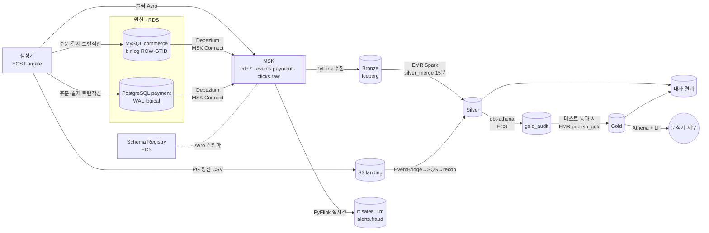




명령어만 따라 배포하다 보면 *"지금 이 데이터가 어디에 있지?"* 를 놓치기 쉽습니다. 이 글은 **주문 한 건**을 따라가며 어떤 코드가 어떤 AWS 서비스에서 실행되고, 결과가 어디에 쌓이는지 정리합니다. 나머지 편은 각 단계를 깊게 다룹니다.

## 한 장으로 보기



## 단계별 지도

| # | 단계 | 실행되는 코드 | 실행 위치(AWS) | 결과가 쌓이는 곳 |
| --- | --- | --- | --- | --- |
| ① | 운영 쓰기 | `p1/generator` (상태 기계) | ECS Fargate Spot 서비스 | RDS MySQL `commerce`, PostgreSQL `payment` |
| ② | 변경 캡처 | `p1/cdc/connectors/*.tftpl` | MSK Connect(Debezium 2.7) 커넥터 2개 | MSK 토픽 `cdc.mysql.commerce.*`, `cdc.pg.public.*`, `events.payment` |
| ③ | 이벤트 버스 | `p1/streaming/topics.yaml` | Amazon MSK(Kafka 3.9, 브로커 2) | 토픽 23개, 스키마는 Schema Registry(ECS) |
| ④ | 수집 | `p1/streaming/ingest/main.py` | Managed Flink 1.20 앱 | `bronze.cdc_events`, `bronze.domain_events`, `bronze.clicks` (+`dlq.ingest`) |
| ⑤ | 저장 | `p1/lakehouse/ddl` | S3 + Iceberg + Glue Data Catalog | `s3://danbi-dev-bronze-<계정>/…` |
| ⑥ | 정제 | `p1/batch/jobs/silver_merge.py` | EMR Serverless(emr-7.12, Spark) | `silver.*` 16개, `ops.pipeline_watermarks` |
| ⑦ | 변환 | `p1/dbt` | ECS RunTask → Athena | `gold_audit.*` 마트 7개 |
| ⑧ | 게시 | `p1/batch/jobs/publish_gold.py` | EMR Serverless | `gold.*`, `ops.publish_log` |
| ⑨ | 대사 | `p1/recon` | ECS RunTask (S3 → EventBridge → SQS 트리거) | `bronze.pg_settlement_*`, `silver.pg_settlement`, `gold.recon_pg_settlement` |
| ⑩ | 오케스트레이션 | `p1/orchestration/dags` | MWAA(Airflow 3) | ⑥~⑨ 를 부르고 기다림 |
| ⑪ | 권한 | `infra/stacks/p1-60-governance`, `p1/governance` | Lake Formation | LF-Tag 기반 컬럼 권한, 행 필터 |

## 주문 한 건의 여정

1. **생성기**가 `orders`·`order_items` 를 MySQL 에, `payments`·`payment_status_history`·`outbox_events` 를 PostgreSQL 에 각각 한 트랜잭션으로 씁니다.
2. MySQL 은 binlog 에, PostgreSQL 은 WAL 에 변경이 남습니다. **Debezium** 이 이를 읽어 테이블마다 토픽(`cdc.mysql.commerce.orders` 등)에 Avro 로 보내고, Outbox 행은 `events.payment` 로 다시 라우팅합니다.
3. **Flink 수집 잡**이 토픽을 바이트 그대로 읽어 Python UDTF 에서 해석합니다. 이때 `member_id` 는 토큰으로, 이름·주소는 회원별 키로 암호화된 값으로 바뀝니다. 15초마다 체크포인트를 찍으며 **Bronze Iceberg** 에 커밋합니다.
4. 15분마다 **MWAA** 가 EMR Serverless 에 `silver_merge` 를 제출합니다. Bronze 의 새 변경을 계약대로 해석해 `silver.orders` 에 MERGE 합니다. 같은 주문의 여러 변경 중 원천 순서가 가장 늦은 것만 남습니다.
5. 매일 05:30 KST 에 **dbt** 가 ECS 에서 실행되어 Athena 로 `gold_audit.mart_daily_sales` 등을 만들고 테스트합니다.
6. 테스트가 모두 통과하면 **publish_gold** 가 `gold.mart_daily_sales` 를 한 번의 Iceberg 커밋으로 교체합니다.
7. 분석가는 Athena 분석가 워크그룹에서 `gold` 만 조회합니다. 토큰 컬럼은 Lake Formation 이 결과에서 자동으로 뺍니다.
8. 다음 날 PG 정산 파일이 랜딩 버킷에 도착하면 **recon** 이 내부 결제와 맞춰 보고, 차이를 원인 코드로 분류합니다.

## Terraform 스택 = 적용 순서

```text
10-network → 20-security → 30-platform                          (공통)
p1-10-sources → p1-20-streaming → p1-30-lakehouse → p1-40-processing
→ p1-50-orchestration → p1-60-governance → p1-70-observability  (P1)
```

스택끼리는 출력값을 **SSM Parameter Store**(`/danbi/dev/<스택>/<키>`)로 주고받습니다. 앞 스택을 다시 만들어도 뒤 스택은 이름으로 값을 찾습니다.

## 비용을 다루는 방법

dev 환경이라 비싼 리소스는 끌 수 있게 만들었습니다.

| 리소스 | 끄는 방법 |
| --- | --- |
| MSK·Flink·MWAA·NAT | `infra/envs/paused/*.tfvars` 로 apply (`make pause`) |
| RDS | 태그 기반 정지 스크립트 + 매일 02:00 KST 자동 정지 스케줄 |
| 생성기 | ECS 서비스 기본 0대, 필요할 때만 `make gen-start` |
| EMR Serverless | 10분 유휴 시 자동 정지 |

MSK 를 지우고 다시 만들면 Debezium 이 처음부터 다시 스냅샷합니다. 이때 Silver MERGE 가 중복을 흡수하는지가 곧 멱등성 설계의 실전 검증이 됩니다.
