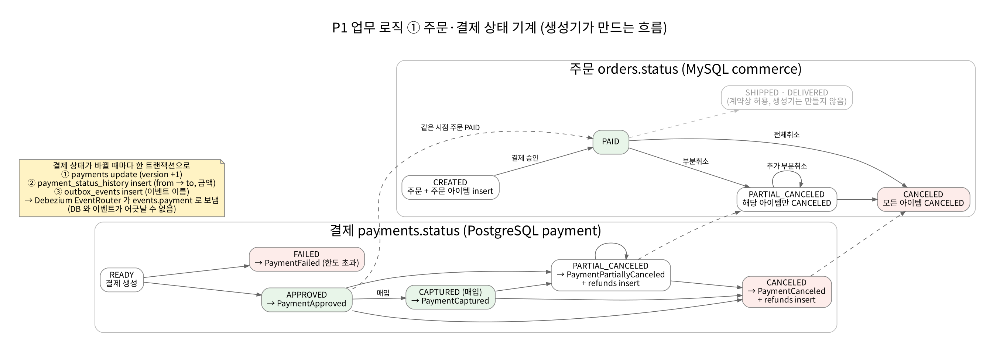
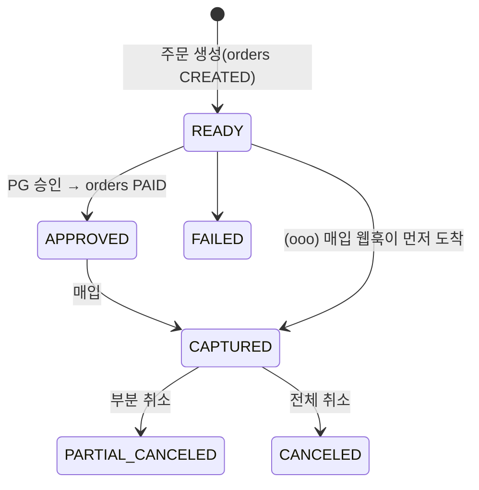




테스트할 실제 쇼핑몰이 없으니 쇼핑몰을 흉내 내는 생성기가 필요했습니다. 다만 랜덤 행을 넣으면 파이프라인이 다뤄야 할 **진짜 어려움**(상태 역전, 부분 취소, 늦은 도착)이 생기지 않습니다. 그래서 업무 흐름을 따르는 상태 기계로 만들었습니다.

## 원천 DB 두 개

| DB | 엔진 | 테이블 | 역할 |
| --- | --- | --- | --- |
| `commerce` | RDS MySQL 8.0 | members, member_addresses, products, product_prices, coupons, orders, order_items, coupon_usages, cs_tickets (+ debezium_signal) | 주문 모놀리스 |
| `payment` | RDS PostgreSQL 16 | payments, payment_status_history, refunds, **outbox_events** (+ debezium_signal, debezium_heartbeat) | 결제(단비페이) |

두 DB 는 데이터 서브넷에 있고 퍼블릭 접근이 꺼져 있습니다. 보안 그룹은 앱 계층의 `sg-db-clients` 와 운영 EC2 의 `sg-ops` 에서 오는 연결만 받습니다.

### CDC 를 위한 설정 — "운영에 주는 부담"을 숫자로 통제

| 설정 | 값 | 이유 |
| --- | --- | --- |
| `binlog_format` / `binlog_row_image` | ROW / FULL | 행 단위 before·after. SCD2 와 감사에 필요 |
| `gtid-mode` | ON | 장애 조치 후 같은 위치에서 이어받기 |
| binlog retention hours | 72 | RDS 기본은 바로 삭제. 주말 동안 커넥터가 멈춰도 복구 가능 |
| 백업 보존 | 1일 | 0 이면 RDS MySQL 의 binlog 자체가 꺼진다 |
| `rds.logical_replication` | 1 | PostgreSQL pgoutput 논리 복제 |
| `max_slot_wal_keep_size` | 4GB | 슬롯이 WAL 을 무한히 붙잡아 디스크가 차는 것을 막는다 |
| publication | 수동 생성 | 커넥터에 슈퍼유저를 주지 않고 대상 테이블을 명시 |
| 하트비트 테이블 | 있음 | 결제 DB 가 한가해도 복제 슬롯이 전진하도록 |

### 계정과 마이그레이션

`p1/sources/migrate.py` 는 버전·체크섬 기반 마이그레이션 도구입니다. `--bootstrap-users` 로 애플리케이션 계정(debezium, generator, recon 등)을 만들고 암호를 **Secrets Manager 에 직접** 씁니다. Terraform state 에 암호가 남지 않습니다.

> 배포 중 고친 점: 처음에는 다시 실행하면 암호가 몰래 회전되어 이미 돌고 있는 커넥터가 다음 연결부터 실패했습니다. 지금은 **계정과 비밀 값이 있으면 GRANT 만 다시 실행**하고, 회전은 `--rotate` 를 줄 때만 합니다.
{: .prompt-tip }

## 생성기 — 상태 기계


_생성기가 만드는 주문·결제 흐름_

`p1/generator/simulate.py` 의 `tick()` 은 **가상 1초**를 진행하고 *할 일 목록(액션)* 만 돌려줍니다. DB 에 직접 쓰지 않으므로 같은 seed 면 언제나 같은 결과가 나오고, 단위 테스트는 DB 없이 돌아갑니다. 실제 쓰기는 `sinks.py` 의 적용기(MySQL·PostgreSQL·Kafka·메모리)가 맡습니다.



결제 상태가 바뀔 때마다 **한 트랜잭션**으로 세 테이블을 씁니다.

```text
UPDATE payments SET status = 'CAPTURED' …
INSERT INTO payment_status_history (from_status, to_status, amount, occurred_at) …
INSERT INTO outbox_events (aggregatetype='payment', aggregateid=<결제>, type='PaymentCaptured', payload=…)
```

이렇게 하면 *DB 에는 반영됐는데 이벤트는 유실* 되는 경우가 생기지 않습니다(Outbox 패턴). 이벤트는 다음 편의 Debezium 이 꺼내 갑니다.

## 결함 주입 — 파이프라인이 다뤄야 할 문제를 일부러 만든다

```bash
python -m p1.generator.cli run --duration 3600 --faults late=0.02,ooo=0.01,dup=0.01,schema_change_at=600
```

| 옵션 | 재현하는 것 | 검증되는 곳 |
| --- | --- | --- |
| `late=` | 앱이 오프라인이었다가 최대 2시간 늦게 보내는 클릭 | 실시간 허용 지연, Silver 재계산 |
| `dup=` | 같은 클릭 재전송, 같은 version 의 outbox 중복 | Silver 중복 제거 |
| `ooo=` | 매입 웹훅이 승인보다 먼저 도착(상태 역전) | 원천 순서 MERGE |
| `hard_delete=` | 배송지 하드 삭제 | Silver `is_deleted` |
| `schema_change_at=` / `breaking_change_at=` | 컬럼 추가 / 금액 컬럼 타입 변경 | 스키마 드리프트, CI 호환성 검사 |
| `null_amount=` | outbox 금액 null 급증 | dbt null 비율 테스트 → 게시 차단 |
| `fraud=` | 도용 카드로 짧은 시간에 여러 배송지 결제 | 실시간 이상결제 탐지 |
| `settle --faults missing,skew,extra,duplicate,correction,broken_encoding,header_v2` | PG 정산 파일 문제 전부 | 정산 파일 판정·대사 |

## 클릭 데이터 — 어디에 쓰이나

생성기는 `page_view → search → add_to_cart → checkout_start → purchase` 흐름의 클릭을 Avro 로 `clicks.raw` 토픽에 보냅니다.

| 단계 | 처리 |
| --- | --- |
| Bronze `clicks` | 회원 ID·기기 ID 토큰화, 검색어 마스킹 후 그대로 적재 |
| Silver `events_clean` | `event_id` 중복 제거, **봇 판정(규칙 버전 기록)**, 늦은 전송(`delay_seconds`) 표시 |
| Gold `mart_funnel` | 일·플랫폼별 방문 세션 → 장바구니 → 결제 시작 → 구매 전환율(봇 제외) |

클릭 스키마는 `FULL_TRANSITIVE` 호환으로 등록합니다. 구버전 앱이 몇 달 동안 섞여서 보내기 때문에 앞뒤 어느 쪽으로도 읽을 수 있어야 합니다. `event_type` 을 enum 대신 string 으로 둔 것도 같은 이유입니다. enum 심볼 추가는 BACKWARD 비호환입니다.

## PG 정산 파일

`p1/generator/settlement.py` 는 실제 PG 사 파일처럼 **CP949** 인코딩, 23:30 KST 마감, 수수료·부가세, 마지막 줄의 TRAILER(건수·합계)를 가진 CSV 를 만들어 `s3://danbi-dev-landing-<계정>/pg_settlement/dt=YYYY-MM-DD/` 에 올립니다. 이 파일을 판정하고 맞춰 보는 과정은 [대사 편]()에서 다룹니다.

## 실행 위치

| 무엇 | 어디서 |
| --- | --- |
| 생성기 상시 실행 | ECS Fargate Spot 서비스 `generator` (기본 0대, `make gen-start`) |
| 마이그레이션·계정 생성 | ECS RunTask `db-migrate` (마스터 암호를 읽는 유일한 주체) |
| 로컬 검증 | `python -m p1.generator.cli dry-run --seconds 600 --faults late=0.05,ooo=0.05` (DB 불필요) |
