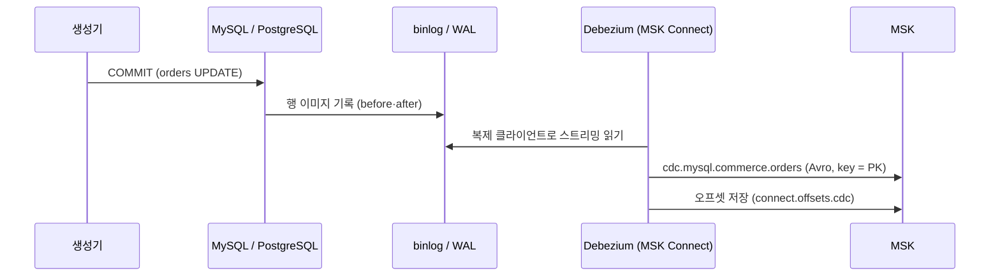
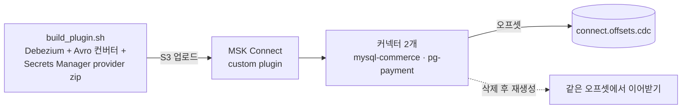




## 왜 로그 기반 CDC 인가

| 방식 | 문제 |
| --- | --- |
| 매일 전체 덤프 | 중간 상태(결제 후 취소)를 잃는다. 운영 DB 에 큰 부하 |
| `updated_at > ?` 폴링 | 하드 삭제를 못 본다. 같은 초에 두 번 바뀌면 하나를 놓친다 |
| 애플리케이션이 이벤트 발행 | DB 커밋과 발행 사이에 죽으면 둘이 어긋난다 |
| **트랜잭션 로그(binlog·WAL) 읽기** | DB 가 이미 쓰는 로그라 추가 쿼리 부하가 거의 없고, 삭제·모든 중간 상태가 커밋 순서대로 남는다 |

## Debezium 이 로그를 읽는 방법



- **MySQL**: Debezium 은 복제 서버(replica)인 척 접속합니다(`database.server.id`). binlog 이벤트를 받아 행 단위 before·after 로 바꿉니다. GTID 로 위치를 기억합니다.
- **PostgreSQL**: 논리 복제 슬롯(`debezium_payment`)과 publication(`dbz_publication`)으로 pgoutput 스트림을 받습니다. 슬롯은 Debezium 이 확인한 LSN 까지만 WAL 을 지우게 합니다.

메시지 하나는 이런 봉투(envelope)입니다.

```json
{
  "before": {"order_id": 1001, "status": "CREATED", …},
  "after":  {"order_id": 1001, "status": "PAID", …},
  "source": {"connector": "mysql", "file": "mysql-bin-changelog.000123", "pos": 4567, "row": 0, "gtid": "…", "ts_ms": 1793000000000},
  "op": "u"
}
```

`op` 는 `c`(insert)·`u`(update)·`d`(delete)·`r`(스냅샷 읽기)입니다. `source` 의 binlog 위치·LSN 이 나중에 Silver 에서 *어느 변경이 최신인가* 를 정하는 기준이 됩니다.

## 커넥터 설정에서 고른 것들

설정 원본은 `p1/cdc/connectors/*.json.tftpl` 입니다. Terraform `templatefile` 과 CI 린트(`p1/cdc/lint.py`)가 **같은 파일**을 읽어, 린트를 통과한 설정만 배포됩니다.

| 설정 | 값 | 이유 |
| --- | --- | --- |
| `offset.storage.topic` | `connect.offsets.cdc` (compact) | MSK Connect 기본 오프셋 토픽은 커넥터 ID 에 묶여, 지우고 다시 만들면 처음부터 다시 스냅샷한다 |
| `database.password` | `${secretsmanager:…}` | 커넥터 설정은 콘솔·API 로 누구나 읽는다. 평문이면 유출 |
| `snapshot.locking.mode` | `none` | RDS 는 전역 락이 불가하고, 운영 테이블 락은 장애다. GTID 로 일관성 확보 |
| `decimal.handling.mode` | `string` | 금액 정밀도 보존. Avro bytes decimal 은 Python 소비자에서 다루기 번거롭다 |
| `tombstones.on.delete` | `false` | 삭제는 `op=d` 이벤트로 기록한다. 압축 토픽이 아니므로 툼스톤은 잡음 |
| `heartbeat.action.query` (PG) | `UPDATE debezium_heartbeat …` | 결제 DB 가 한가해도 슬롯 LSN 이 전진 → WAL 누적 방지 |
| `signal.data.collection` | `*.debezium_signal` | 신호 테이블에 행을 넣어 **증분 스냅샷**(특정 테이블·구간만 다시 읽기) |
| `tasks.max` | 1 | binlog·WAL 은 하나의 순서 있는 스트림이라 병렬 이득이 없다 |
| `errors.max.retries` / `event.processing.failure.handling.mode` | -1 / fail | 해석 못 하는 이벤트를 건너뛰지 않는다. 조용한 유실보다 멈춤이 낫다 |

## Outbox EventRouter — DB 행을 도메인 이벤트로

결제 DB 의 `outbox_events` 테이블도 CDC 로 읽힙니다. 이 토픽만 SMT(Single Message Transform)로 다시 라우팅합니다.

```text
transforms.outbox.type              = io.debezium.transforms.outbox.EventRouter
predicates.isOutbox.pattern         = cdc\.pg\.public\.outbox_events      # outbox 토픽에만 적용
transforms.outbox.route.by.field    = aggregatetype                        # 'payment'
transforms.outbox.route.topic.replacement = events.${routedByValue}        # → events.payment
transforms.outbox.table.field.event.key   = aggregateid                    # 키 = 결제 ID
```

키가 결제 ID 라서 **같은 결제의 이벤트는 같은 파티션**으로 갑니다. Kafka 는 파티션 안에서만 순서를 보장하므로, 소비자는 한 결제의 승인 → 매입 → 취소를 순서대로 받습니다.

## 커넥터 수명 주기



- 플러그인 zip 은 Maven Central 에서 받아 **sha1 을 검증**한 뒤 만듭니다.
- 커넥터를 지웠다 다시 만들어도 오프셋 토픽 이름이 고정이라 재스냅샷 없이 이어받습니다. 장애 훈련 F-01 이 이것을 확인합니다.
- 커넥터가 쓸 토픽이 `topics.yaml` 에 모두 있는지 CI 가 교차 검사합니다(`auto.create.topics.enable=false` 라 없으면 커넥터가 실패).

## 운영 중 마주치는 상황

| 상황 | 대응 | 런북 |
| --- | --- | --- |
| 커넥터 FAILED | 원인 확인 후 재시작, 오프셋 유지 | `cdc-connector-down.md` |
| binlog 가 이미 지워짐 | 증분 스냅샷 신호로 구간 재수집 | `binlog-purged.md` |
| 테이블 추가 | 계약·토픽·include list 갱신 후 신호로 그 테이블만 스냅샷 | `cdc-add-tables.md` |
| 원천과 레이크 건수 차이 | 매시 대사 결과 확인 | `cdc-completeness.md` |

> 배포 중 고친 점: MSK Connect 커스텀 플러그인 이름에는 점(.)을 쓸 수 없습니다. 버전 문자열 `2.7.4` 의 점을 하이픈으로 바꿔 이름을 만듭니다.
{: .prompt-tip }
