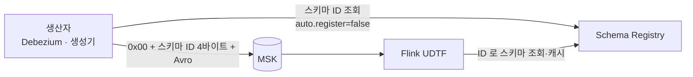




## MSK 와 MSK Connect 의 역할 차이

| | Amazon MSK | MSK Connect |
| --- | --- | --- |
| 무엇 | Kafka 브로커 클러스터 | Kafka Connect 워커를 관리형으로 실행 |
| 이 프로젝트에서 | 모든 이벤트가 지나가는 버스. 재처리 가능한 보관소 | Debezium 커넥터 2개를 실행 |
| 쓰는 쪽 | Debezium, 생성기(클릭), Flink 실시간 잡 | — |
| 읽는 쪽 | Flink 수집·실시간 잡, 알림 Lambda | — |

## 클러스터

| 항목 | 값 | 이유 |
| --- | --- | --- |
| 버전 | Kafka 3.9.x (ZooKeeper 모드) | KRaft(`3.9.x.kraft`)는 m5·m7g 브로커만 허용 → t3.small 을 쓰려면 ZooKeeper 모드 |
| 브로커 | kafka.t3.small × 2, 데이터 서브넷 | dev 비용. 운영은 3대 + `min.insync.replicas=2` |
| 인증 | IAM 만 (포트 9098) | 사용자·암호 관리 없이 IAM 역할 = Kafka 권한 |
| 암호화 | 전송 TLS, 저장 KMS | |
| `auto.create.topics.enable` | false | 오타 토픽이 조용히 생기는 사고 방지 |
| 내부 토픽 복제 수 | 2 | 기본값 3 은 브로커 2대에서 `__consumer_offsets` 를 만들지 못한다 |

브로커 2대의 한계를 숨기지 않았습니다. `min.insync.replicas=2` 로 두면 롤링 패치 동안 `acks=all` 쓰기가 멈추기 때문에 1 로 두었고, 그래서 리더만 받은 쓰기는 디스크 장애 시 잃을 수 있습니다. 운영이라면 브로커 3대에 2 로 둡니다.

## 토픽 as code

`p1/streaming/topics.yaml` 이 토픽의 단일 원본입니다.

```yaml
- {name: cdc.mysql.commerce.orders, partitions: 6, pii: true}
- {name: events.payment, partitions: 6, pii: true}
- {name: clicks.raw, partitions: 12, pii: true}
- {name: connect.offsets.cdc, partitions: 6, config: {cleanup.policy: compact, retention.ms: '-1'}}
- {name: dlq.ingest, partitions: 3, pii: true, config: {retention.ms: '259200000'}}   # 72시간
```

| 그룹 | 토픽 | 쓰는 쪽 |
| --- | --- | --- |
| CDC (14) | `cdc.mysql.commerce.*` 10개, `cdc.pg.public.*` 4개 | Debezium |
| 도메인 이벤트 | `events.payment` | Debezium Outbox |
| 클릭 | `clicks.raw` | 생성기 |
| 실시간 결과 | `rt.sales_1m`, `alerts.fraud` | Flink 실시간 잡 |
| 운영 | `connect.offsets.cdc`, `schemahistory.mysql.commerce`, `dlq.ingest`, Debezium 하트비트 2개 | |

`python -m p1.streaming.topics plan|apply` 는 Terraform 처럼 차이를 보여 주고 적용합니다.

- **파티션 감소는 거부** — Kafka 는 줄일 수 없고, 키 → 파티션 배치가 바뀐다.
- **PII 토픽 보존 ≤ 72시간 린트** — 파기 SLO(72시간) 안에서 원문이 사라지게. 오래 남는 사본은 토큰화된 Bronze 다.
- **관리 밖 토픽 표시** — 누가 손으로 만든 토픽을 찾아낸다.

## Schema Registry

Confluent Schema Registry 7.9 를 ECS 서비스(`schema-registry.danbi.internal:8081`)로 띄우고, 저장소는 MSK 의 `_schemas` 토픽입니다. MSK IAM 인증 jar 를 넣은 이미지를 직접 빌드했습니다.



메시지는 **Confluent 와이어 포맷**입니다. 첫 바이트 `0x00`, 다음 4바이트가 스키마 ID, 나머지가 Avro 본문입니다. 소비자는 ID 로 스키마를 받아 해석합니다.

### 등록 권한 분리

- 애플리케이션은 `auto.register.schemas=false` — 스키마를 마음대로 올리지 못한다.
- 등록은 `make schemas SR=register` 만, 그것도 **호환성 검사를 통과할 때만**.
- 전역 호환성은 BACKWARD, 클릭은 FULL_TRANSITIVE.
- CI 는 같은 규칙을 오프라인으로 검사(`contracts/compat.py`)해서 PR 단계에서 막는다.

| 호환성 | 의미 | 쓰는 곳 |
| --- | --- | --- |
| BACKWARD | 새 스키마로 옛 데이터를 읽을 수 있다 | CDC, 이벤트 |
| FULL_TRANSITIVE | 모든 과거·미래 버전끼리 서로 읽을 수 있다 | 클릭(구버전 앱이 몇 달 섞임) |

## 배포 중 고친 점

| 증상 | 원인 | 해결 |
| --- | --- | --- |
| MSK 생성 실패 `Unsupported InstanceType` | KRaft 모드는 t3.small 미지원 | ZooKeeper 모드 3.9.x |
| 레지스트리 그룹 가입 시간 초과 | 내부 토픽 복제 수 3 > 브로커 2 | `offsets.topic.replication.factor=2` 등 |
| 레지스트리 `ClusterAuthorizationException` | 멱등 프로듀서는 클러스터 단위 `WriteDataIdempotently` 권한 필요 | IAM 정책에 추가 |
| 레지스트리 컨테이너가 사전 점검에서 종료 | 점검 도구(cub)가 별도 클래스패스라 IAM jar 를 못 찾음 | jar 를 그 경로에도 배치 |
| 토픽 도구 `Broker transport failure` | librdkafka AdminClient 는 `poll()` 안에서만 IAM 토큰 콜백 실행 | 생성 직후 `poll()` |
