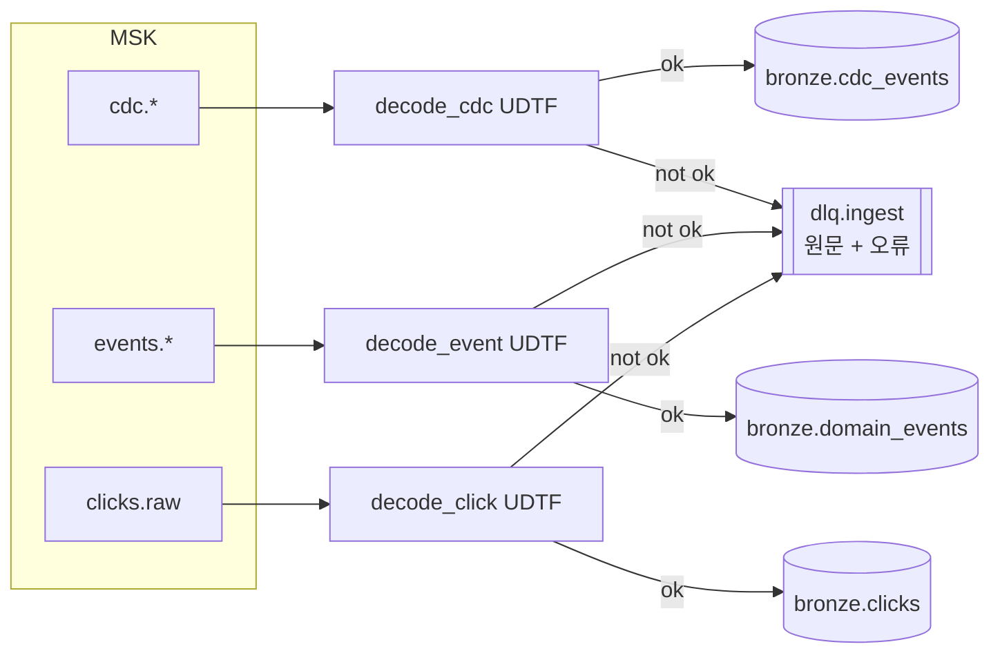
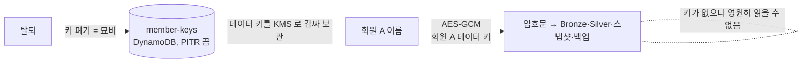




## 왜 수집 시점에 가리는가

Silver 에서 가리면 그 앞 단계인 Bronze, 체크포인트, 로그에 원문이 남습니다. 레이크는 스냅샷과 백업 때문에 지우기도 어렵습니다. 그래서 **레이크에 처음 들어오는 순간**인 Flink 수집 단계에서 처리합니다. Bronze 부터 평문 개인정보가 없습니다.

## 잡 구조



`p1/streaming/ingest/main.py` 는 PyFlink Table API 로 **StatementSet 하나**에 INSERT 6개(정상 3 + DLQ 3)를 묶습니다. 같은 UDTF 호출을 정상 경로와 DLQ 경로가 공유하도록 서브플랜 재사용을 켰습니다.

### 값을 바이트 그대로 받고 UDTF 에서 해석한다

Kafka 소스는 `key.format = raw`, `value.format = raw` 입니다. Avro 해석을 Flink 포맷에 맡기면 **해석 못 하는 메시지 하나가 잡 전체를 멈춥니다.** 대신 Python UDTF 가 해석하고, 실패하면 예외를 던지지 않고 `ok=false` 행을 내보냅니다.

```python
class DecodeCdc(TableFunction):
    def eval(self, topic, key, value):
        try:
            row = self.decoder.cdc(topic, key, value)          # 와이어 포맷 → Avro → Debezium 봉투 → PII 처리
            yield Row(True, *[row[f] for f in CDC_FIELDS], None)
        except Exception as e:
            yield Row(False, *([None] * len(CDC_FIELDS)), f"{type(e).__name__}: {e}"[:2000])
```

```sql
INSERT INTO lake.bronze.cdc_events
SELECT d.source_db, d.table_name, d.op, …, s.`topic`, s.`partition`, s.`offset`, CURRENT_TIMESTAMP
FROM src_cdc AS s, LATERAL TABLE(decode_cdc(s.`topic`, s.k, s.v)) AS d(`ok`, `source_db`, …, `error`)
WHERE d.ok;

INSERT INTO dlq
SELECT s.`topic`, s.`partition`, s.`offset`, d.error, s.v
FROM src_cdc AS s, LATERAL TABLE(decode_cdc(s.`topic`, s.k, s.v)) AS d(…)
WHERE NOT d.ok;
```

DLQ 에는 원문 바이트와 오류, 원래 위치(topic, partition, offset)가 남습니다. 재처리 도구가 이 위치로 중복을 거릅니다.

## 해석 과정

| 단계 | 코드 | 하는 일 |
| --- | --- | --- |
| 와이어 포맷 | `ingest/wire.py` | 매직 바이트 `0x00` 확인, 스키마 ID 4바이트, Schema Registry 조회(캐시), Avro 해석 |
| 봉투 → 행 | `ingest/records.py` | Debezium 봉투의 before·after·op·source 를 Bronze 컬럼으로 |
| 정렬 키 | `change_seq()` | binlog 파일 번호+위치+행, 또는 LSN 을 **사전순 = 커밋 순서**인 문자열로 |
| 개인정보 | `ingest/pii.py` | 계약에서 만든 정책을 필드마다 적용 |

```python
def change_seq(source, op):
    rank = 0 if op == "r" else 1          # 스냅샷 읽기는 같은 위치의 스트리밍 변경보다 앞선다
    if source.get("connector") == "postgresql" or "lsn" in source:
        return f"p{int(source.get('lsn') or 0):020d}{rank}"
    file_no = …  # mysql-bin-changelog.000123 → 123
    return f"m{file_no:08d}{int(source.get('pos') or 0):012d}{rank}{int(source.get('row') or 0):06d}"
```

이 값이 [Silver MERGE]() 에서 *어느 변경이 최신인가* 를 정합니다.

## 개인정보 처리 4가지

정책은 [데이터 계약]()의 `transform` 에서 빌드 시점에 `pii_policy.json` 으로 만들어 앱 zip 에 넣습니다. 계약이 바뀌면 앱을 다시 배포해야 반영되므로 **정책 변경 이력 = 배포 이력**입니다.

| 처리 | 계약 표기 | 대상 | 결과 |
| --- | --- | --- | --- |
| 토큰화 | `token:member` 등 | 회원 ID·이메일·전화·카드·기기 | `HMAC-SHA256(키, "member:" + 정규화 값)`. 조인·집계는 되고 되돌릴 수 없음 |
| 회원별 키 암호화 | `encrypt:member` | 이름·주소 | AES-GCM. 키는 회원마다 하나(DynamoDB + KMS 봉투 암호화) |
| 일반화 | `generalize:birth_year` 등 | 생년월일·우편번호·주소 | 출생연도, 우편번호 앞 3자리, 시도·시군구 |
| 마스킹 | `mask:text` | 상담 내용·검색어 | 본문 속 전화번호·주민번호·카드번호를 찾아 가림 |

- **같은 회원 = 같은 토큰.** 모든 소스에서 `member_id` 가 같은 키로 토큰화되어 주문·결제·클릭을 조인할 수 있습니다. CDC 메시지 키에도 같은 정책을 적용합니다.
- **AAD = (회원 토큰, 필드명).** 암호문을 다른 회원이나 다른 필드로 옮겨 붙이면 복호화가 실패합니다.
- **일반화만 있는 필드는 원문을 지운다.** `birth_date` 처럼 치환 규칙 없이 일반화만 있으면 자동으로 drop 이 붙어 원문이 남지 않습니다.

### crypto-shredding — 지우는 대신 키를 버린다



Iceberg 는 과거 스냅샷을, S3 는 이전 버전을, 백업은 그 시점 사본을 가지고 있습니다. 모든 사본을 찾아 지우는 대신 **그 회원의 키를 폐기**하면 어디에 남은 암호문이든 읽을 수 없게 됩니다. 키 테이블에 PITR(시점 복구)을 일부러 켜지 않았습니다. 켜면 35일 동안 지운 키를 되살릴 수 있어 파기가 끝나지 않기 때문입니다.

## Managed Flink 설정

| 항목 | 값 | 이유 |
| --- | --- | --- |
| 런타임 | Flink 1.20, VPC 안 | MSK·Glue·S3 에 사설 경로로 접근 |
| 체크포인트 | 15초 | Iceberg 커밋은 체크포인트 때 일어난다 → Bronze 지연의 하한(목표 p95 ≤ 30초) |
| 병렬도 | 1, 오토스케일 끔 | 재시작마다 체크포인트·재처리 지연. 부하 테스트로 정한다 |
| 실행 역할 | 토픽·테이블 단위 최소 권한 | |
| 패키지 | zip = `main.py` + `p1/` + `libs/danbi_common` + `site-packages`(cp311·x86_64 휠) + 커넥터 uber jar | |

## 배포 중 고친 점

| 증상 | 원인 | 해결 |
| --- | --- | --- |
| 카탈로그 생성 `NoClassDefFoundError: org/apache/hadoop/conf/Configuration` | Managed Flink 런타임에는 Hadoop 이 없고, `org.apache.hadoop` 은 부모 클래스로더 우선 | uber jar 안의 Hadoop 을 relocation |
| 이어서 `NoSuchMethodError` (HadoopUtils) | Hadoop 만 이름을 바꾸니 Flink 의 `HadoopUtils` 시그니처와 어긋남 | `HadoopUtils` 를 jar 에 넣고 함께 relocation |
| Kafka 연결 시 `AuthenticateCallbackHandler` 없음 | SQL Kafka 커넥터는 kafka-clients 를 숨긴 패키지 이름으로 포함 | MSK IAM 라이브러리의 `org.apache.kafka` 참조를 같은 이름으로 relocation (적용 후 재배포 확인 필요) |
| `Column 'ok' not found` | UDTF 결과 타입을 ROW 하나로 주면 *ROW 컬럼 1개* 로 취급 | 컬럼별 타입 목록 + SQL 에서 `AS d(컬럼들)` 로 이름 부여 |
| 워커에서 `ModuleNotFoundError` | `add_python_file(디렉터리)` 는 디렉터리 이름 그대로 워커 경로에 둔다 | 패키지는 디렉터리째, site-packages 는 안의 항목을 하나씩 |

`Column 'ok' not found` 는 로컬 PyFlink 1.20 에서 같은 SQL 을 실행해 재현한 뒤 고쳤습니다. 클라우드에서 앱을 다시 올리는 데 몇 분씩 걸리기 때문에, 재현 가능한 문제는 로컬에서 먼저 확인하는 편이 훨씬 빨랐습니다.
