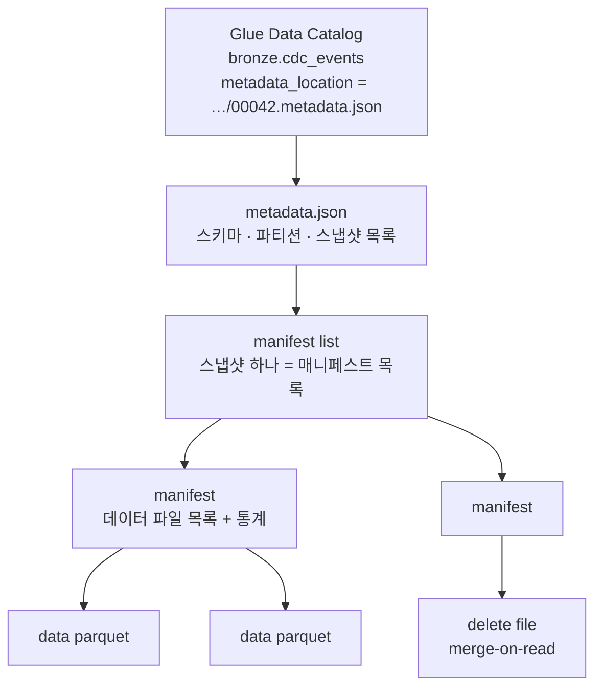




## 레이크하우스 저장소

| 버킷 | 내용 | Glue DB |
| --- | --- | --- |
| `danbi-dev-landing-<계정>` | PG 정산 원본 파일, 격리 파일 | — |
| `danbi-dev-bronze-<계정>` | 수집 원본(불변 변경 로그) | `bronze` |
| `danbi-dev-silver-<계정>` | 계약 기반 정본, 운영 기록(`_ops/`) | `silver`, `ops` |
| `danbi-dev-gold-<계정>` | 게시본, 검사 전 영역(`_audit/`), 실시간(`_rt/`) | `gold`, `gold_audit`, `rt` |
| `danbi-dev-athena-<계정>` | Athena 결과 | — |

모든 버킷은 KMS 로 암호화되고, Athena 워크그룹 4개(엔지니어·파이프라인·분석가·재무)는 **결과 위치와 스캔 상한을 강제**합니다. 사람이 결과를 다른 버킷으로 내보낼 수 없고, 분석가는 쿼리당 10GB 를 넘게 스캔할 수 없습니다.

## Iceberg 테이블은 파일 + 포인터



- **커밋 = 포인터 교체.** 쓰는 쪽은 새 데이터 파일과 새 metadata.json 을 만든 뒤, Glue 의 `metadata_location` 을 *이전 값이 그대로일 때만* 새 파일로 바꿉니다(낙관적 동시성). 읽는 쪽은 언제나 이전 스냅샷 또는 새 스냅샷 하나만 봅니다.
- **스냅샷 = 시간 여행.** `FOR TIMESTAMP AS OF` 로 과거 상태를 읽고, `rollback_to_snapshot` 으로 되돌립니다. [Gold 게시]()의 롤백이 이 기능입니다.
- **통계로 건너뛰기.** 매니페스트에 파일별 최소·최대값이 있어 쿼리가 필요 없는 파일을 읽지 않습니다.

S3 경로로 보면 이렇습니다.

```text
s3://danbi-dev-bronze-<계정>/cdc_events/
  data/source_db=commerce/table_name=orders/ingest_ts_day=2026-11-07/00000-…parquet
  metadata/00042-….metadata.json
  metadata/snap-…avro          ← manifest list
  metadata/…-m0.avro           ← manifest
```

## Bronze 테이블 설계

```sql
CREATE TABLE IF NOT EXISTS bronze.cdc_events (
  source_db string, table_name string,
  op string            COMMENT 'c=insert u=update d=delete r=snapshot read',
  key_json string, before_json string, after_json string,
  change_seq string    COMMENT '정렬 가능한 소스 위치. 도착 순서가 아니라 이 값으로 최신을 고른다',
  txn_id string, source_ts timestamp, is_snapshot boolean, schema_id int,
  kafka_topic string, kafka_partition int, kafka_offset bigint, ingest_ts timestamp
)
PARTITIONED BY (source_db, table_name, day(ingest_ts))
TBLPROPERTIES ('table_type'='ICEBERG', 'format'='parquet', 'write_compression'='zstd');
```

| 결정 | 이유 |
| --- | --- |
| **테이블별 스키마 대신 before/after JSON** | 운영 DB 에 컬럼이 생기거나 바뀌어도 Bronze 는 깨지지 않는다. 해석은 계약을 따르는 Silver 가 맡는다 |
| **수집일(ingest_ts) 파티션** | 늦게 도착한 이벤트도 *도착한 날* 에 쌓여, 증분 처리가 "어제 이후 도착분" 으로 단순해진다 |
| **Kafka 위치 보관** | (topic, partition, offset) 로 원본 메시지를 추적·재처리 |
| **append-only** | Bronze 는 일어난 일의 기록. 고치지 않는다 |

Bronze 테이블은 5개입니다: `cdc_events`, `domain_events`, `clicks`, `pg_settlement_files`, `pg_settlement_lines`. 손으로 쓴 DDL 은 `p1/lakehouse/ddl/*.sql` 에 있고 `p1/lakehouse/migrate.py` 가 체크섬으로 적용 여부를 추적합니다. Silver 테이블은 계약에서 DDL 을 생성합니다.

## 보존은 테이블 연산으로

> Iceberg 버킷에 S3 수명 주기 만료를 걸면 안 됩니다. 메타데이터가 가리키는 파일이 사라져 테이블이 깨집니다.
{: .prompt-danger }

그래서 보존·정리는 EMR 유지보수 잡(`p1/batch/jobs/maintenance.py`, 매일 03:30 KST)이 합니다.

| 작업 | 설정 | 이유 |
| --- | --- | --- |
| Bronze 보존 | 90일 지난 행 DELETE | 원본 로그 보존 기간 |
| 컴팩션 | 작은 파일 병합 | 체크포인트 15초마다 커밋 → 작은 파일이 많이 생긴다 |
| 스냅샷 만료 | 7일 | 메타데이터·삭제된 파일 정리 |
| 고아 파일 정리 | 3일 | 실패한 쓰기가 남긴 파일 |
| 매니페스트 재작성 | | 계획 시간 단축 |

S3 수명 주기는 *이전 버전(noncurrent)* 만 7일 뒤 정리하도록 두었습니다. 개인정보 파기 직후에는 `--expire-only --retain-last 1` 로 과거 스냅샷을 바로 물리 삭제합니다([거버넌스 편]()).

## Athena 에서 보기

```sql
SELECT table_name, op, count(*) FROM bronze.cdc_events
WHERE ingest_ts >= current_timestamp - interval '1' hour GROUP BY 1, 2;

SELECT * FROM "bronze"."cdc_events$snapshots" ORDER BY committed_at DESC LIMIT 5;   -- 커밋 이력
SELECT * FROM "bronze"."cdc_events$files" LIMIT 10;                                 -- 파일 크기 분포
```
