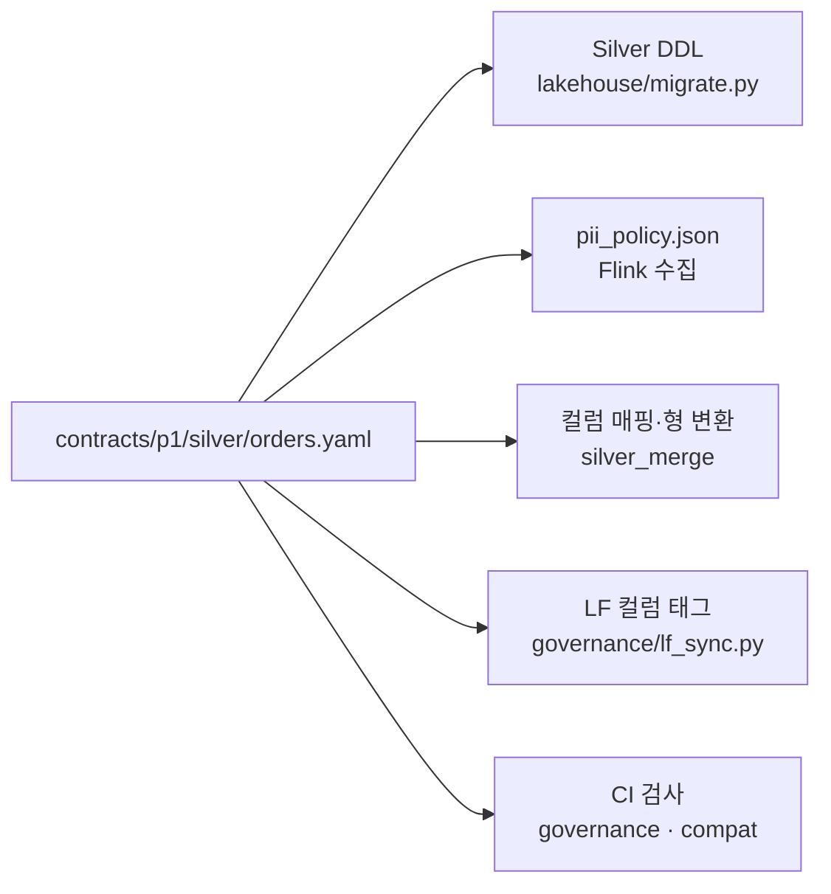
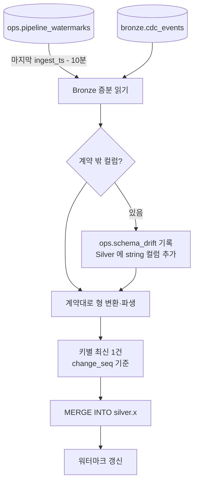




## 데이터 계약 — Silver 의 단일 원본

Silver 데이터셋마다 YAML 계약이 하나 있습니다(`contracts/p1/silver/*.yaml`, 16개).

```yaml
dataset: silver.orders
owner: team-commerce-data
grain: [order_id]                       # 1행 = 1주문
source: {db: commerce, table: orders}
update: merge                           # merge | scd2 | append
partition: ["month(ordered_at)"]
retention: {class: ecommerce_transaction_5y}   # 보존 클래스 = 법적 근거
sla: {freshness_minutes: 15}
schema_compatibility: BACKWARD
columns:
  - {name: order_id,     type: bigint, source: order_id, classification: internal}
  - {name: member_token, type: string, source: member_id, transform: "token:member", classification: personal_token}
  - {name: status,       type: string, source: status, classification: internal,
     accepted_values: [CREATED, PAID, SHIPPED, DELIVERED, CANCELED, PARTIAL_CANCELED]}
  - {name: total_amount, type: "decimal(12,0)", source: total_amount, classification: internal}
  - {name: ordered_at,   type: timestamp, source: ordered_at, transform: ts_iso, classification: internal}
  - {name: ordered_date_kst, type: date, derive: "kst_date(ordered_at)", classification: internal}
quality:
  - {not_null: [order_id, ordered_at, total_amount]}
```

이 파일 하나에서 여러 결과물이 나옵니다.



| 계약 필드 | 쓰는 곳 |
| --- | --- |
| `transform: token:/encrypt:/mask:/generalize:` | Flink 가 수집 시점에 적용 |
| `classification` | Lake Formation 컬럼 태그 → 누가 볼 수 있나 |
| `grain`, `update` | MERGE 키, 갱신 방식 |
| `retention.class` | 보존 기간과 법적 근거(`contracts/retention.yaml`) |
| `schema_compatibility` | 계약 변경이 호환인지 CI 가 기준 브랜치와 비교 |

CI 는 **원천 DDL 의 모든 컬럼이 계약에 있거나, 일부러 뺀 목록(`unmapped.yaml`)에 이유와 함께 있는지** 검사합니다. 운영팀이 새 컬럼을 추가했는데 아무도 분류하지 않으면 빌드가 실패합니다. 개인정보가 조용히 레이크로 흘러드는 가장 흔한 경로를 막는 장치입니다.

## silver_merge 가 하는 일



EMR Serverless(emr-7.12, ARM64)에서 15분마다 실행됩니다. 계약 16개 중 Bronze 에서 오는 15개를 돌며 `update` 방식에 따라 처리합니다(`pg_settlement` 은 대사 잡이 만드는 파생 테이블).

| 방식 | 테이블 예 | 처리 |
| --- | --- | --- |
| `merge` | orders, payments, members | 키별 현재 상태 1행 |
| `scd2` | dim_member_scd2, product_prices_scd2 | 바뀔 때마다 버전(valid_from·valid_to·is_current) |
| `append` | payment_events, events_clean | 중복 제거 후 추가 |

### 1. 워터마크 + 겹침 창

Bronze 의 `ingest_ts` 로 어디까지 처리했는지 기억합니다. 다음 실행은 **워터마크보다 10분 앞**부터 읽습니다. Iceberg 커밋은 체크포인트 때 일어나서 *지난 시각의 행이 늦게 보일 수* 있기 때문입니다. 겹쳐 읽은 행은 다음 단계의 MERGE 가드가 흡수합니다.

### 2. 키별 최신 1건

같은 주문이 한 구간에서 여러 번 바뀌었으면 `change_seq` 가 가장 큰 것만 남깁니다(`row_number() over (partition by 키 order by _src_seq desc)`).

### 3. 원천 순서 가드가 있는 MERGE

`p1/batch/transforms.py` 가 계약에서 SQL 을 만듭니다.

```sql
MERGE INTO glue.silver.orders t
USING _src_orders s
ON t.order_id = s.order_id
WHEN MATCHED AND s._src_seq > t._src_seq AND s.op = 'd' THEN
  UPDATE SET t.is_deleted = true, t.deleted_at = s._src_ts, t._src_seq = s._src_seq, …
WHEN MATCHED AND s._src_seq > t._src_seq THEN
  UPDATE SET t.status = s.status, …, t.is_deleted = false, t._src_seq = s._src_seq, …
WHEN NOT MATCHED THEN
  INSERT (…, is_deleted, deleted_at, _src_seq, _src_ts, _ingested_at, _run_id) VALUES (…)
```

`s._src_seq > t._src_seq` 한 줄이 핵심입니다.

| 상황 | 결과 |
| --- | --- |
| 같은 메시지가 두 번 옴 | 두 번째는 `>` 가 거짓 → 무시 |
| 매입(CAPTURED)이 승인(APPROVED)보다 먼저 도착 | 나중에 온 승인은 원천 순서가 앞이라 덮지 못함 |
| 장애 후 같은 구간 재처리 | 이미 반영된 변경은 모두 무시 → 결과 동일 |
| 운영 DB 하드 삭제 | 행을 지우지 않고 `is_deleted = true` (분석·감사에서는 이력) |

그래서 복구 절차가 대부분 *같은 구간을 다시 돌린다* 입니다. 백필(`--from/--to`)도 같은 MERGE 를 쓰고, 정기 증분과 섞이지 않게 워터마크는 움직이지 않습니다.

### 4. SCD2 규칙

- **같은 트랜잭션 안의 여러 변경은 마지막 것만** — 유효 구간이 0인 버전을 만들지 않는다.
- **추적 컬럼이 직전 버전과 같으면 버전을 만들지 않는다** — 다른 컬럼만 바뀐 변경이 이력을 부풀리지 않는다.
- **이미 반영된 변경(`_src_seq` ≤ 현재 행)은 버린다** — 재실행 멱등.

### 5. 스키마 드리프트

계약에 없는 컬럼이 Bronze `after_json` 에 나타나면 `ops.schema_drift` 에 *분류 대기* 로 남기고, Silver 에 string 컬럼으로 추가해 다음 주기부터 보이게 합니다. 분류되기 전에는 분석가 컬럼 권한에 포함되지 않습니다. 타입 변경·삭제 같은 비호환 변경은 계약 단계에서 거부됩니다.

## 테이블 설정

| 설정 | 이유 |
| --- | --- |
| merge-on-read | 15분마다 작은 MERGE → 쓰기 증폭을 줄인다. 대가로 매일 컴팩션 |
| Spark·Iceberg 설정은 `spark-defaults.json` 하나 | 파이썬 잡과 Terraform 이 같은 파일을 읽는다 |
| EMR 앱: 최대 16 vCPU, 10분 유휴 정지, 동시 3 | dev 비용 |

## 실행

```bash
# 평소: MWAA p1_silver_merge (15분 cron, 동시 1)
# 수동:
aws emr-serverless start-job-run --application-id <app> --execution-role-arn <role> \
  --job-driver '{"sparkSubmit":{"entryPoint":"s3://…/silver_merge.py","entryPointArguments":["--tables","all","--overlap-minutes=10"]}}'
```

## 배포 중 고친 점

| 증상 | 원인 | 해결 |
| --- | --- | --- |
| `AttributeError: module 'datetime' has no attribute 'UTC'` | EMR 7 의 PySpark 는 Python 3.9 | `dt.timezone.utc`, `zip(strict=)` 제거, ruff 예외를 `p1/batch` 로 한정 |
| `ParamValidationError` (EMR 인자) | DAG 가 `render_template_as_native_obj` 라 `"10"` 이 int 로 바뀜 | `--overlap-minutes=10` 한 덩어리 인자 |
| `TABLE_OR_VIEW_NOT_FOUND glue.ops.pipeline_watermarks` (테이블은 있음) | Lake Formation 이 관리하는 DB 라 EMR 역할에 `Describe` 권한이 없어 *없는 것처럼* 보임 | 거버넌스 스택(LF 권한) 적용 |

마지막 문제는 진단용 EMR 잡으로 Spark 가 보는 네임스페이스를 출력해 보고서야 알았습니다. 오류 메시지는 "테이블 없음" 이었지만 실제 원인은 권한이었습니다.
