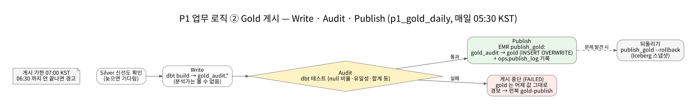
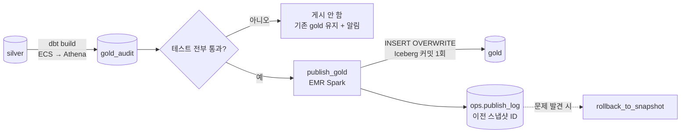




## 왜 검사 전용 영역이 따로 있는가

dbt 가 바로 `gold` 에 쓰면, 테스트가 실패해도 **이미 틀린 숫자가 공개된 뒤** 입니다. 분석가가 그 사이에 대시보드를 새로 고치면 틀린 매출을 봅니다. 그래서 쓰기(Write)·검사(Audit)·공개(Publish)를 분리했습니다.


_p1_gold_daily — 매일 05:30 KST_



## 권한이 경계를 강제한다

| 주체 | gold_audit | gold |
| --- | --- | --- |
| dbt 실행 역할 | 쓰기 | **쓰기 권한 없음** |
| publish_gold (EMR 역할) | 읽기 | 쓰기 |
| 분석가 | **볼 수 없음** | 읽기(컬럼 태그 범위) |

WAP 를 "절차" 로만 두면 누군가 실수로 건너뜁니다. 여기서는 dbt 가 `gold` 에 쓸 수 없고 분석가가 `gold_audit` 를 볼 수 없어서, 검사 안 된 숫자가 새어 나갈 길이 **권한 수준에서** 없습니다.

## Write — dbt-athena on ECS

| 항목 | 내용 |
| --- | --- |
| 실행 | ECS RunTask(Fargate). MWAA 가 `["build", "--select", "tag:publish"]` 로 부른다 |
| 엔진 | dbt-athena → Athena 가 Iceberg 테이블로 CTAS |
| 출력 스키마 | 모든 마트가 `gold_audit` (`+schema: gold_audit`, 스키마 이름 고정 매크로) |
| 결과물 | `run_results.json` 등을 `s3://<artifacts>/dbt/runs/<run_id>/` 에 보관 |
| 계보 | `dbt-ol` 로 OpenLineage 이벤트(컬럼 계보) |
| 스키마 변경 | `on_schema_change: fail` — 조용히 넘어가지 않는다 |

### 마트 7개

| 모델 | 내용 |
| --- | --- |
| `fct_order_items` | 주문 아이템 사실. 주문 할인을 아이템에 **원 단위까지** 배분, SCD2 가격 시점 조인 |
| `fct_payments` | 결제 사실. 매입·취소 누적, 정산 예정일(23:30 마감 규칙) |
| `mart_daily_sales` | 일 매출(취소 **발생일** 기준 — 재무) |
| `mart_daily_sales_by_order_date` | 일 매출(**원주문일** 기준 — 프로모션 분석) |
| `mart_funnel` | 일·플랫폼별 전환 퍼널(봇 제외) |
| `dim_member` | 회원 차원. **암호문 컬럼 없음** — 복호화 대상을 Gold 에 두지 않는다 |
| `dim_product` | 상품 차원 |

두 매출 마트를 같은 이름으로 부르지 않는 것이 중요했습니다. 11월 1일 주문을 11월 3일에 취소했을 때, 재무는 3일 매출에서 빼고 마케팅은 1일 프로모션 성과에서 뺍니다. 지표 정의는 `models/semantic/metrics.yml` 에 모으고, 정의를 바꾸면 `metric_version` 을 올려 마트에 함께 싣습니다.

## Audit — 테스트

| 테스트 | 막는 것 |
| --- | --- |
| `null_ratio_below` (금액 null 비율 < 1%) | 원천 버그로 금액이 비는 상황(F-08) |
| `assert_discount_allocation_exact` | 할인 배분 합계 ≠ 주문 할인 |
| `assert_payment_cancel_not_exceed_capture` | 취소액 > 매입액 |
| `assert_net_sales_matches_silver` | **Gold 순매출 ≠ Silver 에서 독립 재계산한 값** (대사 2단계) |
| 스키마 테스트(not_null, accepted_values, 식 검사) | 형태 오류 |

```sql
-- assert_net_sales_matches_silver.sql: 결과가 0행이어야 통과
with recomputed as (
  select date(with_timezone(occurred_at, 'UTC') AT TIME ZONE 'Asia/Seoul') as date_kst,
         sum(case when to_status = 'CAPTURED' then amount
                  when to_status in ('PARTIAL_CANCELED', 'CANCELED') then -amount else 0 end) as net
  from {{ source('silver', 'payment_status_history') }}
  where not coalesce(is_deleted, false)
  group by 1
)
select r.date_kst, r.net as silver_net, g.net_sales as gold_net
from recomputed r left join {{ ref('mart_daily_sales') }} g on g.date_kst = r.date_kst
where coalesce(g.net_sales, 0) <> r.net
```

마트 로직과 다른 경로(상태 이력)로 같은 숫자를 다시 계산해 비교합니다. 마트 SQL 에 버그가 있어도 두 경로가 같은 버그를 가질 가능성은 낮습니다.

테스트 실패 태스크는 **재시도하지 않습니다**(`retries=0`). 같은 데이터로 다시 돌려도 결과가 같기 때문입니다. 실패 = 게시 보류 + 알림입니다.

## Publish — publish_gold

Athena 는 Iceberg 테이블을 `INSERT OVERWRITE` 로 원자적으로 교체하지 못해서 게시만 Spark(EMR)로 합니다.

```python
# p1/batch/jobs/publish_gold.py (요약)
models, failed = gate(run_results)             # error·fail 이 하나라도 있으면 아무것도 게시하지 않는다
for model in models:
    diff = schema_diff(audit_cols, gold_cols)  # 컬럼 추가만 허용, 삭제·타입 변경은 거부
    prev = current_snapshot(f"gold.{model}")
    spark.sql(f"INSERT OVERWRITE glue.gold.{model} SELECT * FROM glue.gold_audit.{model}")  # 처음이면 CREATE TABLE … AS
    spark.sql(f"INSERT INTO glue.ops.publish_log VALUES ('{model}', '{run_id}', …, {prev}, …)")
```

- **INSERT OVERWRITE 한 번 = Iceberg 커밋 한 번.** 읽는 쪽은 이전 스냅샷 아니면 새 스냅샷만 봅니다. 중간 상태가 없습니다.
- **되돌리기**: `publish_gold --rollback --models mart_daily_sales` → `publish_log` 의 이전 스냅샷으로 `rollback_to_snapshot`.

## 배포 중 고친 점

| 증상 | 원인 | 해결 |
| --- | --- | --- |
| `silver_fresh` 센서가 Athena `FAILED` | Silver·Gold 위치가 Lake Formation 에 등록돼 Athena 가 LF 임시 자격증명으로 읽는데, MWAA 역할에 `lakeformation:GetDataAccess` 가 없음 | MWAA 실행 역할에 추가 |
| 오류 로그에 원인이 안 보임 | 헬퍼가 `athena FAILED` 만 남김 | 쿼리 ID 와 `StateChangeReason` 을 함께 기록 |
| 센서가 `UP_FOR_RESCHEDULE` 로 계속 대기 | 오류가 아니라 Silver 가 아직 신선하지 않음(정상 동작) | Silver MERGE 를 먼저 돌린다 |
