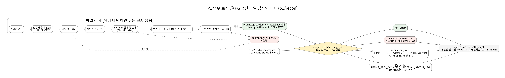
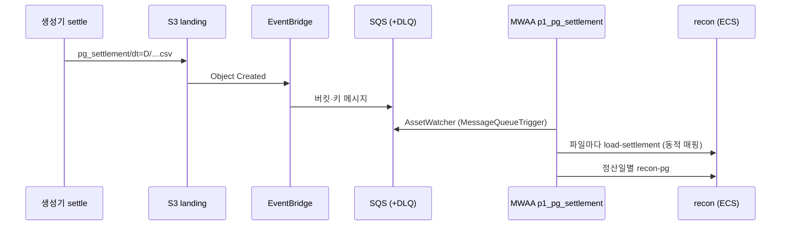




국내 커머스·핀테크에서 데이터팀이 가장 자주 받는 질문은 *"우리 매출과 PG 정산이 왜 다르냐"* 입니다. 이 편은 그 질문에 매일 아침 자동으로 답하는 대사(reconciliation)와, 전체 배치를 묶는 오케스트레이션을 다룹니다.

## 대사 3단계

| 단계 | 비교 | 주기 | 실패 시 |
| --- | --- | --- | --- |
| 1. 원천 ↔ 레이크 | 창 안 갱신 행 수·금액 합(원천 DB vs Silver, 30분 지연 여유) | 매시 :40 | `SourceLakeMismatch` 알림 → CDC 런북 |
| 2. Silver ↔ Gold | Gold 순매출을 Silver 에서 독립 재계산 | Gold 빌드마다 | dbt 테스트 실패 → 게시 중단([8편]()) |
| 3. 내부 ↔ PG | (결제 키, 구분)별 금액 합 | 파일 도착 시 + 매일 08:30 KST | 미설명 차이 1건 이상 즉시 알림 |

## 정산 파일 판정


_PG 정산 파일 검사와 대사 (p1/recon)_

정산 파일은 다음 순서로 검사하고, **하나라도 실패하면 파일 전체를 격리**합니다.

```text
파일명 규칙 → 내용 해시 중복 → CP949 엄격 디코딩 → 헤더 버전(v1·v2만) → TRAILER(건수·합계) → 행 형식
```

| 결정 | 이유 |
| --- | --- |
| 부분 적재 금지 | 일부만 들어가면 대사가 *거짓으로 일치* 한다 |
| 중복은 이름이 아니라 내용 해시로 | 같은 이름의 정정본과 진짜 재전송을 구별. 정정본은 차수가 높은 파일이 유효 |
| v1 헤더는 부가세를 분리할 수 없다 | 추측하지 않고 `vat = NULL` |
| 정산일 단위 덮어쓰기 | 몇 번 다시 돌려도 결과가 같다 |

생성기(`p1/generator/settlement.py`)가 만든 결함 파일 7종(누락·금액 차이·PG 단독·중복·정정본·인코딩 깨짐·헤더 v2)을 테스트가 그대로 적재기에 넣어 판정을 확인합니다. **생성기와 적재기가 서로를 검증**하는 구조입니다.

## 원인 코드

| 분류 | 원인 | 설명됨 | 의미 |
| --- | --- | --- | --- |
| INTERNAL_ONLY | TIMING_NEXT_DAY | 예 | 23:30 마감 경계 거래가 다음 날 파일에 있다 |
| INTERNAL_ONLY | PG_PENDING | 보류 | 다음 날 파일이 아직 없다 → 내일 재판정 |
| INTERNAL_ONLY | PG_MISSING | 아니오 | PG 누락 → PG 사에 문의 |
| PG_ONLY | TIMING_PREV_DAY | 예 | 내부는 전날 정산일로 분류 |
| PG_ONLY | INTERNAL_STATUS_LAG | 아니오 | 결제는 있는데 내부 상태 미반영(CDC 지연·누락 의심) |
| PG_ONLY | UNKNOWN_TXN | 아니오(위험) | 내부에 없는 거래 → 즉시 에스컬레이션 |
| AMOUNT_MISMATCH | AMOUNT_DIFF | 아니오 | 금액 차이 → 정정본 요청 |

재무팀은 *차이가 몇 건인가* 보다 *설명 안 되는 차이가 몇 건인가* 가 궁금합니다. 그래서 SLO 는 **미설명 차이 0건**이고, 결과는 `gold.recon_pg_settlement` 와 마크다운 리포트(`_reports/recon/dt=D/report.md`)로 남습니다.

## 파일 도착 → 실행: 이벤트 기반



정산 파일은 언제 올지 모릅니다. 폴링 센서 대신 Airflow 3 의 **AssetWatcher** 가 SQS 를 감시해 도착 즉시 DAG 를 실행합니다. 같은 파일이 재전송되면 버전 ID 가 달라 둘 다 적재기로 가지만, 적재기가 내용 해시로 판정합니다.

## MWAA DAG 7개

| DAG | 트리거 | 하는 일 |
| --- | --- | --- |
| `p1_silver_merge` | 15분 cron | EMR `silver_merge` (동시 1) |
| `p1_gold_daily` | 05:30 KST | Silver 신선도 센서 → dbt build(gold_audit) → `publish_gold` |
| `p1_pg_settlement` | SQS AssetWatcher | 파일마다 `load-settlement` → 정산일별 `recon-pg` |
| `p1_recon_daily` | 08:30 KST | 어제·그제 대사(파일이 안 와도 보고) |
| `p1_recon_source` | 매시 :40 | 원천 vs 레이크 |
| `p1_iceberg_maintenance` | 03:30 KST | 컴팩션·스냅샷 만료·고아 파일 |
| `p1_backfill` | 수동(params) | 계보로 영향 범위 → Silver 재처리 → Gold 재빌드 → **사람 승인 후** 게시 |

### 설계 원칙

- **무거운 일은 MWAA 밖에서.** 워커는 EMR·ECS 를 부르고 기다리기만 합니다(지연 가능 연산자로 슬롯 반환). 그래서 가장 작은 mw1.micro 로 충분합니다.
- **파싱 시점에 AWS 호출 금지.** 설정은 SSM 시크릿 백엔드의 Airflow Variable(`p1_config`)을 템플릿으로 *실행 시점* 에 풉니다.
- **모든 실패 알림에 런북 링크.** DAG params 의 `runbook` 이 알림 메시지에 붙습니다.
- **계보 3중 수집.** Airflow(inlets/outlets), dbt(dbt-ol), Spark(OpenLineage 리스너) → Marquez.

```python
# p1_common.py 의 작업 생성기 — DAG 는 "무엇을" 만 적는다
spark_job("silver_merge", "silver_merge", ["--tables", "all", "--overlap-minutes=10"])
ecs_task("dbt_build_audit", "dbt_task_family", ["build", "--select", "tag:publish"], retries=0)
```

## 배포 중 고친 점

| 증상 | 원인 | 해결 |
| --- | --- | --- |
| MWAA `CREATE_FAILED: INCORRECT_CONFIGURATION` | MWAA 는 원본 버킷과 같은 KMS 키로 환경을 암호화해야 하는데, 그 키 정책에 CloudWatch Logs 허용이 없음 | lake 키 정책에 이 계정 로그 그룹 한정 Logs 서비스 허용 |
| (중간에 시도한 잘못된 해결) `kms_key` 제거 | "KMS key used for encrypting S3 bucket … not compatible" | 키를 되돌리고 키 정책을 고침 |
| `AirflowInactiveAssetInInletOrOutletException` | Bronze 를 outlet 으로 내는 DAG 가 없어 inlets 의 Bronze 자산이 비활성 | inlets 제거(계보는 Spark OpenLineage 가 남김) |
| `p1_pg_settlement` 가 `ValueError` | landing 버킷의 다른 객체 이벤트도 같은 큐로 옴 | 정산 파일이 아니면 skip |
| recon `No module named p1.generator.faults` | 대사 잡이 생성기 CLI 에서 DB 연결 함수를 가져왔는데 대사 이미지엔 생성기 일부만 있음 | 연결 함수를 공용 라이브러리 `danbi_common.db` 로 이동 |

> MWAA 를 거치지 않고 같은 작업을 손으로 돌릴 수도 있습니다. DAG 가 읽는 SSM `p1_config` 를 그대로 읽어 EMR `start-job-run`, ECS `run-task` 를 부르는 스크립트를 만들어 두면, Airflow 문제와 작업 자체의 문제를 분리해서 볼 수 있습니다.
{: .prompt-tip }
