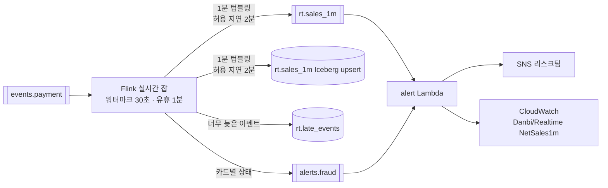




## 실시간 잡이 하는 일

| 사용자 | 요구 | 목표 |
| --- | --- | --- |
| 마케팅 | 타임세일 중 1분 단위 매출 | 이벤트 → 대시보드 p95 ≤ 90초 |
| 리스크 | 도용 카드 패턴 알림 | 탐지 지연 p95 ≤ 10초 |



### 속보치와 확정치를 섞지 않는다

실시간 값에는 `label=속보치` 와 `revision` 이 붙고, 확정치는 다음 날 Gold 입니다. 대시보드는 둘을 구분해 표시합니다.

- **허용 지연 2분 안의 늦은 이벤트**는 그 창을 다시 내보냅니다(`revision + 1`). 소비자는 `window_start` 로 덮어씁니다(Iceberg upsert).
- **그보다 늦은 이벤트**는 `rt.late_events` 로 빠집니다. 확정치는 Silver 에서 다시 계산하므로 100% 반영됩니다.
- **null 금액은 버리지 않고 셉니다**(`NullAmounts1m`). 원천 버그의 조기 신호이기 때문입니다.

### 이상결제 — 이벤트 시간으로 판단

규칙: **같은 카드 토큰으로 5분 안에 서로 다른 배송지 3곳 이상 승인** → 알림. 같은 카드는 5분 쿨다운.

| 상황 | 판단 |
| --- | --- |
| 10분 전 이벤트가 늦게 도착, 5분 창 밖 | 묶지 않음 |
| 늦게 왔지만 같은 5분 창 안 | 탐지 |
| 같은 주소 반복 | 서로 다른 주소만 센다 |
| 쿨다운 안의 두 번째 알림 | 보내지 않음. Lambda 는 alert_id 로 한 번 더 거름(최소 한 번 전달) |

카드별 상태는 `KeyedProcessFunction` 에 TTL 을 두고 보관합니다. 생성기의 `fraud=` 결함으로 주입한 도용 카드를 테스트가 100% 탐지하고, 정상 카드 오탐은 0건이어야 통과합니다.

### 상태 있는 잡 업그레이드

모든 상태 연산자에 **uid 를 고정**했습니다. uid 가 바뀌면 스냅샷 상태를 복원하지 못해 카드 이력이 사라지고, 중복 알림이 납니다. Managed Flink 는 코드를 업데이트할 때 스냅샷을 찍고 그 스냅샷에서 다시 시작합니다.

> Managed Flink 앱 업데이트는 실행 중 스냅샷이 실패하면 업데이트 자체가 실패합니다. 이 경우 앱을 강제 정지한 뒤 업데이트해야 하고, 그 순간의 상태는 잃습니다.
{: .prompt-warning }

## 관측 — 새벽 3시에 런북만 보고 30분 안에 판단할 수 있는가

### SLO 5개

| 데이터 제품 | SLI | 목표(30일) | 알림 |
| --- | --- | --- | --- |
| silver.orders | 마지막 커밋 경과 | 시간의 99% ≤ 15분 | 30분 초과 2회 연속 |
| bronze.cdc_events | 마지막 커밋 경과 | 99% ≤ 2분 | 10분 초과 |
| rt.sales_1m | 집계 반영 지연 | 99% ≤ 90초 | 5분 연속 5분 초과 |
| gold.mart_daily_sales | 게시 시각 | 30일 중 29일 07:00 이전 | 06:30 미게시 |
| gold.recon_pg_settlement | 미설명 차이 | 0건 | 1건 이상 즉시 |

SLO·알림의 단일 원본은 `p1/observability/slos.yaml` 이고, Terraform 이 이 YAML 로 CloudWatch 알람을 `for_each` 로 만듭니다.

### 설계 원칙

- **신선도는 쿼리가 아니라 메타데이터로.** 모니터 Lambda 가 5분마다 Iceberg 메타데이터의 마지막 커밋 시각만 읽습니다. 테이블을 스캔하지 않아 비용이 없고, *쿼리 실패* 와 *데이터 지연* 이 섞이지 않습니다.
- **측정이 멈춘 것도 장애.** 지표가 안 들어오면 알람이 울립니다(`treat_missing_data = breaching`). 월간 리포트에서도 빈 표본은 *나쁨* 으로 셉니다.
- **지연은 건수가 아니라 시간으로.** "1만 건 밀림" 은 처리량에 따라 1초일 수도 10분일 수도 있습니다.
- **원인 지표는 대시보드, 증상만 알림.** 브로커 CPU 는 사용자 영향이 아니라서 알림을 걸지 않았습니다.
- **에러 버짓 정책.** 버짓을 다 쓰면 그 데이터 제품의 기능 작업을 멈추고 안정화합니다.
- **DLQ 는 건수만.** DLQ 원문에는 개인정보가 있어 알림 Lambda 는 내용을 읽지 않습니다.

### 런북과 장애 훈련

| 구성 | 내용 |
| --- | --- |
| 런북 17개 (`docs/runbooks/`) | 증상 → 영향 → 확인 순서(명령) → 조치(경우별 표) → 에스컬레이션 → 사후 |
| 장애 훈련 10개 (`p1/drills`) | 주입 명령, 기대 동작, 수용 기준, 검증 SQL, 복구, 증빙, 런북 |
| 테스트 | 코드·알람·DAG 가 가리키는 **런북이 모두 존재**하는지(깨진 링크 0) |

| 훈련 | 시나리오 |
| --- | --- |
| F-01 | Debezium 커넥터 30분 중단 — 유실 0, 재스냅샷 없이 이어받기 |
| F-02 | MySQL primary 교체(재부팅·장애 조치) — GTID 로 이어받기 |
| F-03 | binlog 만료 — 증분 스냅샷으로 구간 복구 |
| F-04 | 해석 불가 메시지 — DLQ 격리, 잡은 계속 |
| F-05 | 2시간 늦은 클릭 — 속보치 vs 확정치 |
| F-06 | PG 파일 중복·정정·CP949 깨짐·헤더 변경 — 판정·격리 |
| F-07 | 작은 파일 폭증 — 컴팩션 |
| F-08 | 금액 null 급증 — WAP 게시 차단 |
| F-09 | 실시간 잡 업그레이드 — 상태 유지 |
| F-10 | 분석가 대량 PII 조회 시도 — 접속기록·알림 |

```bash
python -m p1.drills.run show F-03
python -m p1.drills.run verify F-01 > docs/postmortems/evidence/F-01-$(date +%F).json
python -m p1.drills.run postmortem F-01 > docs/postmortems/$(date +%F)-F01.md
```
