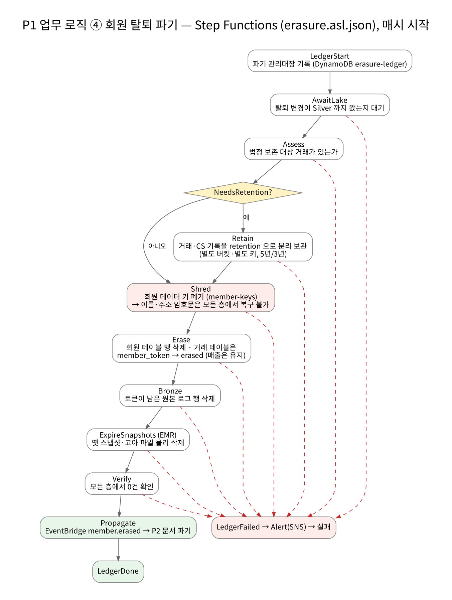
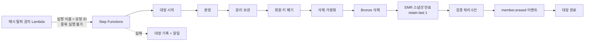




## 누가 어떤 컬럼을 볼 수 있나 — 태그로 정한다

Lake Formation 의 **LF-Tag** 3종으로 권한을 표현합니다.

| 태그 | 값 |
| --- | --- |
| `layer` | silver, gold, ops, gold_audit |
| `domain` | commerce, payment, marketing, cs, finance, platform |
| `classification` | public, internal, personal_token, personal_encrypted, personal_generalized, restricted |

`p1/governance/lf_sync.py` 가 **Silver 는 데이터 계약에서, Gold 는 dbt manifest 에서** 테이블·컬럼 태그를 동기화합니다. 사람 역할에는 테이블 이름이 아니라 *태그 식* 으로 권한을 줍니다.

| 주체 | 범위(태그 식) | 못 보는 것 |
| --- | --- | --- |
| 분석가 | layer=gold ∧ classification ∈ {public, internal, personal_generalized} | 토큰·암호문 컬럼, gold_audit, silver, dim_member 전체(동의 회원 행 필터로만) |
| 재무 | layer=gold ∧ classification ∈ {public, internal} | 위 + 일반화 값 |
| 엔지니어 | layer ∈ {silver, gold, ops} ∧ 암호문·restricted 제외 | 암호문 |
| 파이프라인(EMR·dbt·대사·MWAA) | 위치 접근 + DB·테이블 ALL | — (쓰기 주체) |
| break-glass | silver·gold 전체 + 회원 키 복호화 | — (MFA·SourceIdentity 필수, 1시간, 사용 즉시 알림) |

- **컬럼 태그가 테이블 태그를 이깁니다.** 테이블은 `internal` 인데 `member_token` 컬럼만 `personal_token` 이면, 분석가의 `SELECT *` 결과에서 그 컬럼이 자동으로 빠집니다.
- **안전망.** 새 dbt 모델에 메타가 없어도 이름이 `*_token` 이면 `personal_token` 으로 태깅합니다.
- **동의 범위 = 행 필터.** 마케팅 분석은 마케팅 수신 동의 회원만 대상입니다(개인정보 보호법의 목적 외 이용 제한). 정책을 문서가 아니라 LF 데이터 셀 필터로 강제합니다.
- **LF 는 쓰기를 통제하지 않습니다.** 쓰기 권한은 파이프라인 역할의 IAM 에만 있고, 사람 역할에는 레이크 버킷 S3 권한이 아예 없습니다.

### 기간제 접근 요청 = PR

신규 분석가가 특정 테이블을 한 달 봐야 한다면 `governance/access/<요청>.yaml` 을 PR 로 올립니다. CI 가 **승인자 2명, 최대 30일, 암호문·restricted 요청 불가** 를 검사하고, 머지되면 Terraform 이 권한을 주며, 매일 도는 워크플로가 만료된 권한을 회수합니다. 부여·변경·말소 이력이 Git 과 CloudTrail 에 남습니다.

## 탈퇴 회원 파기 — 72시간 워크플로

_Step Functions erasure.asl.json — 매시 시작_

법은 *지체 없이 파기* 를 요구하지만, 전자상거래법은 거래 기록을 5년 보관하라고 합니다. 둘을 데이터 종류별로 나눠 풀었습니다.

| 데이터 | 처리 | 이유 |
| --- | --- | --- |
| 회원·배송지·등급 이력·클릭·dim_member | 행 삭제 | 목적 달성(탈퇴) → 파기 |
| 주문·결제·쿠폰 사용·fct_* | `member_token` → `erased` | 거래 사실(금액·일시)은 남겨 과거 매출이 소급해 바뀌지 않게 |
| 위 거래와 회원의 원래 연결 | `retention.*` 로 복사(별도 버킷·PII 키·법무 역할만) | 전자상거래법 시행령(5년) |
| CS 문의 | 분리 보관 후 본문 제거 | 분쟁 처리 기록 3년 |
| 이름·주소 암호문(모든 계층·스냅샷·백업) | **회원 키 폐기(묘비)** | 불변 저장소에서의 파기 |
| Bronze 원본 로그 | 행 삭제 + 스냅샷 만료 | 토큰이 남은 원본 |
| Kafka 원문 | 토픽 보존 ≤ 72시간 | SLO 안에서 자연 소멸 |

- 파기 관리대장은 DynamoDB(PITR **켬** — 회원 키 테이블과 반대). 대장은 지워지면 안 되는 기록입니다.
- 상태 머신 실행 입력은 로그에 남기지 않습니다(토큰이 들어 있으므로).
- 제한 시간 72시간, 초과·실패 시 알림.

## 접속기록 — 누가 언제 무엇을 조회했나

개인정보 조회는 누가·언제·어디서·무엇을 했는지 2년간 위·변조 없이 남아야 합니다.

1. `p1/privacy/access_log.py` 가 CloudTrail 에서 **사람의** Athena 조회·비상 접근·권한 거부를 골라 JSONL 로 씁니다.
2. 파일은 객체 잠금(2년) 버킷에 저장합니다.
3. 매일 해시 체인을 잇습니다: `chain(d) = sha256(chain(d-1) + sha256(file(d)))`. 어느 날 파일을 고치거나 지우면 그 뒤 체인이 모두 달라집니다.
4. 매주 `verify` 가 전체 체인을 다시 계산하고, 월간 리포트가 대량·심야·반복 거부·비상 접근을 표시합니다.

*"특정 회원을 누가 조회했나"* 같은 감사 요청은 접속기록의 `subject_tokens` 로 답합니다.

## 배포 중 고친 점

| 증상 | 원인 | 해결 |
| --- | --- | --- |
| LF 태그 생성 `AccessDeniedException` | 태그는 LF 관리자만 만들 수 있는데, 관리자 등록(data_lake_settings)과 병렬로 생성됨 | 태그에 `depends_on = [data_lake_settings]` |
| 접근 요청 부여 실패 | 예시 요청 파일의 `000000000000` 계정 ARN 에 권한을 주려 함 | 이 계정 주체만 대상으로 필터 |
| IAM 역할 생성 실패 | IAM description 은 ASCII·Latin-1 만 허용 | 영어 설명 + 한국어는 주석 |
| EMR 이 `ops.pipeline_watermarks` 를 못 찾음 | LF 관리 DB 인데 EMR 역할에 Describe 권한 없음 | 거버넌스 스택을 파이프라인 첫 실행 전에 적용 |
| MWAA 의 Athena 쿼리 실패 | LF 위치에서 읽으려면 IAM `lakeformation:GetDataAccess` 도 필요 | MWAA 실행 역할에 추가 |

> Lake Formation 설정을 Terraform 으로 지우면(`destroy`) 관리자 목록도 비워집니다. 다시 만들 때는 관리자 등록이 먼저 적용되어야 나머지가 성공합니다.
{: .prompt-warning }
