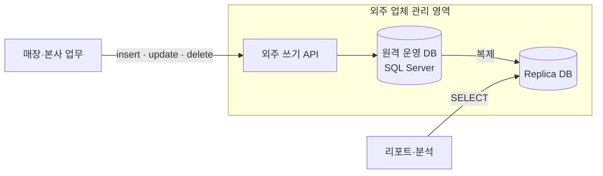
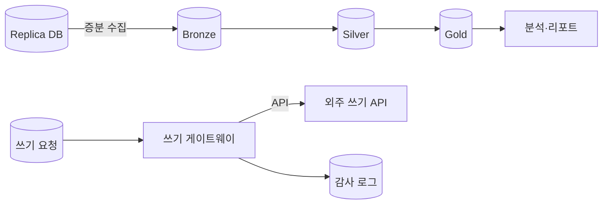




2026년 5월부터 7월까지 두 달 동안 호주의 안경·검안 체인 **1001 Optometry** 에서 데이터 엔지니어링 인턴으로 일했습니다. 그 기간 회사는 사내 데이터를 **Azure Databricks 레이크하우스**로 옮기고 있었고, 저는 그중 **replica 에서 데이터를 가져오는 수집 파이프라인**과 **외주 API 를 거치는 쓰기 경로**를 맡았습니다.

이 시리즈는 *왜 옮겼는지*, *어떤 제약 아래서 어떻게 설계했는지* 를 정리합니다. 회사 내부 테이블 이름, 데이터 규모, 외주 업체 이름은 적지 않았고, 예시 코드는 개념을 설명하려고 새로 쓴 것입니다.

## 출발점 — 내 데이터인데 내 손에 없다

사내 시스템에 쌓이는 모든 데이터가 **외주 업체가 관리하는 원격 DB** 에 있었습니다.

- **읽기**: 운영 DB 를 직접 보지 않고 항상 **replica DB** 로 조회했습니다.
- **쓰기**: insert, update, delete 는 DB 에 직접 하지 못하고 **외주 업체가 제공하는 API** 를 거쳐 간접적으로 처리했습니다.

평소 업무는 이 구조로도 돌아갑니다. 문제는 데이터를 *업무 처리 수단* 이 아니라 *회사 자산* 으로 다루려고 할 때 드러났습니다.

## 무엇이 불편했나

| 질문 | 기존 구조에서의 답 |
| --- | --- |
| "지난달 이 고객 상태가 언제 바뀌었지?" | replica 에는 현재 값만 있어서 알 수 없음 |
| "매장별 실적을 몇 년치로 보고 싶다" | 무거운 쿼리를 replica 에 직접 날려야 함 |
| "잘못 들어간 데이터 수백 건을 고쳐야 한다" | API 를 한 건씩 호출. 누가 무엇을 고쳤는지 사내에 남지 않음 |
| "새 컬럼을 추가하거나 보존 기간을 바꾸고 싶다" | 외주에 요청하고 기다려야 함 |
| "누가 고객 정보에 접근했나" | 접근 통제와 기록이 외주 시스템 기준 |

정리하면 회사는 **자기 데이터를 소유하지 못하고 빌려 보는** 상태였습니다.

## 왜 Databricks 였나

후보를 고를 때 본 기준은 다섯 가지입니다.

1. **회사 구독 안에 정본을 둘 수 있는가** — Delta Lake 테이블은 회사 Azure 구독의 ADLS 에 저장됩니다. 보존, 권한, 스키마를 직접 정할 수 있습니다.
2. **현재 상태 너머의 이력을 남길 수 있는가** — `MERGE` 와 트랜잭션 로그, time travel 로 replica 에 없던 변경 이력과 특정 시점 조회를 만들 수 있습니다.
3. **작은 팀이 운영할 수 있는가** — 수집(Spark), 변환·분석(SQL), 스케줄링(Jobs)이 한 플랫폼 안에 있어서 별도로 운영할 시스템이 줄어듭니다.
4. **민감 정보를 다룰 수 있는가** — 고객과 검안 관련 정보는 민감 데이터입니다. Unity Catalog 로 카탈로그, 스키마, 컬럼 단위 권한과 계보를 한곳에서 관리합니다.
5. **기존 환경과 붙는가** — Azure Databricks 는 Entra ID, Key Vault, ADLS 와 바로 연동됩니다.

## 목표 그림

- **읽기**는 replica 직접 조회에서 **레이크(Bronze → Silver → Gold)** 로 옮깁니다.
- **쓰기**는 당장 외주 API 를 떼어 낼 수 없으므로, 앞단에 **쓰기 게이트웨이**를 두고 모든 쓰기를 기록하고 검증합니다.
- 나중에 쓰기 정본까지 사내로 옮길 수 있게 경계를 나눠 둡니다.

## 이 시리즈에서 다루는 것

| 편 | 내용 |
| --- | --- |
| 2편 | 기존 구조를 분석하며 찾은 제약 — CDC 불가, 복제 지연, 이력 없음, 간접 쓰기 |
| 3편 | **(담당)** replica → Bronze 증분 수집 설계 |
| 4편 | **(담당)** 외주 API 쓰기 게이트웨이 설계 |
| 5편 | 단계적 전환 전략, 내 기여도, 회고 |
