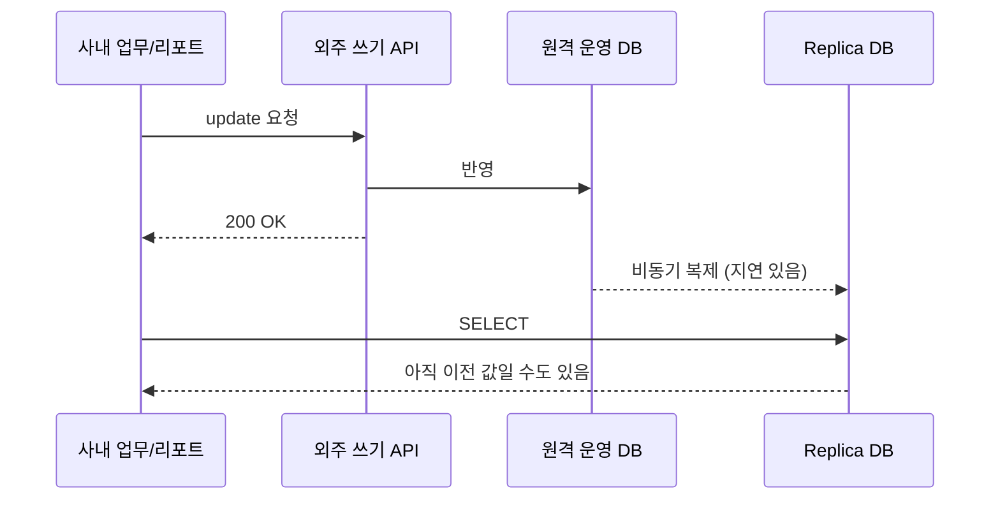




마이그레이션 설계는 **무엇을 할 수 없는지** 정리하는 데서 시작했습니다. 우리 소유가 아닌 시스템에서는 제약이 곧 설계 조건이 됩니다.

## 구조 다시 보기

## 제약 1 — 변경 감지 기능을 우리가 켤 수 없다

로그 기반 CDC(SQL Server 의 CDC/Change Tracking, 또는 Debezium 같은 도구)를 쓰려면 **원천 DB 의 설정을 바꿔야** 합니다. 원천 DB 는 외주 소유였고, 우리에게 있는 것은 **replica 읽기 권한**뿐이었습니다.

→ **설계 영향**: 변경 감지를 DB 에 맡기지 않고 **쿼리 기반 증분 추출**로 설계했습니다. 그래서 테이블마다 *무엇으로 변경을 알아낼 수 있는지* 조사하는 일이 먼저였습니다.

## 제약 2 — replica 는 늦다

replica 는 비동기 복제라서 운영 DB 보다 늦습니다. 평소에는 짧아도 부하가 몰리면 길어질 수 있습니다.

→ **설계 영향**
- 증분 수집 기준점(워터마크)을 *마지막으로 본 값* 이 아니라 **그보다 앞선 지점**부터 겹쳐 읽습니다. 늦게 복제된 행을 놓치지 않기 위해서입니다.
- 쓰기 직후 replica 를 읽으면 이전 값이 보일 수 있으므로, 쓰기 반영 확인도 **일정 시간을 두고 재확인**합니다.

## 제약 3 — replica 에는 현재 상태만 있다

운영 DB 를 복제한 replica 에는 각 행의 **현재 값**만 있습니다. 예약 상태가 *예약 → 변경 → 취소* 로 바뀌어도 replica 에는 *취소* 만 남습니다.

→ **설계 영향**: 이력이 필요한 테이블은 레이크 쪽에서 직접 만듭니다. 수집할 때마다 Bronze 에 원본을 쌓고, Silver 에서 변경을 감지해 이력(SCD2)으로 남깁니다. 단, 이 이력은 *수집 주기 단위* 입니다. 주기 사이에 여러 번 바뀐 중간 상태까지 잡을 수는 없다는 한계를 문서에 명시했습니다.

## 제약 4 — 쓰기는 API 로만, 기록은 외주 쪽에만

insert, update, delete 는 외주 API 로만 가능했습니다. API 는 *요청을 받았다* 는 응답을 주지만, 사내에는 **누가, 언제, 무엇을, 왜 바꿨는지** 기록이 남지 않았습니다.

→ **설계 영향**: 쓰기를 금지하거나 우회하지 않고 **감쌌습니다**. 모든 쓰기를 요청 테이블에 먼저 남기고, 게이트웨이가 API 를 부르고, 결과와 실제 반영 여부를 감사 로그에 남깁니다. 자세한 내용은 4편에서 다룹니다.

## 제약 5 — replica 도 결국 남의 서버다

replica 는 사내 업무도 함께 쓰는 서버입니다. 마이그레이션 수집이 무거운 쿼리를 보내면 업무 조회가 느려집니다.

→ **설계 영향**: 필요한 컬럼만 읽고, 키 범위로 나눠 적당히 병렬로 읽고, 업무가 적은 시간대에 큰 작업을 몰았습니다.

## 테이블 조사 — 무엇으로 변경을 알아낼 수 있나

수집 설계 전에 테이블마다 아래 항목을 표로 정리했습니다.

| 조사 항목 | 왜 필요한가 |
| --- | --- |
| 기본 키 | `MERGE` 기준. 없으면 대체 키를 정의해야 함 |
| 변경 시각 컬럼 존재 여부와 신뢰도 | 증분 수집 가능 여부. 모든 갱신 경로에서 실제로 갱신되는지 확인 |
| 하드 삭제 여부 | 증분 쿼리로는 삭제가 보이지 않으므로 별도 감지 필요 |
| 대략적인 크기와 증가 속도 | 전체 스냅샷과 증분 중 무엇을 쓸지 결정 |
| 민감 정보 컬럼 | 레이크에서 권한과 마스킹을 적용할 대상 |
| 시간대 | 호주 매장 시각(AEST/AEDT, 서머타임) 인지 UTC 인지 |

이 표가 3편에서 다루는 **테이블별 수집 방식**의 근거가 되었습니다.
