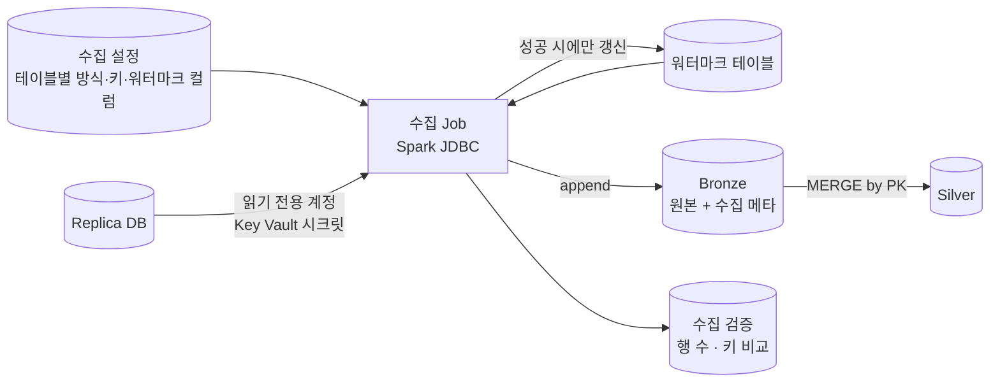




제가 맡은 첫 번째 영역입니다. 조건은 2편에서 정리한 그대로입니다. **CDC 는 켤 수 없고, replica 는 늦고, replica 는 업무와 함께 쓰는 서버**입니다.

> 아래 코드는 설계를 설명하려고 새로 쓴 개념 예시입니다. 회사 코드와 테이블 이름이 아닙니다.
{: .prompt-tip }

## 전체 흐름



## 테이블별 수집 방식 — 설정으로 나눈다

테이블마다 코드를 따로 쓰지 않고 **수집 설정 한 줄**로 방식을 정하게 했습니다.

| 방식 | 대상 | 방법 |
| --- | --- | --- |
| `incremental` | 변경 시각 컬럼을 믿을 수 있는 큰 테이블 | 워터마크 이후 바뀐 행만 |
| `snapshot` | 작은 기준 테이블(매장, 상품 분류 등) | 매번 전체를 읽어 교체 |
| `incremental + pk_check` | 하드 삭제가 일어나는 테이블 | 증분 + 주기적 기본 키 비교 |

```yaml
# 수집 설정 예시
- source: dbo.appointments
  mode: incremental
  primary_key: [appointment_id]
  watermark_column: updated_at
  overlap: 30m
  partition_column: appointment_id
- source: dbo.stores
  mode: snapshot
  primary_key: [store_id]
```

새 테이블을 추가할 때 코드를 바꾸지 않고 설정만 추가하면 되도록 했습니다.

## 핵심 1 — 겹쳐 읽기: 복제 지연을 이기는 워터마크

워터마크를 *마지막으로 본 최대값* 에서 바로 이어 읽으면, 그 시점에 아직 복제되지 않은 행을 영영 놓칠 수 있습니다. 그래서 **겹침 구간(overlap)** 을 두고 앞에서부터 다시 읽습니다.

```text
이번 읽기 범위 = (마지막 워터마크 − overlap, 이번 실행 시작 시각]
```

- 같은 행을 두 번 읽게 되지만, 아래의 멱등 `MERGE` 가 중복을 흡수합니다.
- 워터마크는 **Bronze 적재와 Silver MERGE 가 모두 성공한 뒤에만** 갱신합니다. 중간에 실패하면 다음 실행이 같은 구간을 다시 읽습니다.
- 상한을 *실행 시작 시각* 으로 고정해서, 실행 중에 들어온 행은 다음 실행이 처리합니다.

## 핵심 2 — 멱등 MERGE: 두 번 돌려도 결과가 같게

Bronze 에는 읽은 그대로 **추가(append)** 하고 수집 메타 컬럼을 붙입니다.

| 메타 컬럼 | 용도 |
| --- | --- |
| `_ingested_at` | 레이크에 들어온 시각 |
| `_batch_id` | 같은 실행에서 들어온 행 묶음. 재처리 단위 |
| `_source_table` | 원천 테이블 |

Silver 는 기본 키 기준 `MERGE` 로 받습니다. **이미 가진 것보다 새롭지 않은 행은 덮어쓰지 않는** 조건을 넣었습니다.

```sql
MERGE INTO silver.appointments t
USING (
  -- 이번 배치 안에서 같은 키가 여러 번 나오면 가장 최신 것만
  SELECT * FROM batch_rows
  QUALIFY row_number() OVER (PARTITION BY appointment_id ORDER BY updated_at DESC) = 1
) s
ON t.appointment_id = s.appointment_id
WHEN MATCHED AND s.updated_at >= t.updated_at THEN UPDATE SET *
WHEN NOT MATCHED THEN INSERT *
```

이 덕분에 **실패하면 같은 구간을 다시 돌리면 된다** 는 단순한 복구 규칙이 생겼습니다.

## 핵심 3 — 보이지 않는 삭제 찾기

증분 쿼리는 *바뀐 행* 만 보여 줍니다. 원천에서 삭제된 행은 아예 결과에 나오지 않습니다. 하드 삭제가 있는 테이블은 주기적으로 **기본 키 목록만** 읽어 Silver 와 비교합니다.

- replica 에서는 키 컬럼만 가볍게 읽습니다.
- Silver 에만 있는 키는 바로 지우지 않고 **삭제 표시(`_is_deleted`, `_deleted_detected_at`)** 를 합니다. 일시적인 조회 오류로 정상 데이터를 지우는 사고를 막기 위해서입니다.

## 핵심 4 — replica 에 부담 주지 않기

| 방법 | 내용 |
| --- | --- |
| 필요한 컬럼만 | `SELECT *` 대신 설정에 정의한 컬럼만 |
| 키 범위 병렬 읽기 | Spark JDBC 의 `partitionColumn` · `lowerBound` · `upperBound` · `numPartitions` 로 나눠 읽되 동시 연결 수는 작게 |
| `fetchsize` 조절 | 네트워크 왕복 감소 |
| 실행 시간대 | 최초 전체 적재와 키 비교는 업무가 적은 시간대에 |
| 읽기 전용 계정 | Key Vault 기반 Databricks 시크릿 스코프로 관리, 노트북에 비밀번호 노출 없음 |

## 핵심 5 — 들어온 것이 맞는지 확인하기

수집이 *성공* 했다고 데이터가 *맞는* 것은 아닙니다. 실행마다 아래를 비교해 결과 테이블에 남겼습니다.

- 같은 기준 시각의 **replica 행 수 vs Silver 행 수**
- 하드 삭제 테이블은 **키 집합 차이** 건수
- 금액처럼 중요한 컬럼은 **합계** 비교

차이가 허용 범위를 넘으면 Job 을 실패 처리해서, 사람이 모르는 사이에 틀린 데이터가 Gold 로 넘어가지 않게 했습니다.

## 그 밖의 처리

- **시간대**: 원천 시각 컬럼이 호주 현지 시각(서머타임 포함)인지 UTC 인지 테이블마다 확인하고, Silver 에서는 UTC 와 현지 시각을 함께 보관했습니다.
- **스키마 변경**: 원천에 새 컬럼이 생기면 Bronze 는 받아들이고, Silver 에 반영할지는 설정에서 명시적으로 정하게 했습니다. 예고 없는 스키마 변경이 Silver 를 깨뜨리지 않도록 하기 위해서입니다.

## 정리

| 문제 | 해결 |
| --- | --- |
| CDC 를 켤 수 없음 | 설정 기반 쿼리 증분 추출 |
| replica 복제 지연 | 겹침 구간 + 성공 후 워터마크 갱신 |
| 중복 읽기 | 기본 키 기준 멱등 `MERGE` |
| 하드 삭제 | 기본 키 비교 + 삭제 표시 |
| replica 부하 | 컬럼 최소화, 제한된 병렬 읽기, 시간대 조절 |
| 조용한 데이터 오류 | 행 수·키·합계 비교 후 실패 처리 |
