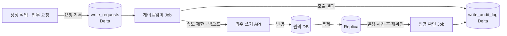
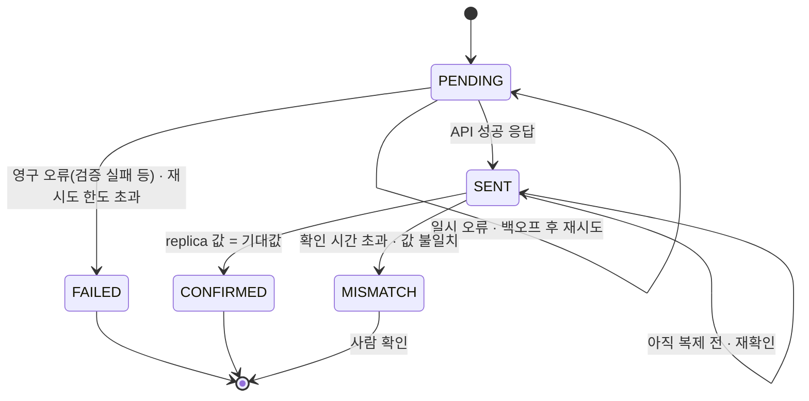




제가 맡은 두 번째 영역입니다. 읽기는 레이크로 옮길 수 있었지만 **쓰기는 여전히 외주 API 로만** 가능했습니다. 쓰기를 당장 옮길 수 없다면, 최소한 *사내에서 통제하고 기록할 수 있게* 만들기로 했습니다.

> 아래 코드와 테이블 이름은 설계를 설명하려고 새로 쓴 개념 예시입니다.
{: .prompt-tip }

## 문제

| 기존 | 문제 |
| --- | --- |
| 사람이나 스크립트가 API 를 직접 호출 | 호출 방식이 제각각이고 재시도 규칙이 없음 |
| API 응답 200 = 끝 | 실제 DB 에 반영됐는지 확인하지 않음 |
| 실패하면 다시 호출 | 첫 호출이 사실은 성공했다면 **중복 반영** |
| 기록은 외주 쪽에만 | 사내에 *누가·언제·무엇을·왜* 가 남지 않음 |
| 대량 정정 | 수백 건을 손으로 반복 호출 |

## 설계 — 요청, 호출, 확인을 분리한다

1. **요청 기록** — 쓰기는 API 를 바로 부르지 않고 `write_requests` 테이블에 *의도* 를 먼저 남깁니다.
2. **호출** — 게이트웨이 Job 이 대기 중인 요청을 가져와 API 를 부릅니다.
3. **확인** — 일정 시간 뒤 replica 에서 실제 값을 읽어 기대값과 비교합니다.

## 요청 테이블

| 컬럼 | 설명 |
| --- | --- |
| `request_id` | 사내에서 만든 고유 ID. 중복 방지 기준 |
| `entity`, `entity_key` | 대상 엔터티와 키 |
| `operation` | `insert` / `update` / `delete` |
| `payload` | 보낼 값 |
| `expected_state` | 반영 후 replica 에 보여야 하는 값 |
| `requested_by`, `reason` | 누가, 왜 |
| `status` | `PENDING → SENT → CONFIRMED` / `FAILED` / `MISMATCH` |

## 상태 흐름

## 핵심 1 — 중복 반영 막기

네트워크 타임아웃이 나면 *요청이 처리됐는지* 알 수 없습니다. 무작정 다시 보내면 insert 가 두 번 들어갈 수 있습니다.

- 요청마다 `request_id` 를 붙이고, 같은 ID 는 한 번만 `SENT` 가 될 수 있습니다.
- 응답이 불확실한 요청은 **재전송 전에 replica 에서 이미 반영됐는지 먼저 확인**합니다. 이미 반영됐으면 다시 보내지 않고 `SENT` 로 넘깁니다.
- update 는 *최종 값을 설정하는* 형태로만 만들고, *값을 1 올려라* 같은 상대 변경은 피했습니다. 두 번 반영돼도 결과가 같게 하기 위해서입니다.

## 핵심 2 — 외주 API 에 예의 바르게

| 상황 | 처리 |
| --- | --- |
| 429 / 5xx / 타임아웃 | 지수 백오프 + 지터로 재시도, 횟수 제한 |
| 4xx (요청 형식 오류 등) | 재시도하지 않고 바로 `FAILED` + 오류 본문 기록 |
| 대량 요청 | 초당 호출 수를 제한해 외주 시스템과 업무에 영향 없게 |

## 핵심 3 — 성공 응답 ≠ 반영 완료

API 의 성공 응답은 *요청을 받았다* 는 뜻입니다. 실제로 원격 DB 에 반영되고 replica 로 복제됐는지는 따로 봐야 합니다.

- 반영 확인 Job 이 `SENT` 요청의 대상 행을 replica 에서 읽어 `expected_state` 와 비교합니다.
- 복제 지연이 있으니 바로 실패로 보지 않고 **정해진 시간 동안 재확인**합니다.
- 그래도 다르면 `MISMATCH` 로 표시하고 담당자가 확인하게 했습니다.

## 핵심 4 — 감사 로그

`write_audit_log` 에는 모든 시도를 append 로만 남깁니다(요청 ID, 시도 횟수, 응답 코드, 응답 요약, 확인 결과, 시각). 그 결과:

- *"이 고객 정보 누가 바꿨어요?"* 에 사내에서 답할 수 있게 되었습니다.
- 대량 정정을 **요청 테이블에 넣고 돌리는 작업**으로 바꿀 수 있었습니다. 진행률과 실패 건도 테이블 조회로 확인합니다.
- 민감 정보가 포함된 payload 는 로그에 원문 대신 필요한 키와 변경 컬럼 이름만 남겼습니다.

## 핵심 5 — 나중을 위한 경계

게이트웨이는 *쓰기 요청을 받는 쪽* 과 *실제로 반영하는 쪽(외주 API 어댑터)* 을 나눴습니다. 나중에 쓰기 정본을 사내로 옮기면 **어댑터만 바꾸면 되고**, 요청 테이블과 감사 로그는 그대로 둘 수 있습니다. 이것이 5편에서 말할 단계적 전환의 다리 역할을 합니다.

## 정리

| 문제 | 해결 |
| --- | --- |
| 제각각인 직접 호출 | 요청 테이블 + 단일 게이트웨이 |
| 타임아웃 후 중복 반영 | 요청 ID, 재전송 전 반영 확인, 절대값 update |
| 성공 응답만 믿음 | replica 재확인 → `CONFIRMED` / `MISMATCH` |
| 사내 기록 없음 | append 전용 감사 로그 |
| 외주 의존 고착 | 어댑터 경계로 교체 가능하게 |
