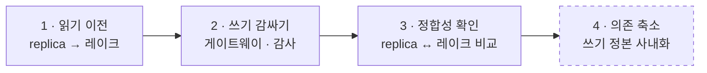




## 왜 한 번에 바꾸지 않았나

외주 시스템은 매장 업무가 매일 쓰는 시스템이라 멈출 수 없었고, 쓰기 정본도 당장은 외주 DB 였습니다. 그래서 기존 시스템을 **감싼 채로 기능을 하나씩 옮기는 방식(strangler)** 을 택했습니다. 단계마다 되돌릴 수 있다는 점이 가장 중요했습니다.

| 단계 | 하는 일 | 되돌리기 | 인턴 기간 |
| --- | --- | --- | --- |
| 1. 읽기 이전 | 리포트·분석을 replica 직접 조회에서 Gold 로 | 리포트를 replica 로 다시 연결 | ✅ 수집 담당 |
| 2. 쓰기 감싸기 | 쓰기를 게이트웨이로 모음 | 게이트웨이를 끄고 직접 호출 | ✅ 게이트웨이 담당 |
| 3. 정합성 확인 | 행 수·키·합계 정기 비교 | — | ✅ 수집 쪽 검증 |
| 4. 의존 축소 | 쓰기 정본을 사내로 옮기고 어댑터 교체 | 어댑터를 외주 API 로 복귀 | 이후 과제 |

## 내 기여도

### 가지고 간 것

| 배경 | 프로젝트에서 쓴 곳 |
| --- | --- |
| **한국에서 7개월간 Spark 기반 데이터 엔지니어링 실무** | JDBC 파티션 읽기, 증분 적재, 기본 키 기준 `MERGE`, 재처리 가능한 배치 설계 같은 실무 패턴을 처음부터 수집 파이프라인에 넣었습니다. 2개월 인턴이라 적응 기간이 짧아야 했는데, Spark 와 배치 운영이 익숙했기 때문에 도구를 배우는 대신 외주 시스템의 제약을 파악하는 데 시간을 쓸 수 있었습니다. |
| **Databricks Certified Data Engineer Professional** | Delta Lake `MERGE` 와 스키마 변경 처리, medallion 계층 나누기, Jobs 구성, Unity Catalog 권한 모델을 기준으로 설계 근거를 설명했습니다. 이 근거가 팀과 설계를 합의하는 데 도움이 됐습니다. |

### 맡은 것

| 영역 | 내가 한 일 |
| --- | --- |
| 기존 구조 분석 | 테이블별 기본 키, 변경 시각 컬럼, 하드 삭제, 시간대, 민감 컬럼 조사표 작성 ([2편]()) |
| replica 증분 수집 | 설정 기반 수집, 겹침 워터마크, 멱등 `MERGE`, 삭제 감지, 수집 검증 설계·구현 ([3편]()) |
| 쓰기 게이트웨이 | 요청 테이블, 중복 방지, 재시도, 감사 로그, replica 반영 확인 설계·구현 ([4편]()) |
| 인수인계 | 테이블별 수집 방식, 재실행 방법, 장애 시 확인 순서 문서화 |

### 팀과 함께 한 것
레이크하우스 전체 구조(Bronze/Silver/Gold), Unity Catalog 거버넌스, 리포트 이전은 팀이 함께 진행했습니다. 저는 그 안에서 **데이터가 레이크로 들어오고(수집), 레이크 밖으로 나가는(쓰기) 경계** 를 맡았습니다.

## 회고

### 잘한 것
- **제약부터 정리했다.** *CDC 불가, 복제 지연, 현재 상태만 있음, 간접 쓰기* 를 먼저 표로 만들고 나니 설계 선택지가 자연스럽게 좁혀졌습니다.
- **멱등하게 만들었다.** 겹쳐 읽고 `MERGE` 로 받는 구조라서 장애가 나도 *다시 돌리기* 로 끝났고, 인수인계 문서도 짧아졌습니다.
- **성공 응답을 의심했다.** 쓰기 반영 확인 단계를 넣은 덕분에 *응답은 성공인데 실제로는 반영되지 않은* 경우를 사람이 아니라 상태값으로 잡을 수 있었습니다.

### 아쉬운 것
- **수집 주기 사이의 중간 상태는 잡지 못한다.** 쿼리 기반 증분의 근본적인 한계입니다. 외주 업체와 협의해 CDC 를 켤 수 있다면 가장 먼저 바꾸고 싶은 부분입니다.
- **2개월은 짧았다.** 쓰기 정본을 사내로 옮기는 4단계는 설계 방향만 남기고 마쳤습니다.

### 배운 것
- 내 소유가 아닌 시스템과 일할 때는 *기술 선택* 보다 *경계 설계* 가 더 중요합니다. 어디까지가 우리 책임이고, 어디서 확인하고, 어떻게 되돌릴지를 정하는 일입니다.
- 영어로 일하는 팀에서 요구사항을 확인하고 설계를 문서로 설득하는 경험을 했습니다. 표 하나와 그림 하나가 긴 설명보다 빠를 때가 많았습니다.
