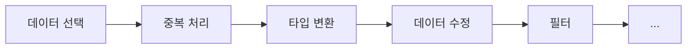
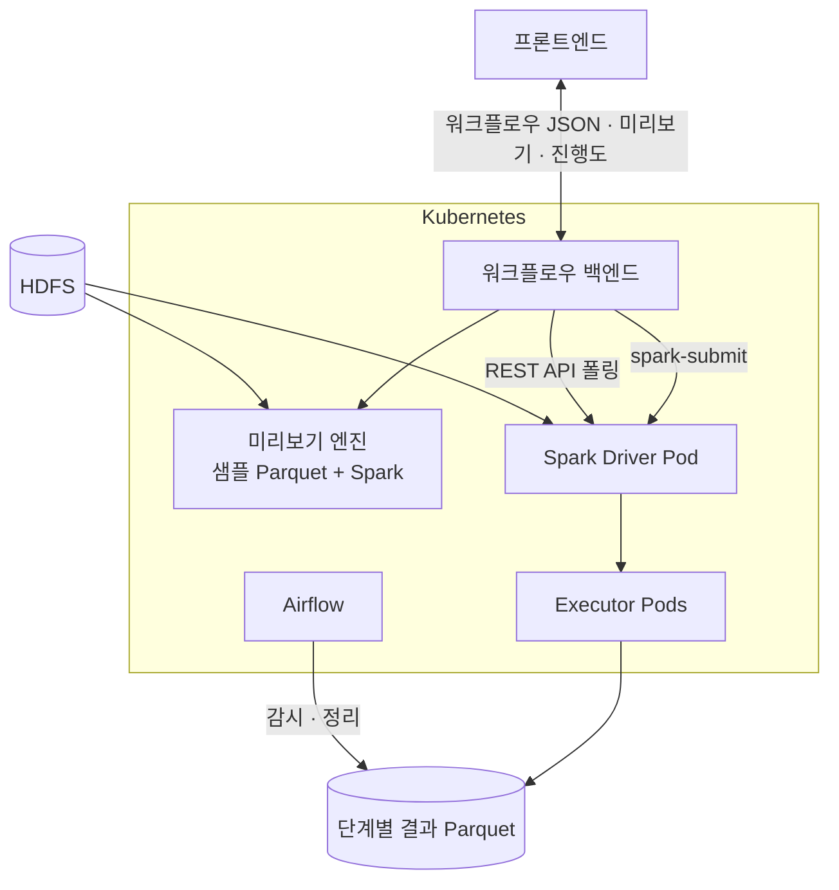




2024년 1월부터 7월까지 국내 회사에서 데이터 엔지니어로 일하며 **Spark 와 Kubernetes 기반 데이터 분석 도구**를 개발했습니다. 이 시리즈는 그 도구를 *왜 이렇게 설계했는지* 를 기능별로 정리합니다.

> 회사 제품 코드는 공개하지 않습니다. 글에 나오는 코드는 개념을 설명하려고 새로 쓴 예시입니다.
{: .prompt-tip }

## 제품의 자리

회사의 주력 제품은 **Hadoop 기반 빅데이터 Hub 플랫폼**이었습니다. 고객은 이 플랫폼에 데이터를 모으고 관리했고, 데이터를 *분석* 할 때 제가 개발한 도구를 썼습니다.

고객의 상당수는 Spark 코드를 직접 쓰는 사람이 아니었습니다. 그래서 목표는 **코드를 몰라도 대용량 데이터를 가공할 수 있게** 하는 것이었습니다.

## 사용자가 보는 것

1. 캔버스에 처리 단계를 드래그해서 놓고 선으로 연결합니다.
2. 각 단계의 옵션(중복 기준 컬럼, 바꿀 타입, 수정 규칙 등)을 고르면 **샘플 데이터로 결과를 바로 확인**합니다.
3. 다 만들면 **실행** 을 누르고, 진행도를 보며 다른 일을 합니다.
4. 실행이 끝나면 단계별 결과를 표와 차트로 확인합니다. 며칠 뒤에 다시 와서 봐도 됩니다.

## 팀

| 구성원 | 역할 |
| --- | --- |
| 팀장 | 설계 방향, 코드 리뷰 (개발은 하지 않음) |
| **본인** | 백엔드 · 데이터 엔지니어링 |
| 동기 | 백엔드 개발 |
| (협업) 프론트엔드 팀 | 캔버스 UI, 결과 시각화 |

개발자가 둘뿐이라 Spark 작업 코드, Kubernetes 배포, Airflow DAG, 프론트엔드와의 API 협의까지 넓게 맡았습니다.

## 전체 구조

## 이 시리즈에서 다루는 것

| 편 | 주제 | 핵심 |
| --- | --- | --- |
| 2편 | 워크플로우 모델 | 캔버스의 노드와 선을 Spark 작업으로 바꾸는 방법 |
| 3편 | 사전 검증 | 샘플 Parquet + Spark 로 제출 전에 오류 찾기 |
| 4편 | 단계별 디스크 저장 | 수십 단계 · 대용량 OOM 해결과 trade-off |
| 5편 | Airflow 디스크 관리 | 사용량 알림, UI 에서 정리 실행 |
| 6편 | 실행 관리 | 비동기 제출, REST API 진행도, 동시 실행 제한, SIGTERM 취소 |
| 7편 | 프론트엔드 협업과 회고 | 시각화 방식과 데이터 포맷 계약 |
