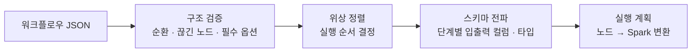




사용자가 캔버스에 그린 그림은 결국 **Spark 가 실행할 수 있는 작업**이 되어야 합니다. 이 글은 그 사이의 변환 과정을 다룹니다.

> 코드와 필드 이름은 개념 예시입니다.
{: .prompt-tip }

## 워크플로우는 DAG 다

캔버스의 **노드 = 처리 단계**, **선 = 데이터가 흐르는 방향** 입니다. 순환이 있으면 실행할 수 없으므로 워크플로우는 방향 비순환 그래프(DAG)여야 합니다.

```json
{
  "workflow_id": "wf-001",
  "nodes": [
    {"id": "n1", "type": "select",  "params": {"dataset": "hub://sales/2024", "columns": ["order_id", "price", "ordered_at"]}},
    {"id": "n2", "type": "dedup",   "params": {"keys": ["order_id"], "keep": "latest", "order_by": "ordered_at"}},
    {"id": "n3", "type": "cast",    "params": {"column": "price", "to": "decimal(12,2)", "on_error": "null"}},
    {"id": "n4", "type": "modify",  "params": {"column": "price", "rule": "multiply", "value": 1.1}}
  ],
  "edges": [["n1", "n2"], ["n2", "n3"], ["n3", "n4"]]
}
```

## 노드 종류

| 분류 | 예시 노드 | Spark 에서 하는 일 |
| --- | --- | --- |
| 입력 | 데이터 선택 | Hub 플랫폼(HDFS) 데이터 읽기, 컬럼 선택 |
| 정제 | 중복 처리, 결측 처리, 필터 | `dropDuplicates`, 윈도 함수, `filter` |
| 변환 | 타입 변환, 데이터 수정, 컬럼 파생 | `cast`, `withColumn`, 표현식 |
| 결합 | 조인, 합치기 | `join`, `union` |
| 출력 | 결과 저장 | Parquet 쓰기 |

## JSON 에서 Spark 작업까지



1. **구조 검증** — 순환, 입력이 없는 노드, 빠진 필수 옵션을 실행 전에 거릅니다.
2. **위상 정렬** — 선을 따라 실행 순서를 정합니다.
3. **스키마 전파** — 각 단계가 내보내는 컬럼과 타입을 계산합니다. *타입 변환* 노드에서 존재하지 않는 컬럼을 고르는 실수를 Spark 실행 없이 잡을 수 있습니다.
4. **실행 계획** — 노드마다 정해진 변환 함수를 적용합니다.

```python
# 개념 예시 — 노드 타입별 변환 함수 등록
TRANSFORMS = {}

def transform(node_type):
    def register(fn):
        TRANSFORMS[node_type] = fn
        return fn
    return register

@transform("dedup")
def dedup(df, params):
    if params.get("keep") == "latest":
        w = Window.partitionBy(*params["keys"]).orderBy(F.col(params["order_by"]).desc())
        return df.withColumn("_rn", F.row_number().over(w)).filter("_rn = 1").drop("_rn")
    return df.dropDuplicates(params["keys"])

@transform("cast")
def cast(df, params):
    return df.withColumn(params["column"], F.col(params["column"]).cast(params["to"]))
```

새 노드를 추가할 때 **변환 함수 하나와 옵션 정의만 추가**하면 되게 해서, 기능이 늘어도 실행 엔진은 그대로 둘 수 있었습니다.

## 같은 정의, 세 가지 실행

같은 워크플로우 JSON 과 같은 변환 함수가 세 곳에서 쓰입니다. 미리보기와 최종 실행의 결과가 어긋나지 않게 하기 위해서입니다.

| 쓰는 곳 | 입력 데이터 | 목적 | 다루는 편 |
| --- | --- | --- | --- |
| 미리보기 | 샘플 Parquet | 설정 중 즉시 확인 | 3편 |
| 최종 실행 | 전체 데이터 | 실제 결과 생성 | 4편 · 6편 |
| 재실행 | 저장된 중간 결과 | 실패 단계부터 다시 | 4편 |

다음 편에서는 첫 번째, **미리보기와 사전 검증**을 다룹니다.
