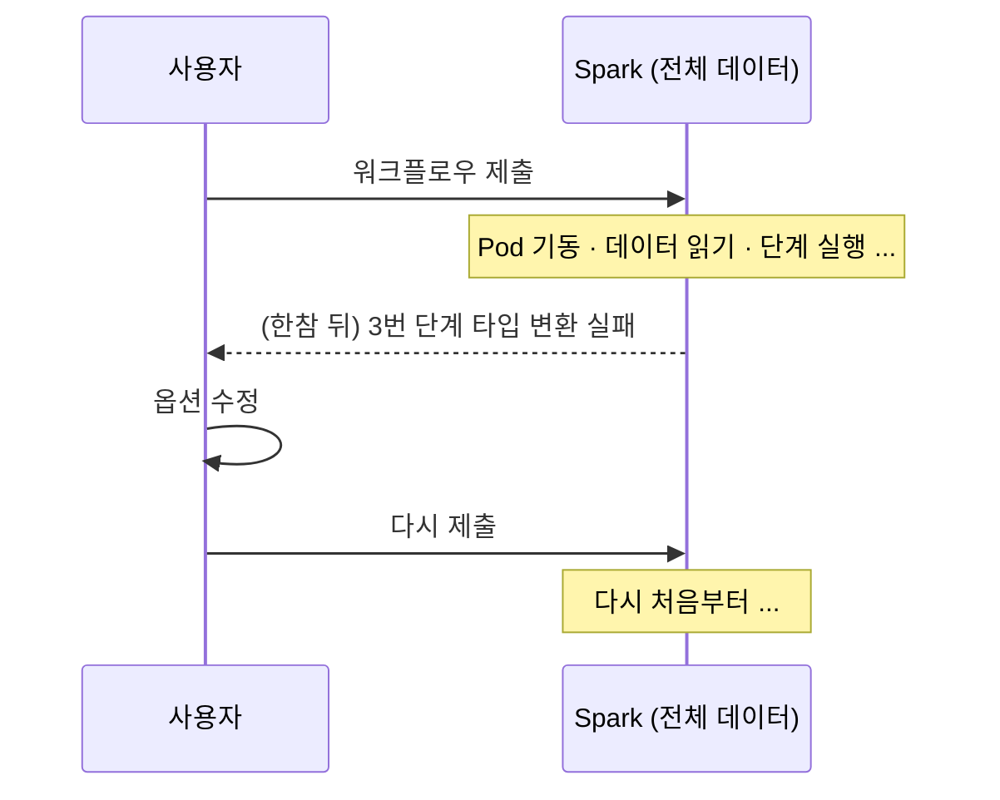
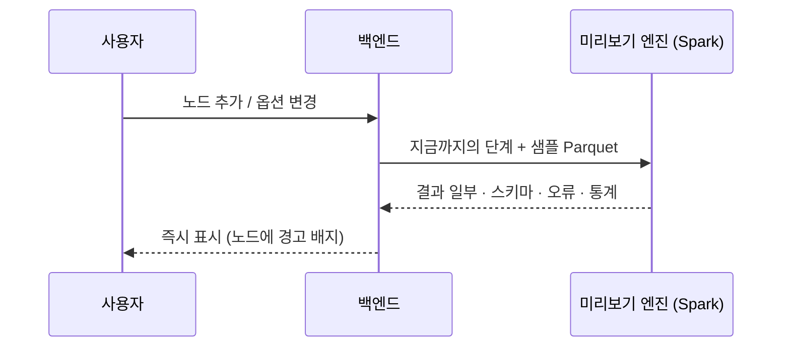




## 문제 — 10분 기다려서 오타를 발견한다

Spark 작업은 제출하면 드라이버와 익스큐터를 띄우고, 데이터를 읽고, 단계를 실행합니다. 대용량에서는 **결과나 오류를 보기까지 오래 걸립니다**.



사용자는 대부분 코드를 쓰지 않는 사람이라 *어떤 옵션이 틀렸는지* 를 실행해 봐야 알았습니다. 제출 → 실패 → 수정 → 재제출이 반복될수록 시간과 클러스터 자원이 낭비됐습니다.

## 해결 — 설정하는 순간 작은 데이터로 돌려 본다



- 데이터셋마다 **작은 샘플을 Parquet 로** 준비해 둡니다.
- 사용자가 노드를 추가하거나 옵션을 바꾸면, **최종 실행과 같은 변환 함수**(2편)를 샘플에 적용합니다.
- Spark SDK 로 띄워 둔 세션에서 실행하므로 전체 제출보다 훨씬 빨리 결과가 돌아옵니다.

## 왜 샘플을 Parquet 로 두었나

| 이유 | 설명 |
| --- | --- |
| 스키마가 함께 저장됨 | 원본과 같은 컬럼 이름과 타입으로 검증할 수 있음 |
| 컬럼 단위로 읽음 | 선택한 컬럼만 읽어서 빠름 |
| Spark 와 같은 경로 | 최종 실행과 같은 읽기 · 변환 코드를 그대로 씀. *미리보기에선 됐는데 실행하면 안 되는* 차이를 줄임 |

## 무엇을 미리 알려주나

| 검사 | 예 | 사용자에게 보이는 것 |
| --- | --- | --- |
| 스키마 | 이전 단계에서 사라진 컬럼을 참조 | 노드에 오류 배지 + 메시지 |
| 타입 변환 실패 | 문자열 `"1,200원"` → 숫자 변환 | 실패해 null 이 된 행 수와 예시 값 |
| 정합성 | 중복 처리 후 키 중복이 남음, 필수 컬럼 null | 경고와 건수 |
| 결과 미리보기 | — | 단계 결과 상위 일부 행 |
| 컬럼 통계 | null 비율, 고유값 수, 최솟값 · 최댓값 | 컬럼 헤더에 요약 |

타입 변환은 특히 중요했습니다. Spark 의 `cast` 는 실패하면 오류를 내지 않고 **조용히 null** 을 만듭니다. 그래서 *변환 전에는 값이 있었는데 변환 후 null 이 된 행* 을 세어서 보여줬습니다.

```python
# 개념 예시 — 타입 변환 실패 건수 세기
before, after = F.col(src), F.col(src).cast(target)
failed = (sample_df
          .where(before.isNotNull() & after.isNull())
          .select(before.alias("value")))
report = {"failed_count": failed.count(), "examples": [r.value for r in failed.limit(5).collect()]}
```

## 한계와 대응

샘플은 전체가 아닙니다. 샘플에 없는 이상한 값은 미리보기에서 잡히지 않습니다.

- 미리보기는 **"실패를 빨리 찾는 도구"** 이지 *"성공을 보장하는 도구"* 가 아니라고 UI 에 명시했습니다.
- 그래서 최종 실행에서도 단계별로 같은 검사를 하고 결과를 저장했습니다(4편).

## 효과

- 설정 실수 대부분을 **제출 전에** 잡게 되어, 실패한 Spark 작업으로 낭비되던 시간과 자원이 줄었습니다.
- 코드를 모르는 사용자도 *단계를 하나 놓을 때마다 결과를 보며* 워크플로우를 만들 수 있게 됐습니다.
