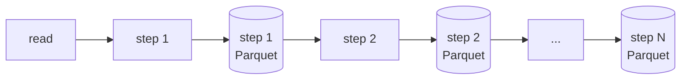




## 문제 — 단계가 늘수록 OOM

워크플로우는 몇 단계로 끝나지 않았습니다. 실제 사용자는 **수십 단계**를 이어 붙였고, 각 단계의 데이터도 컸습니다. 처음 구현은 모든 단계를 **하나의 DataFrame 에 계속 이어서** 마지막에 한 번 쓰는 방식이었습니다.


이 방식에서 OOM 이 자주 났습니다.

| 원인 | 설명 |
| --- | --- |
| 길어지는 계보(lineage) | Spark 는 변환을 미루다가 마지막에 한 번에 실행합니다. 단계가 수십 개면 실행 계획이 매우 커지고, 드라이버가 계획을 만들고 최적화하는 데만 메모리와 시간을 씁니다. |
| 셔플이 겹침 | 중복 처리(윈도 함수), 조인 같은 단계마다 셔플이 생기고, 한 작업 안에 여러 셔플이 겹치면 익스큐터 메모리 압박이 커집니다. |
| 캐시 남용 | 미리보기나 중간 확인을 위해 `cache()` 를 쓰면 대용량에서는 메모리를 오래 붙잡습니다. |
| 실패 시 처음부터 | 30번째 단계에서 실패하면 1번부터 다시 계산해야 합니다. |

## 해결 — 단계마다 디스크에 쓰고 다시 읽는다



각 단계의 결과를 **Parquet 로 디스크에 저장**하고, 다음 단계는 저장된 파일을 다시 읽어서 시작합니다.

```python
# 개념 예시 — 단계별 저장
df = read_input(workflow)
for step in topo_sorted(workflow.nodes):
    df = TRANSFORMS[step.type](df, step.params)
    path = f"{run_dir}/{step.id}"
    df.write.mode("overwrite").parquet(path)   # 이 단계의 실행이 여기서 끝난다
    df = spark.read.parquet(path)              # 계보가 끊긴 새 DataFrame 으로 다음 단계 시작
    mark_step_done(run_id, step.id, path)
```

| 효과 | 이유 |
| --- | --- |
| **OOM 감소** | 다시 읽은 DataFrame 은 이전 단계 계보를 갖지 않습니다. 실행 계획이 *한 단계* 크기로 유지됩니다. |
| **메모리 대신 디스크** | 중간 결과를 메모리에 붙잡지 않으니 데이터가 커도 단계 하나 크기만 감당하면 됩니다. |
| **실패한 단계부터 재실행** | 이미 끝난 단계 결과가 남아 있으니, 실패한 단계부터 다시 시작할 수 있습니다. |
| **단계별 진행도** | 단계 하나가 끝날 때마다 *몇 번째 단계까지 끝났는지* 를 알 수 있습니다 (6편). |

## trade-off — 속도를 조금 내준다

| | 메모리에서 이어 붙이기 | 단계별 디스크 저장 |
| --- | --- | --- |
| 속도 | 빠름 (단계 사이 I/O 없음, 단계를 합쳐 최적화) | **느림** (단계마다 쓰고 읽음) |
| 큰 작업 안정성 | OOM 위험 큼 | **안정적** |
| 실패 복구 | 처음부터 | **실패한 단계부터** |
| 중간 결과 확인 | 불가 (작업이 끝나면 사라짐) | **언제든 가능** |
| 디스크 사용 | 적음 | **많음** → 관리 필요 (5편) |

Spark 의 `checkpoint()` 나 `cache()` 도 검토했지만, 사용자가 **작업이 끝난 뒤에도 결과를 다시 봐야 했기 때문에** 단계별로 이름 붙은 경로에 Parquet 로 남기는 방식을 택했습니다.

## 결정을 굳힌 요구사항 — "며칠 뒤에 다시 보고 싶다"

사용자는 워크플로우가 끝난 직후만 결과를 보지 않았습니다. **며칠 뒤에 다시 와서** *"3번 단계에서 중복이 얼마나 지워졌지?"* 같은 질문을 했습니다.

- 메모리 캐시 방식이라면 작업이 끝나는 순간 중간 결과가 사라집니다.
- 단계별 Parquet 는 그대로 **조회용 결과** 가 됩니다. 결과 화면은 다시 계산하지 않고 저장된 파일에서 필요한 부분만 읽습니다.

속도만 보면 손해였지만 **안정성 + 재조회 + 부분 재실행** 이라는 세 가지를 함께 얻었기 때문에 팀장과 리뷰를 거쳐 이 방향으로 결정했습니다.

## 남은 숙제 — 디스크

중간 결과를 남기면 디스크가 찹니다. 이 문제는 다음 편에서 Airflow 로 해결합니다.
