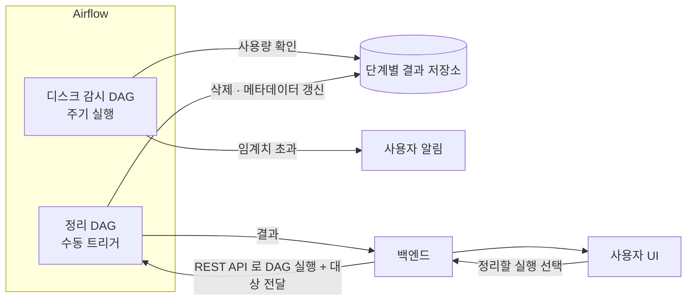




4편에서 단계별 결과를 디스크에 남기기로 하면서 새 문제가 생겼습니다. 수십 단계 × 대용량 × 여러 사용자이니 **디스크가 빠르게 찹니다**. 디스크가 가득 차면 새 워크플로우가 중간에 쓰기 실패로 멈춥니다.

## 왜 자동으로 다 지우지 않았나

결과를 일정 기간 뒤 자동으로 지우면 간단합니다. 하지만 사용자는 *며칠 뒤에도 다시 보고 싶어* 했고, 어떤 결과가 중요한지는 **사용자만 압니다**. 그래서 방향을 이렇게 정했습니다.

- 시스템은 **상황을 알리고**
- 무엇을 지울지는 **사용자가 정하고**
- 실제 삭제는 **안전한 작업(Airflow DAG)** 이 한다

## 구조



## 1. 디스크 감시 DAG

| 단계 | 내용 |
| --- | --- |
| 사용량 확인 | 저장소 전체 사용률과 사용자 · 워크플로우별 사용량 계산 |
| 임계치 판단 | 경고와 위험 두 단계 임계치 (예: 80%, 90%) |
| 알림 | 해당 사용자에게 *"어떤 워크플로우 결과가 얼마나 차지하는지"* 함께 알림 |

알림에 **무엇이 공간을 차지하는지** 를 함께 보여줘서 사용자가 바로 정리 대상을 고를 수 있게 했습니다.

## 2. UI 에서 실행하는 정리 DAG

사용자는 결과 목록에서 지울 실행이나 단계를 고르고 **정리** 버튼을 누릅니다. 백엔드는 Airflow REST API 로 정리 DAG 를 실행하면서 대상을 설정값(`conf`)으로 넘깁니다.

```python
# 개념 예시 — 백엔드에서 정리 DAG 트리거
requests.post(
    f"{AIRFLOW}/api/v1/dags/cleanup_workflow_results/dagRuns",
    json={"conf": {"run_ids": ["run-123"], "requested_by": user_id}},
    auth=airflow_auth,
)
```

정리 DAG 는 지우기 전에 확인부터 합니다.

| 확인 | 이유 |
| --- | --- |
| **실행 중인 작업의 결과인가** | 쓰고 있는 경로를 지우면 실행 중인 Spark 작업이 깨짐. 실행 중이면 건너뜀 |
| 요청자에게 권한이 있는가 | 다른 사용자의 결과를 지우지 못하게 |
| 경로가 결과 저장소 안인가 | 잘못된 경로 삭제 방지 |

삭제 후에는 결과 메타데이터를 *정리됨* 으로 바꿔서 UI 에서 *결과가 없다* 가 아니라 *사용자가 정리했다* 로 보이게 했습니다.

## 왜 백엔드에서 바로 지우지 않고 Airflow 를 썼나

- **기록이 남는다** — 누가 언제 무엇을 지웠는지, 성공했는지 Airflow 실행 이력에 남습니다.
- **재시도와 실패 처리** — 대용량 삭제는 오래 걸리고 중간에 실패할 수 있습니다. Airflow 가 재시도와 상태를 관리합니다.
- **백엔드를 가볍게** — 오래 걸리는 삭제가 API 서버의 요청을 붙잡지 않습니다.
- **감시와 정리를 한곳에서** — 같은 Airflow 에서 감시 DAG 와 정리 DAG 를 함께 운영합니다.

## 정리

| 문제 | 해결 |
| --- | --- |
| 디스크가 차서 새 작업 실패 | 감시 DAG + 단계별 임계치 알림 |
| 무엇을 지울지 시스템은 모름 | 사용자가 UI 에서 선택 |
| 실행 중인 결과 삭제 위험 | 정리 DAG 에서 실행 상태 확인 후 건너뜀 |
| 삭제 이력 · 실패 처리 | Airflow 실행 이력과 재시도 |
