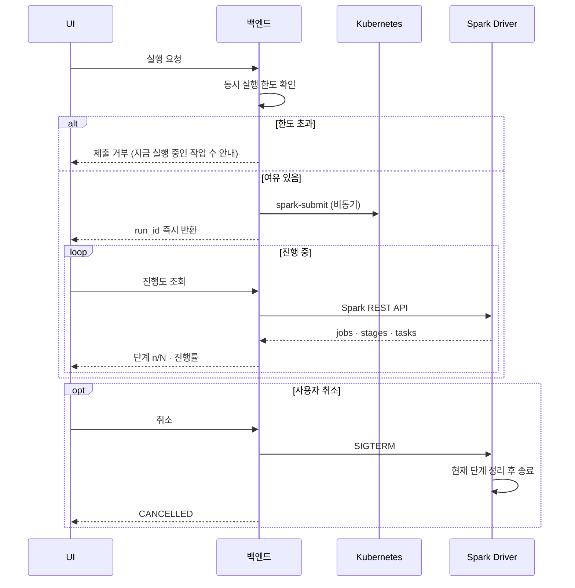




## 문제 — 실행 버튼을 누르면 화면이 멈춘다

처음에는 최종 실행 요청이 **spark-submit 이 끝날 때까지** 응답을 기다렸습니다. 대용량 워크플로우는 오래 걸리니 사용자는 그동안 화면 앞에서 기다려야 했습니다.

함께 생긴 문제도 있었습니다.

| 문제 | 결과 |
| --- | --- |
| 진행 상황을 알 수 없음 | 멈춘 건지 도는 건지 모름 |
| 여러 사용자가 동시에 실행 | 클러스터 자원이 한꺼번에 잡혀 OOM |
| 중간에 멈출 방법이 없음 | 잘못 설정한 작업도 끝까지 자원을 씀 |

## 전체 흐름



## 1. 비동기 제출

- 실행 요청을 받으면 **run_id 를 먼저 만들어 바로 돌려주고**, spark-submit 은 백그라운드에서 진행합니다.
- 실행 상태는 `SUBMITTED → RUNNING → SUCCEEDED / FAILED / CANCELLED` 로 관리합니다.
- 사용자는 화면을 떠났다가 돌아와도 run_id 로 상태를 다시 볼 수 있습니다.

## 2. Spark REST API 로 진행도 읽기

Spark 드라이버는 실행 중에 모니터링 REST API(`/api/v1/applications/...`)를 제공합니다. 백엔드는 이를 주기적으로 읽어 UI 가 이해할 수 있는 형태로 바꿉니다.

| Spark REST API | 백엔드가 만드는 값 |
| --- | --- |
| `/applications/{id}/jobs` | 단계별 Spark job 상태 |
| `/applications/{id}/stages` | 완료된 task 수 / 전체 task 수 → 진행률 |
| 실패한 stage 정보 | 실패한 단계와 오류 요약 |

4편의 **단계별 저장** 덕분에 각 워크플로우 단계가 별도의 Spark job 으로 끝납니다. 그래서 진행도를 단순한 퍼센트가 아니라 **"전체 N단계 중 n번째 단계 실행 중"** 으로 보여줄 수 있었습니다. 단계마다 job 설명에 단계 ID 를 붙여 Spark job 과 워크플로우 단계를 연결했습니다.

```python
# 개념 예시 — Spark job 과 워크플로우 단계 연결
spark.sparkContext.setJobGroup(f"{run_id}:{step.id}", f"step {i}/{total}: {step.type}")
```

## 3. 동시 실행 제한 — OOM 을 막는 block

여러 사용자가 동시에 큰 워크플로우를 실행하면 클러스터 자원이 한꺼번에 잡혀 작업들이 함께 실패했습니다. 그래서 **제출 전에 한도를 확인**합니다.

- 현재 실행 중인 작업 수와 요청하는 자원을 확인합니다.
- 한도를 넘으면 **새 제출을 막고(block)** 사용자에게 *지금 실행 중인 작업이 몇 개인지* 와 함께 안내합니다.
- 함께 실패하는 것보다 **일부를 기다리게 하는 편이 전체 처리량에 낫다** 는 판단이었습니다.

## 4. SIGTERM 으로 안전하게 취소

사용자가 실행 중 **취소** 를 누르면 드라이버에 **SIGTERM** 을 보냅니다. 바로 죽이는 SIGKILL 이 아니라 SIGTERM 을 쓴 이유는 **정리할 시간을 주기 위해서**입니다.

| 정리 작업 | 이유 |
| --- | --- |
| 실행 중인 Spark job 취소, SparkContext 종료 | 익스큐터 Pod 와 클러스터 자원 반납 |
| 쓰다 만 단계 결과 정리 | 반쯤 쓴 Parquet 가 *완료된 결과* 처럼 보이지 않게 |
| 실행 상태를 `CANCELLED` 로 기록 | UI 와 다음 실행이 정확한 상태를 보게 |
| 이미 끝난 단계 결과는 유지 | 4편의 *실패한 단계부터 재실행* 을 취소 후에도 쓸 수 있게 |

Kubernetes 에서 Pod 를 종료하면 컨테이너에 먼저 SIGTERM 이 가고, 유예 시간이 지나야 강제 종료됩니다. 이 유예 시간 안에 위 정리를 마치도록 했습니다.

## 5. Kubernetes 와 고가용성

- 백엔드는 **여러 복제본**으로 띄우고, 실행 상태를 프로세스 메모리가 아니라 저장소에 두어 어느 복제본이 요청을 받아도 같은 상태를 보게 했습니다.
- Pod 가 죽으면 Kubernetes 가 다시 띄웁니다.
- Spark 작업은 실행마다 드라이버와 익스큐터 Pod 를 따로 띄워 **작업 간 자원을 격리**하고, 끝나면 반납합니다.

## 정리

| 문제 | 해결 |
| --- | --- |
| UI 가 실행 완료까지 대기 | 비동기 제출 + run_id |
| 진행 상황을 모름 | Spark REST API → 단계 n/N + 진행률 |
| 동시 실행으로 OOM | 제출 전 한도 확인 후 block |
| 중간에 멈출 수 없음 | SIGTERM → 정리 후 `CANCELLED` |
| 서비스 장애 | Kubernetes 복제본 · 자동 재시작 |
