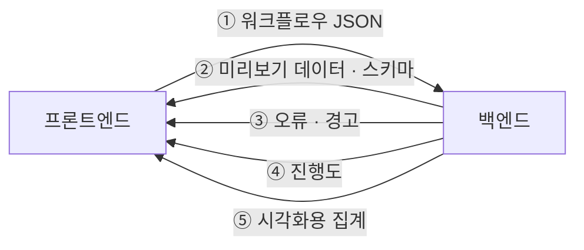




이 도구는 사용자가 **화면에서** 쓰는 제품입니다. 백엔드가 아무리 잘 돌아도 프론트엔드가 데이터를 받아 보여주지 못하면 의미가 없습니다. 프로젝트 내내 프론트엔드 팀과 *무엇을, 어떤 형식으로, 얼마나* 주고받을지 맞췄습니다.

## 무엇을 합의했나



| # | 주제 | 핵심 질문 |
| --- | --- | --- |
| ① | 워크플로우 JSON | 캔버스 상태(노드 위치 등)와 실행에 필요한 정보(노드 타입, 옵션, 연결)를 어떻게 나누나 |
| ② | 미리보기 데이터 | 몇 행을, 어떤 구조로, 타입 정보는 어떻게 |
| ③ | 오류 표현 | 어느 노드의 어떤 옵션이 왜 틀렸는지 화면에 어떻게 연결하나 |
| ④ | 진행도 | 퍼센트만 줄까, 단계 정보까지 줄까 |
| ⑤ | 시각화 | 대용량 결과를 차트로 그리려면 무엇을 넘기나 |

## ① 화면 상태와 실행 정보를 나눈다

캔버스의 노드 좌표, 색, 접힘 상태는 **프론트엔드 소유**, 노드 타입, 옵션, 연결은 **백엔드가 검증하고 실행하는 정보** 로 나눴습니다. 백엔드는 화면 정보를 그대로 저장만 하고 해석하지 않습니다. 덕분에 프론트엔드가 화면을 바꿔도 백엔드를 고칠 필요가 없었습니다.

## ② 미리보기 데이터는 스키마와 함께

```json
{
  "node_id": "n3",
  "schema": [
    {"name": "order_id", "type": "bigint"},
    {"name": "price",    "type": "decimal(12,2)"}
  ],
  "rows": [[1001, "12000.00"], [1002, null]],
  "row_count_sample": 1000,
  "truncated": true
}
```

| 결정 | 이유 |
| --- | --- |
| 스키마를 함께 보냄 | 프론트엔드가 값만 보고 타입을 추측하지 않게. 정렬과 표시 형식을 타입으로 결정 |
| 행은 배열, 컬럼 이름은 스키마에 한 번만 | 응답 크기 감소 |
| 큰 숫자 · decimal 은 문자열 | JavaScript 숫자의 정밀도 한계로 값이 바뀌는 문제 방지 |
| `null` 과 빈 문자열 구분 | 타입 변환 실패(null)를 화면에서 구분해 표시 |
| 행 수 상한 + `truncated` | 대용량 결과를 그대로 넘기지 않음. *일부만 보인다* 를 화면에 명시 |

## ③ 오류는 노드와 옵션에 붙여서

```json
{
  "node_id": "n3",
  "level": "error",
  "code": "CAST_FAILED",
  "field": "params.to",
  "message": "price 컬럼 1,000행 중 37행이 decimal(12,2) 로 변환되지 않았습니다.",
  "examples": ["1,200원", "N/A"]
}
```

`node_id` 와 `field` 를 함께 보내 프론트엔드가 **해당 노드에 배지를, 해당 옵션 칸에 빨간 표시를** 할 수 있게 했습니다. `code` 는 화면 문구를 바꿔도 프론트엔드 로직이 깨지지 않게 하는 안정적인 식별자입니다.

## ④ 진행도는 단계 단위로

6편에서 만든 진행도를 `{"status": "RUNNING", "current_step": 7, "total_steps": 24, "step_progress": 0.42}` 처럼 보냈습니다. 프론트엔드는 캔버스에서 **지금 실행 중인 노드를 강조**하고, 끝난 노드는 결과를 열어볼 수 있게 표시했습니다.

## ⑤ 시각화 — 원본이 아니라 집계를 보낸다

대용량 결과 전체를 브라우저로 보내 차트를 그릴 수는 없습니다. 차트 종류별로 **백엔드가 Spark 로 집계한 결과**만 보내기로 했습니다.

| 차트 | 백엔드가 보내는 것 |
| --- | --- |
| 히스토그램 | 구간 경계와 구간별 건수 |
| 막대 (범주) | 상위 N개 범주와 건수, 나머지는 *기타* 로 묶음 |
| 시계열 | 선택한 시간 단위로 묶은 집계 |
| 컬럼 요약 | null 비율, 고유값 수, 최솟값 · 최댓값 |

*어떤 컬럼 타입에 어떤 차트를 기본으로 보여줄지* 도 함께 정했습니다. 예를 들어 숫자는 히스토그램, 범주형은 막대, 날짜는 시계열입니다.

## 어떻게 협업했나

- **포맷 먼저 합의하고 동시에 개발** — 예시 JSON 을 먼저 정하고, 백엔드가 완성되기 전에는 프론트엔드가 그 예시로 화면을 만들었습니다.
- **바꿀 때는 먼저 알린다** — 필드 추가는 자유롭게, 이름 변경이나 삭제는 미리 공유하고 함께 바꿨습니다.
- **화면을 보면서 이야기한다** — *"이 오류는 어디에 떠야 하나요?"* 같은 질문은 실제 화면을 보며 정하는 게 가장 빨랐습니다.

## 회고

### 잘한 것
- **사용자의 시간을 기준으로 설계했다.** 사전 검증(3편), 비동기 실행(6편), 며칠 뒤 다시 보기(4편)는 모두 *사용자가 기다리고 반복하는 시간* 을 줄이는 결정이었습니다.
- **trade-off 를 숨기지 않았다.** 디스크 저장은 느려진다는 점을 팀장 리뷰에서 그대로 설명하고, 얻는 것(안정성 · 재조회 · 부분 재실행)과 비용(속도 · 디스크)을 표로 비교해 합의했습니다.
- **만든 것의 뒤처리까지 설계했다.** 중간 결과를 남기기로 하면서 Airflow 디스크 관리까지 함께 만들었습니다.

### 아쉬운 것
- **샘플은 전체를 대표하지 못한다.** 샘플에 없는 이상한 값은 최종 실행에서야 드러났습니다. 데이터 특성에 맞춘 샘플링(희귀 값 포함 등)을 더 발전시키고 싶었습니다.
- **동시 실행 제한이 단순했다.** 한도를 넘으면 막는 방식이라 사용자가 다시 눌러야 했습니다. 대기열과 우선순위가 있었다면 더 나았을 것입니다.

### 배운 것
- 2인 개발 팀에서 Spark 작업 코드부터 Kubernetes, Airflow, API 협의까지 넓게 맡으며 **데이터 시스템을 처음부터 끝까지** 보는 경험을 했습니다.
- 이 경험이 이후 호주 1001 Optometry 인턴에서 Databricks 마이그레이션의 수집 파이프라인을 설계하는 바탕이 되었습니다.
