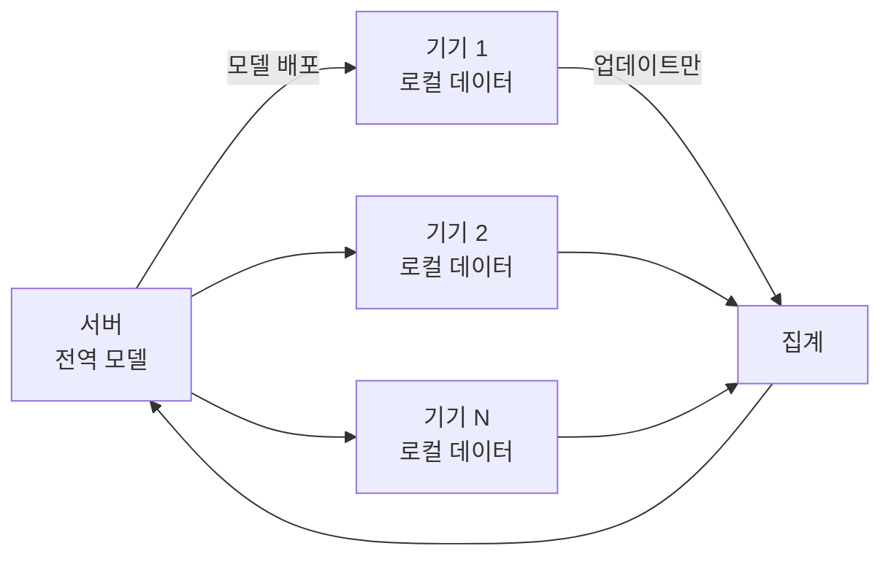




2026년 8월부터 9월까지 6주 동안 Macquarie University 의 **FOSE7901 STEM Research Placement** 로 연합학습 연구를 했습니다. 연구 질문을 세우고, 실험을 설계하고, 코드를 짜고, GPU 실험을 돌리고, 분석하고, 보고서를 쓰는 과정을 혼자 진행했고 매주 지도교수 피드백을 받았습니다. 코드와 로그는 [GitHub](https://github.com/hufs0529/peft_fl_STEM_placement) 에 공개되어 있습니다.

## 연합학습이 필요한 이유

학습 데이터를 한곳에 모을 수 없는 경우가 늘고 있습니다. 병원 기록이나 휴대폰 입력 데이터처럼 기기 밖으로 내보낼 수 없는 데이터가 그렇습니다. **연합학습(Federated Learning)** 은 데이터를 모으는 대신 모델을 각 기기에 보내 학습시키고, 그 결과(업데이트)만 서버에서 합칩니다.

LLM 을 연합학습으로 파인튜닝할 때는 전체 파라미터 대신 **LoRA 어댑터**만 학습하고 주고받는 방식(PEFT)을 많이 씁니다.

## 실제 클라이언트에 걸리는 두 제약

| 제약 | 흔한 대응 | 부작용 |
| --- | --- | --- |
| **메모리가 부족하다** | 동결된 base 모델을 4bit / 8bit 로 양자화해서 올린다 (QLoRA) | 수치 정밀도가 줄어든다 |
| **기기마다 데이터가 다르다** (non-IID) | — | 클라이언트 업데이트가 서로 다른 방향을 향한다 (client drift) |

두 문제의 해법은 각각 잘 알려져 있습니다. 모르는 것은 **둘이 겹칠 때 무슨 일이 일어나는가** 입니다.

## 가설

정밀도를 깎은 모델은 수치적 여유가 적으니, 서로 충돌하는 업데이트를 더 못 버틸 수 있습니다. 그렇다면 양자화의 대가는 데이터가 불균등할수록 커져야 합니다.

> **RQ.** 동결된 base 모델을 양자화할 때 생기는 성능 손실이, 클라이언트 데이터가 비균등해질수록 커지는가?
>
> **H1.** 양자화 오차와 클라이언트 드리프트는 **상호작용** 한다. Dirichlet α 가 작아질수록(비균등할수록) 양자화 페널티가 증가한다.

## 왜 실무적으로 중요한가

| 상호작용이 있다면 | 상호작용이 없다면 |
| --- | --- |
| 압축 수준을 정할 때 **사용자 데이터 분포** 를 알아야 한다. 배포 시점에 그걸 아는 경우는 거의 없다 | 압축 수준은 **하드웨어만 보고** 정하면 된다 |

## 결론부터

**더해지기만 합니다.** NF4 양자화의 성능 대가는 데이터 이질성을 1000배 바꿔도 거의 일정했습니다. 하지만 이 연구에서 더 중요한 부분은, 이 null 결과가 **설계상 상호작용이 나타나기 어려운 조건에서 나왔다** 는 점을 스스로 진단한 것입니다.

## 시리즈 구성

| 편 | 내용 |
| --- | --- |
| 2편 | 24조합 요인 설계, Dirichlet 파티셔닝, 학습 설정, 네 축 지표 |
| 3편 | 구현 판단과 발견하고 고친 문제들 (NaN 손실, 조용한 결과 누락, 환경 혼입) |
| 4편 | 결과 — 주효과, 상호작용 없음, INT8 속도 역전, 통신량, FedProx |
| 5편 | 회고 — null 결과를 설계로 진단하기, 다시 한다면 |
