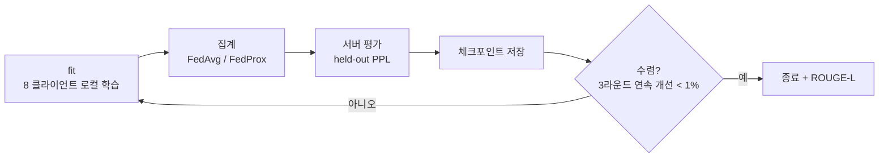




## 코드 구조

```text
src/
  models.py        LoRA / QLoRA(8bit · 4bit) 배선, 단일 get_model(config) 진입점
  data.py          Dolly-15k 로딩, held-out 분리, 토크나이즈(프롬프트 라벨 마스킹)
  partitioning.py  카테고리별 Dirichlet non-IID 분배
  fl_client.py     로컬 학습, FedProx proximal term, VRAM · 지연 계측
  fl_runner.py     라운드 루프 (fit → 집계 → 평가 → 체크포인트 → 수렴 판정)
  evaluate.py      PPL · ROUGE-L 평가, 상호작용 분석 함수
scripts/           run_experiment · analyze_interaction · plot_results
tests/             12개 파일, 66개 테스트
```

## 라운드 루프를 직접 만든 이유



Flower 의 `start_simulation()` 은 **고정 라운드 수**만 돌 수 있어서, 수렴 기준에 따른 조기 종료와 중간 재개가 어려웠습니다. GPU 는 스팟 인스턴스라 언제든 회수될 수 있었으므로,

- 라운드 루프를 직접 구현하고
- **매 라운드 체크포인트**를 저장하고
- 재시작하면 마지막 라운드부터 **자동 재개**하게 했습니다.

## 발견하고 고친 문제들

### ① NaN 손실 — 라벨이 전부 마스킹되던 버그

instruction 튜닝에서는 프롬프트 부분의 라벨을 −100 으로 가려 응답만 학습합니다. 처음에는 *프롬프트 + 응답* 전체를 **뒤에서** 잘랐습니다.

```text
[ 긴 context 프롬프트 ............................ | 응답 ]
                                    max_len 512 ↑ 여기서 잘림 → 응답이 통째로 사라짐
```

context 가 긴 카테고리(closed_qa, summarization)는 응답이 통째로 잘려 **라벨이 전부 −100** 이 됐습니다. 그런 예제가 한 미니배치에 몰리면 loss 분모가 0 이 되어 NaN 이 나고, **FedAvg 집계를 거쳐 전역 모델 전체가 오염**됩니다. 한 클라이언트의 문제가 모두에게 퍼지는 것이 연합학습 버그의 무서운 점입니다.

α=0.1 파일럿에서 재현한 뒤, **프롬프트 앞부분을 자르는** 방식으로 바꿔 응답이 항상 남도록 했습니다.

### ② 완료된 6개 런이 "없음" 으로 보고되던 문제

분석 스크립트는 α 를 정수로 들고 있어 `..._a10` 을 찾았는데, 실행기는 float 로 받아 `..._a10.0` 으로 저장하고 있었습니다. 에러는 하나도 없이 **조용히 12/18 만 완료됐다고** 보고했습니다.

양쪽 `build_run_name()` 을 `float(alpha)` 로 정규화하고, 이름 규칙을 테스트로 고정했습니다. 데이터 파이프라인에서 자주 보던 *조용한 누락* 이 연구 코드에서도 똑같이 일어났습니다.

### ③ 아카이브와 체크섬 매니페스트 불일치

Zenodo 배포본의 `MANIFEST.sha256` 은 로그 48개를 목록화했는데 실제로는 12개만 들어 있었고, 반대로 *재생성 가능하므로 제외한다* 고 문서화한 체크포인트 138MB 가 포함돼 있었습니다. 누락분을 채우고 체크포인트를 빼서 **141.6MB → 9.6MB** 로 정리했습니다.

### ④ 환경 혼입 — 숫자의 변화에서 역추적

α=100 의 6개 런만 **다른 소프트웨어 스택**에서 돌았다는 사실을, INT8 라운드 시간이 **25.5분 → 21.6분** 으로 바뀐 것을 보고 역으로 찾아냈습니다. 이후 시간 비교는 같은 환경에서 돈 18런으로 제한했습니다. (품질 지표는 영향이 없어 24런 전체를 사용했습니다.)

## 테스트 66개

| 영역 | 확인하는 것 |
| --- | --- |
| 데이터 준비 | held-out 분리, 토크나이즈, 응답 라벨이 항상 남는지 |
| 파티셔닝 | α 별 분포, 시드 재현성 |
| 어댑터 배선 | LoRA / QLoRA 8bit · 4bit 모델 구성 |
| 집계 · 라운드 | FedAvg / FedProx, 직렬화 왕복 |
| 체크포인트 · 수렴 | 저장 · 재개, 조기 종료 기준 |
| 분석 함수 | 상호작용 계산, 런 이름 규칙 |

각 실험을 돌리기 전에 전체 테스트 통과를 확인했습니다.

## 재현 가능성

- 주차별 브랜치가 연구 일지 역할을 합니다 (`week1`~`week6`, `week4-results`, `week5`).
- 분석은 JSONL 로그만 읽으므로 **GPU 없이** 모든 표와 그림을 다시 만들 수 있습니다.
- 코드는 Apache-2.0, 실험 로그는 CC BY 4.0 으로 공개했습니다.
