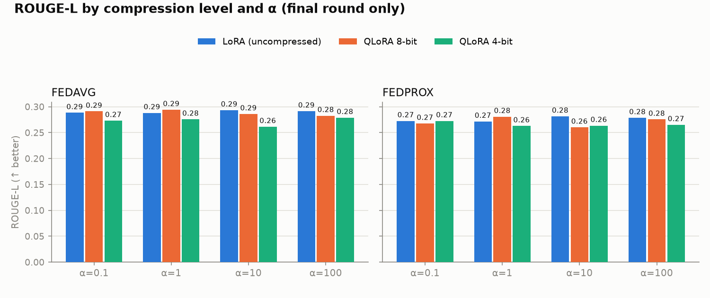
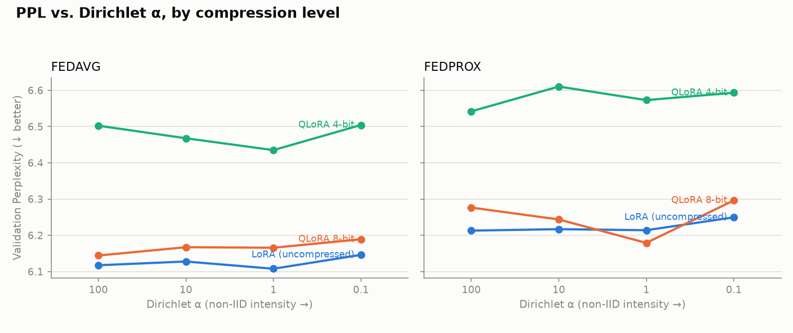
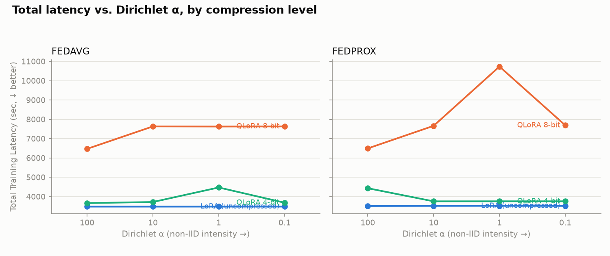
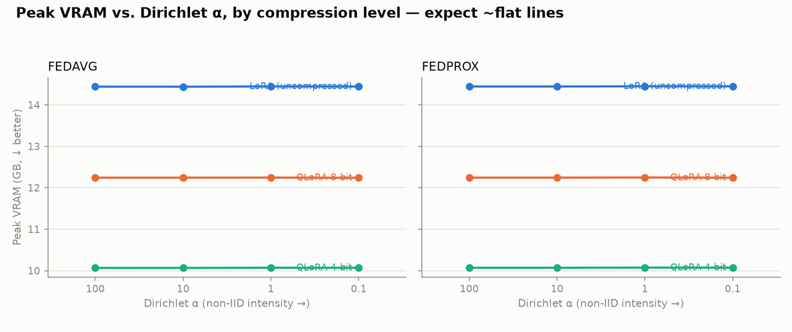
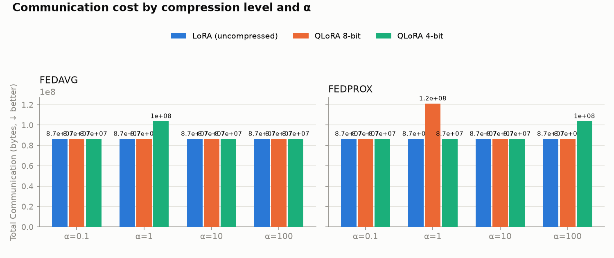
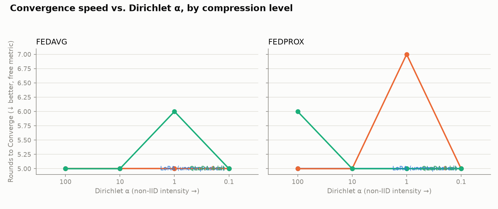




## 1. 압축의 주효과 — 명확하고 단조적

bf16 LoRA 대비, 같은 (FL × α) 8셀을 짝지어 비교한 값입니다.

| | PPL 악화 | ROUGE-L 변화 | 8칸 중 하락 |
| --- | --- | --- | --- |
| INT8 QLoRA | **+0.55%** (−0.56 ~ +1.02) | −0.0034 | 5칸 (3칸은 상승) |
| NF4 QLoRA | **+5.74%** (5.29 ~ 6.33) | −0.0141 | **8칸 전부** |

INT8 은 셀마다 **부호가 바뀝니다**. 실제 효과가 아니라 측정 노이즈라는 뜻입니다. NF4 는 8칸 모두 같은 방향입니다. 측정 원리가 다른 PPL(teacher forcing)과 ROUGE-L(실제 생성)이 독립적으로 같은 결론을 냈습니다.

{: w="1500" h="630" }
_조합별 ROUGE-L — NF4 가 일관되게 낮다_

## 2. 상호작용 — 찾지 못했다 (핵심 결과)

{: w="1500" h="630" }
_α 별 perplexity — 압축 수준별 선이 거의 평행하다_

NF4 의 PPL 악화를 α 별로 늘어놓으면:

| α | 0.1 | 1 | 10 | 100 |
| --- | --- | --- | --- | --- |
| NF4 | 5.66% | 5.57% | 5.94% | 5.79% |
| INT8 | 0.72% | 0.19% | 0.54% | 0.73% |

- **1000배 범위에서 변동폭 0.37%p.**
- 이 크기가 의미 있는지 판단하려면 노이즈 기준이 필요한데, INT8 이 그 역할을 합니다. 성능 손실이 없는 INT8 도 8칸에서 −0.56% ~ +1.02%(폭 1.58)로 흩어집니다. **NF4 페널티는 *효과가 없는* 값보다도 좁게 움직였습니다.**
- 방향도 가설과 반대입니다. 가장 큰 NF4 페널티는 **α=100(가장 균등)** 에서 나왔습니다.

3원 분산분해에서도 같은 결론입니다.

| 요인 | 전체 변동 중 비중 |
| --- | --- |
| 압축 | **89.6%** |
| 압축 × α | **0.2%** (F = 0.15, 잔차보다 작음) |

→ **H1 기각.** 양자화 페널티와 데이터 이질성은 *더해지기만* 합니다.

## 3. 예상 밖의 발견 — INT8 은 품질 손실 없이 2.2배 느리다

{: w="1500" h="630" }
_라운드 시간 — INT8 만 크게 튀어 오른다_

| | VRAM | 라운드당 시간 | PPL 악화 |
| --- | --- | --- | --- |
| bf16 LoRA | 14.44 GB | 11.7분 | 기준 |
| **INT8** | 12.25 GB (−15%) | **25.5분 (2.19배)** | +0.55% |
| NF4 | 10.07 GB (−30%) | 12.4분 (1.07배) | +5.74% |

메모리 1GB 를 아끼는 대가가 두 단계에서 10배 다릅니다.

```text
bf16 → INT8 :  −2.20GB,  PPL +0.25%p/GB,  라운드당 +13.8분
INT8 → NF4  :  −2.18GB,  PPL +2.39%p/GB,  라운드당 −13.1분
```

원인은 bitsandbytes 의 `LLM.int8()` 이 정확도를 지키려고 **매 행렬곱을 outlier 경로와 int8 경로로 쪼개 계산**하기 때문입니다. 이 고정 비용은 행렬 크기와 무관해서 0.5B 처럼 연산이 가벼운 모델에서 비중이 커집니다. 라이브러리 버전이 다른 환경에서는 1.85배로 줄었습니다.

**정확도만 보면 INT8 이 최선의 절충처럼 보이지만, 시간 축을 넣으면 결론이 뒤집힙니다.** 네 축을 모두 기록한 이유가 여기서 드러났습니다.

{: w="1500" h="630" }
_최대 VRAM — 압축 단계마다 약 2.2GB 씩 감소_

## 4. 양자화는 통신량을 줄이지 않는다

{: w="1500" h="630" }
_라운드당 통신량 — 24런 모두 동일_

24런 전부 라운드당 **17,301,504 바이트**로 같았습니다.

```text
LoRA 어댑터 540,672개 × 4바이트(fp32) = 2.16MB   (클라이언트 1대)
2.16MB × 8대                         = 17.3MB   (라운드당)
```

QLoRA 가 양자화하는 것은 **전송하지 않는 동결 base 모델** 이고, 전송되는 어댑터는 fp32 그대로이기 때문입니다. FL 문헌의 *quantisation reduces communication* 은 전송되는 업데이트를 양자화하는 이야기로, 이 실험이 조작한 축과 다릅니다(5편).

## 5. FedProx 는 12셀 전부에서 FedAvg 보다 나빴다

- PPL 평균 **+1.51%** 악화, ROUGE-L 도 12셀 중 11셀에서 하락.
- 수렴 라운드(5.25 vs 5.08), 시간, 메모리에서 얻는 이득도 없었습니다.
- 다만 μ 를 0.01 하나만 시험했기 때문에 *"FedProx 가 열세"* 와 *"μ=0.01 이 이 설정에 맞지 않았다"* 를 구별할 수 없습니다.

{: w="1500" h="630" }
_수렴 라운드 수 — 대부분 5~7 라운드에서 종료_

## 요약

| 질문 | 답 |
| --- | --- |
| 양자화는 성능을 깎는가 | NF4 는 확실히(+5.74%), INT8 은 노이즈 수준 |
| 데이터가 불균등할수록 더 깎는가 | **아니다** (변동폭 0.37%p, 상호작용 0.2%) |
| 그럼 INT8 이 최선인가 | **아니다**. 품질은 같지만 2.19배 느리다 |
| 양자화하면 통신이 줄어드는가 | **아니다**. 전송되는 건 fp32 어댑터 |
