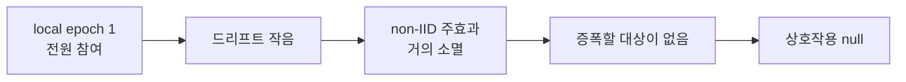




포트폴리오에서 가장 중요한 글이라고 생각합니다. *상호작용이 없었다* 는 결과를 변호하는 대신, **이 실험이 애초에 상호작용을 찾을 수 있는 실험이었는지** 를 따져 봤습니다.

## ① 드리프트를 최소화한 설정에서 드리프트 상호작용을 찾았다

가설의 기전은 *양자화된 모델이 클라이언트 드리프트를 잘 흡수하지 못한다* 입니다. 그런데 드리프트는 **동기화 사이의 로컬 연산량**에 비례해 커집니다.

```text
local_epochs = 1      ← 1에폭 돌고 바로 집계
fraction_fit = 1.0    ← 8대 전원 매 라운드 참여
수렴 5~7 라운드        ← 전체 개선의 71% 가 라운드 1 → 2 에서 끝남
```

로컬 1에폭 + 전원 참여는 FedAvg 를 사실상 **큰 배치 SGD** 에 가깝게 만듭니다. 실제로 non-IID 의 주효과 자체가 **라운드 1 +0.147 PPL 에서 최종 +0.024 로 거의 사라졌습니다**. 거의 사라진 효과를 양자화가 증폭할 여지는 없습니다.



**즉 이 null 은 양자화에 대한 발견이라기보다 설계의 귀결에 가깝습니다.**

## ② 드리프트를 한 번도 측정하지 않았다

라운드별로 남긴 것은 전역 지표(loss, PPL, 시간, 통신량, VRAM)뿐이었습니다. 클라이언트 업데이트 간 **코사인 유사도**, **노름 분산**, **전역 모델로부터의 이탈 거리** 는 하나도 기록하지 않았습니다. 그래서 *"양자화 오차는 모든 클라이언트가 공유하는 편향이고 드리프트는 어댑터에서 생기므로 둘은 독립적이다"* 라는 해석을 **검증할 수단 자체가 없었습니다.**

기전을 가설로 세웠다면 기전을 측정해야 했습니다.

## ③ 연구 질문과 조작한 변수가 어긋났다

| | 문헌에서 상호작용이 보고되는 압축 | 이 실험이 조작한 압축 |
| --- | --- | --- |
| 대상 | **전송되는 업데이트** (양자화 · 희소화) | **동결된 base 모델** |
| 종류 | 통신 압축 | 메모리 압축 |
| 드리프트와의 관계 | 업데이트 자체에 오차가 섞여 집계에 직접 영향 | 모든 클라이언트에 같은 편향 |

측정하려던 개념과 실제로 조작한 변수가 다른 **구성 타당도(construct validity)** 문제입니다. 4편의 *양자화는 통신량을 줄이지 않는다* 는 결과도 같은 뿌리입니다.

## ④ 통계적 근거가 약하다

- 24조합을 **각 1회** 만 돌렸습니다. 분산분해의 오차항은 반복 측정이 아니라 *3원 상호작용을 노이즈로 가정* 해 만든 것입니다.
- 파티션 시드를 42 로 고정해서, 같은 α 의 런들은 **같은 분할을 공유**합니다.

## ⑤ 그 밖의 한계

| 항목 | 문제 |
| --- | --- |
| 라운드 수 | 조건마다 5 / 6 / 7 로 달라 최종값 비교에 학습량 차이가 섞임 |
| FedProx | μ=0.01 하나만 시험 → 알고리즘 열세로 단정 불가 |
| VRAM | GPU 한 장에 모델 9개를 올린 값. 기기 1대 기준으로는 차이가 4~7% 정도로 추정 |
| 통신량 | 업로드만 집계 → 실제 왕복의 절반 |
| 모델 규모 | 0.5B 는 활성값이 메모리를 지배해 양자화 이득이 작게 나옴 |

## 다시 설계한다면

| # | 바꿀 것 | 이유 |
| --- | --- | --- |
| 1 | local epoch 5~10, 참여율 < 1 | **드리프트를 키운다** — 증폭될 대상이 있어야 한다 |
| 2 | 라운드별 클라이언트 업데이트 코사인 유사도 · 노름 분산 로깅 | **드리프트를 측정한다** — 기전을 검증한다 |
| 3 | base 가 아니라 전송되는 어댑터를 양자화 | **문헌과 같은 축** 으로 구성 타당도 확보 |
| 4 | 시드 3회 반복 (파티션 시드 포함) | 가정된 오차항 대신 **실측 오차** |
| 5 | 조기 종료와 별개로 고정 라운드 시점 비교 | 학습량 차이 제거 |
| 6 | μ 스윕 | FedProx 를 공정하게 평가 |

## 이 연구에서 가져가는 것

- **null 결과도 결과다. 단, 왜 null 인지 설명할 수 있어야 한다.** *가설이 틀렸다* 와 *이 설계로는 검출할 수 없었다* 는 다른 결론입니다.
- **지표를 넓게 남기면 예상 밖의 발견이 생긴다.** 시간 축이 없었다면 INT8 을 최선으로 결론 내렸을 것입니다.
- **조용한 버그가 가장 위험하다.** 결과 6개를 에러 없이 빠뜨린 이름 불일치처럼, 파이프라인 신뢰성은 데이터 엔지니어링과 연구에서 같은 문제였습니다. 데이터 엔지니어로 일하며 익힌 *검증하고 기록하는 습관* 이 연구에서도 그대로 쓰였습니다.
- **피드백을 설계에 반영하는 과정 자체가 기록이다.** 세 번의 설계 변경을 브랜치와 커밋 메시지로 남겨 두니, 결과를 해석할 때 *그 결과가 어떤 설계에서 나왔는지* 를 정확히 말할 수 있었습니다.
