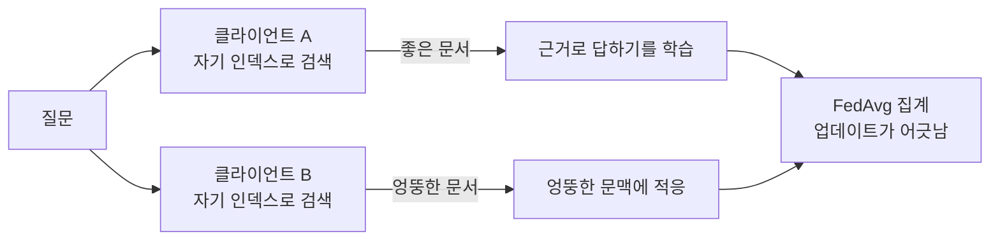




Macquarie University **FOSE7901 STEM Research Placement** 의 두 번째 6주 연구입니다(2026.09 – 2026.10). 첫 연구([FL × QLoRA]({{ '/portfolio/fl-peft-quantization/' | relative_url }}))에 이어 연합학습을 다뤘고, 이번에는 **RAG 와 통신 비용**의 관계를 물었습니다. 코드, 실행 로그, 보고서는 [GitHub](https://github.com/hufs0529/rag_fl_STEM_placement) 과 Zenodo([10.5281/zenodo.23718102](https://doi.org/10.5281/zenodo.23718102))에 공개했습니다.

## 연합학습의 비용은 통신이다

```text
total bytes  =  R  ×  N  ×  |AB|  ×  2
                ↑     ↑      ↑       ↑
             필요 라운드  클라이언트 수  LoRA 어댑터 크기  업로드 + 다운로드
```

지금까지 알려진 방법(PEFT, 양자화, 희소화)은 모두 **|AB|, 라운드당 바이트** 를 줄입니다. 이 연구는 다른 인수, **R 필요 라운드 수** 를 의외의 방향에서 공략합니다. 각 클라이언트의 학습 입력을 만드는 **검색의 품질** 입니다.

## 왜 검색이 라운드 수를 바꿀 수 있나

데이터를 한곳에 모을 수 없는 기관은 파인튜닝한 모델을 그냥 배포하지 않고 **RAG** 로 배포합니다. 학습을 배포와 맞추려면 학습 루프 *안에서* 검색해야 합니다(retrieval-augmented fine-tuning, RAFT). 즉 각 클라이언트는 **자기 코퍼스와 자기 인덱스**로 검색한 문서로 프롬프트를 만들어 학습합니다.



- 검색이 **성공** 하면 모든 클라이언트가 같은 과제(근거 문서로 답하기)를 배웁니다.
- 검색이 **실패** 하면 각 클라이언트는 자기만의 엉뚱한 문맥 패턴에 적응합니다.

non-IID 업데이트가 발산하면 수렴이 느려진다는 것은 알려져 있습니다. 그렇다면 **나쁘고 고르지 않은 검색은 라운드 수를 늘리는 원인** 일 수 있고, 아직 아무도 측정하지 않았습니다.

## 개선이 아니라 거래

검색 품질을 높이는 표준 방법은 **리랭킹** 입니다. 밀집 검색으로 후보를 뽑고 크로스 인코더로 다시 점수를 매깁니다. 하지만 연합 학습 루프 안에서 리랭킹은 **모든 클라이언트가 매 질의마다 내는 반복 비용** 입니다. 그래서 질문은 *좋아지는가* 가 아니라 **거래가 성립하는가** 입니다.

> **RQ.** 연합 LLM 파인튜닝에서 클라이언트 측 검색 연산을 써서 통신을 얼마나 되살 수 있으며, 그 교환비는 얼마인가?

## 가설 — 네 고리로 된 인과 사슬


연구 목표도 이 사슬에서 나왔습니다.

1. 처리 축 **하나(리랭킹 깊이)** 만 바꾸고 통신 예산은 똑같이 고정한다 → 라운드 차이를 처리 탓으로 돌릴 수 있게.
2. 목표 정확도를 **고르지 않고** 절감을 잰다 → 목표 선택이 답을 정하지 않게.
3. 절감을 **측정한 FLOPs** 로 값을 매긴다 → 결론이 방향이 아니라 단위가 있는 양이 되게.
4. 사슬이 실패하면 **어느 고리가 끊어졌는지** 찾는다.

네 번째 목표가 결국 가장 중요해졌습니다.

## 결론부터

| 고리 | 결과 |
| --- | --- |
| ① 더 나은 문서 | ✓ 새 문서 비율 0% → 52.5% |
| ② 일관된 학습 | **✗ 클라이언트 업데이트 발산이 0.77% 만 변화** |
| ③ 더 적은 라운드 | 63개 목표 중 어느 깊이도 5개 넘게 유의한 절감 없음 |
| ④ 더 적은 바이트 | 교환비 10개 중 8개 음수 |

더 좋은 문서는 클라이언트에 도착했지만, 클라이언트는 그것을 쓰지 않았습니다.

## 시리즈 구성

| 편 | 내용 |
| --- | --- |
| 2편 | 실험 설계 — 단일 처리 축, d=3 통제군, 고정 예산, d=0 평가, 파일럿 게이트 3개 |
| 3편 | 파이프라인과 데이터 — 20만 문단 코퍼스, gold 판정 규칙, 설계 약속을 코드로 강제하기 |
| 4편 | 결과 — 처리는 작동, 학습은 무반응, 교환비와 손익분기, 끊어진 고리 |
| 5편 | 통계와 회고 — t=3.182, 해상도 한계, 고친 결함 9개, 다음 실험 |
