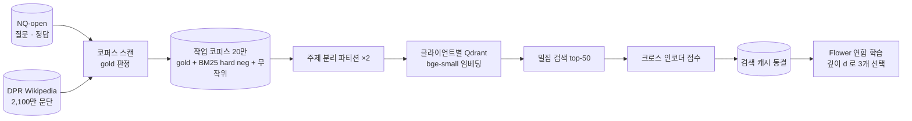




## 주차별 구성

| 브랜치 | 내용 |
| --- | --- |
| `week1` | NQ · `psgs_w100` 스캔, 지표, 프롬프트, **파일럿 게이트 3개** |
| `week2` | 20만 문단 코퍼스와 hard negative, 주제 파티션, Qdrant, **검색 캐시 동결** |
| `week3` | Flower + PEFT 연합 파이프라인, 손실 마스킹, 비용 · recall · 드리프트 로깅 |
| `week4` | 고정 통신 예산으로 본 실험 24회 |
| `week5` | τ sweep 보간, 두 항 비용 모델, 손익분기 평면, 진단 |
| `week6` | 최종 보고서, 발표, 한계, 릴리스 |

각 브랜치는 이전 브랜치 위에 쌓이고, 모든 모듈의 docstring 에 *연구 계획서의 몇 번 세부 과제를 구현하는지* 를 적어 코드와 계획서를 서로 추적할 수 있게 했습니다.

## 데이터 파이프라인

### 다운로드 86 GB → 8 GB

원래 `wiki_dpr` 로더는 `datasets ≥ 3` 에서 동작하지 않아, 같은 ID 와 텍스트를 가진 parquet 미러를 썼습니다. 이 미러에는 임베딩 컬럼이 붙어 있어서 **`id`, `title`, `text` 컬럼만 읽도록** 해 다운로드를 약 86 GB 에서 8 GB 로 줄였습니다.

### gold 판정 — 포함 여부만으로는 98% 가 정답이 된다

어떤 문단이 질문의 정답 근거(gold)인지 판정하는 규칙이 중요했습니다.

| 규칙 | 결과 |
| --- | --- |
| 1단계: 정규화한 정답 문자열이 문단에 포함 | 코퍼스의 **98%** 가 누군가의 gold 로 표시됨. NQ 정답의 69% 가 `"1950"`, `"North"` 같은 한 토큰이기 때문 |
| 2단계: + 질문과 의미 있는 내용어를 2개 이상 공유 | 그런 거짓 양성의 **96.8% 제거** |

각 질문에는 BM25 hard negative 를 최대 5개 붙이되, **정답 문자열이 든 후보는 제외** 했습니다. 방해 문서가 우연히 정답이면 안 되기 때문입니다. 위반하면 `verify_no_answer_bearing_negatives()` 가 0 이 아닌 종료 코드로 파이프라인을 멈춥니다.

처음 게이트 ② 는 300 질문과 포함 규칙만으로 돌렸고, 이후 2,000 질문과 엄격한 규칙으로 다시 돌렸습니다. **대체된 첫 결과 파일도 지우지 않고 남겼습니다.** 방법을 바꾼 것 자체가 기록되어야 하기 때문입니다.

### 검색 캐시 동결

코퍼스, 파티션, 밀집 검색 결과, 크로스 인코더 점수를 **한 번만 계산해 동결** 했습니다.

- 크로스 인코더는 질문마다 *라운드마다* 가 아니라 *한 번* 점수를 매깁니다.
- 깊이는 같은 동결 아티팩트에서 **다른 조각을 고르는 것** 뿐입니다.
- 검색의 무작위성이 실행 간 차이에 섞이지 않아, 24개 실행은 **정확히 한 가지 점에서만** 다릅니다.
- 조건마다 캐시를 따로 두면 서로 어긋날 수 있어 **공통 top-50 풀 하나** 를 모든 깊이가 씁니다.

## 설계 약속을 코드로 강제하기

이 연구에서 가장 신경 쓴 부분입니다. 틀리기 쉬운 설계 약속은 문서로 남기는 대신 **어기면 실패하게** 만들었습니다.

| 설계 약속 | 강제 방법 |
| --- | --- |
| 문서는 정확히 3개, 공통 풀 하나, 깊이만 다르다 | `selection.py` + 테스트 |
| d = 3 은 순서만 바꾸고 새 문서를 올리지 않는다 | `promotion_rate == 0` 을 테스트와 게이트 ② 에서 단언 |
| recall 곡선이 평평하면 *통과* 가 아니라 *실패* | `monotonicity_decision()` — 처리 축이 없으면 실험도 없다 |
| 정답이 든 문단은 hard negative 로 쓰지 않는다 | `verify_no_answer_bearing_negatives()` |
| 라운드는 관례가 아니라 파일럿에서 | 게이트 ③ 산출물이 없으면 `resolve_schedule()` 예외 |
| 조기 종료 없음 | `fl_runner.py` 에 정지 분기 자체가 없다 |
| 평가 문맥은 d = 0 고정 | 리허설에서 모든 깊이의 평가 깊이가 같은지 단언 |
| 24개 실행이 같은 예산을 썼다 | `check_runs.py` 가 사후에 모든 예산 필드 비교 |
| τ 는 훑고, 도달 못 한 조건은 외삽하지 않는다 | `tau_grid()` + 도달 못 하면 `None` 을 돌려주는 `rounds_to_target()` |
| 보고서 숫자 = 분석 결과 | 보고서를 분석 JSON 에서 **생성**, 손으로 옮겨 적지 않음 |

순수 로직 모듈(지표, 문서 선택, 파티셔닝, 비용 모델, 곡선 보간)은 `numpy` 와 `pyyaml` 에만 의존해서 **GPU 없이 테스트** 할 수 있게 했습니다. 전체 테스트는 **333개** 입니다.

## 실행 중에 찾아 고친 결함

| 결함 | 못 찾았다면 | 조치 |
| --- | --- | --- |
| 재시도 시 로거가 이어 쓰기 | 학습 곡선이 라운드 순서를 거꾸로 걸음 | 덮어쓰기 + 로더 중복 제거 |
| sweep 이 동시에 두 번 실행 | 두 프로세스가 같은 로그에 씀 | PID 잠금, 두 번째 실행 거부 확인 |
| `--only-depth` 가 행렬에 없는 값을 받음 | 8개 실행 의도였는데 조용히 4개만 실행 | 가능한 값을 출력하고 종료 |
| 매니페스트에 기본 모델 미기록 | 다른 모델로 다시 돌리면 본 실험 결과를 덮어씀 | 기록 · 검사 · 차단 |
| 배치 분할 미기록 | *같은 예산* 주장을 검증할 수 없음 | 필드 3개 추가 후 비교 |

데이터 엔지니어로 일하며 겪은 *조용한 누락* 과 *동시 실행 충돌* 이 연구 파이프라인에서도 똑같이 나타났고, 같은 방식(잠금, 사후 검증, 실패하는 기본값)으로 막았습니다.
