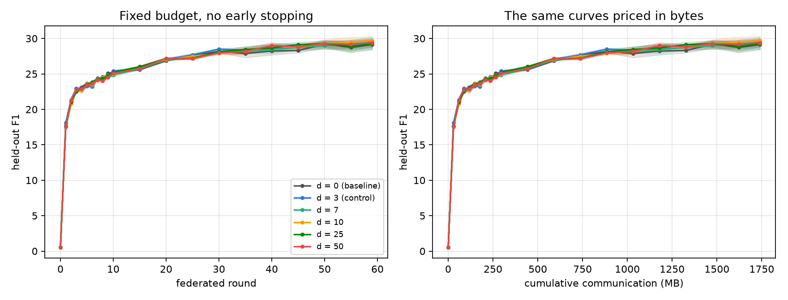
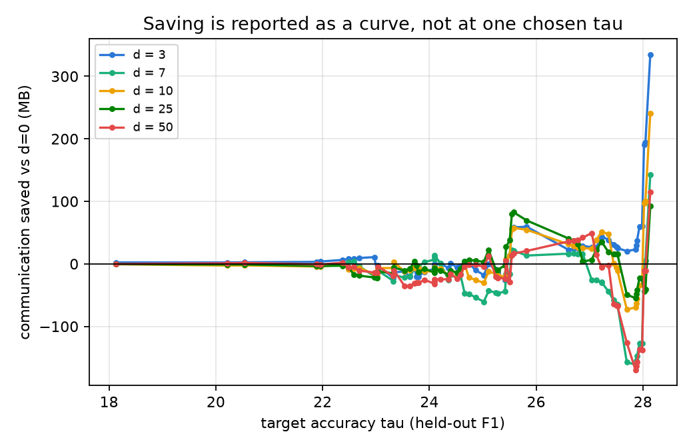
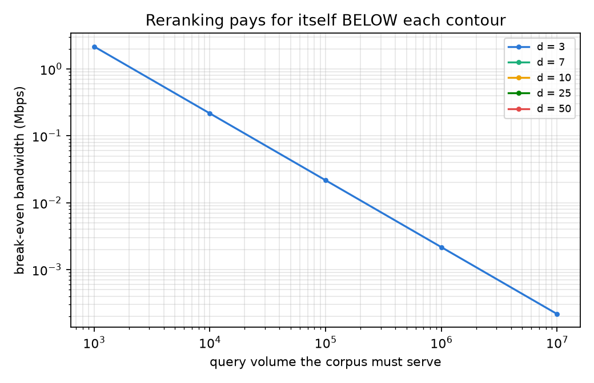
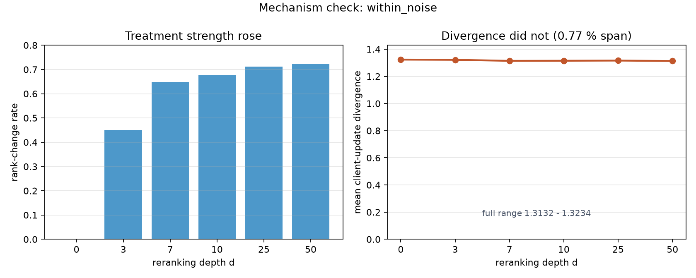




## 고리 ① — 처리는 작동했다

| d | promotion (새 문서) | rank-change (순서 포함) | 차이 (순서만 바뀐 몫) |
| --- | --- | --- | --- |
| 0 | 0.0% | 0.0% | — |
| **3** (통제) | **0.0%** | 45.0% | 45.0%p |
| 7 | 36.2% | 64.8% | 28.6%p |
| 10 | 42.0% | 67.6% | 25.6%p |
| 25 | 49.8% | 71.2% | 21.4%p |
| 50 | **52.5%** | 72.4% | 19.9%p |

- 새 문서 비율은 깊이에 따라 **단조 증가** 했고, d = 0 과 통제군 d = 3 에서는 설계대로 정확히 0 이었습니다. 장치는 작동했습니다.
- 효과는 **포화** 됩니다. d = 10 → 50 으로 다섯 배 늘려도 promotion 은 4분의 1 만 늘었습니다. 크로스 인코더가 올리는 문서는 후보 목록 앞쪽에 몰려 있기 때문입니다. 비용은 깊이에 비례해 늘어납니다.
- 얕은 리랭킹은 대부분 *순서 섞기* 이고, 깊은 리랭킹이어야 *문서 교체* 가 됩니다.

## 고정 예산에서의 최종 정확도

| d | F1 (평균 ± 표준오차) | EM |
| --- | --- | --- |
| 0 | 29.13 ± 0.69 | 22.32 ± 0.63 |
| 3 (통제) | 29.44 ± 0.76 | 22.43 ± 0.64 |
| 7 | 29.20 ± 0.76 | 22.15 ± 0.62 |
| 10 | 29.72 ± 0.55 | 22.70 ± 0.47 |
| 25 | 29.24 ± 0.39 | 22.25 ± 0.35 |
| 50 | 29.41 ± 0.48 | 22.45 ± 0.46 |

여섯 조건이 약 0.5점 안에 모여 있고, 깊이 간 차이가 어느 한 조건의 표준오차보다 작습니다.

{: w="1760" h="672" }
_라운드별(왼쪽) · 누적 통신량별(오른쪽) F1. 예산이 같아 두 그림은 같은 정보를 담는다 — 여섯 곡선이 끝까지 구별되지 않는다_

## 고리 ③ — 63개 목표에서 라운드 절감

| d | 기준보다 빠른 목표 | 그중 판정 기준 통과 | 중앙값 |
| --- | --- | --- | --- |
| **3** (통제) | **41 / 63** | **5 / 63** | **0.15 라운드 빠름** |
| 7 | 19 / 63 | 0 / 63 | 0.56 라운드 느림 |
| 10 | 20 / 63 | 1 / 63 | 0.21 라운드 느림 |
| 25 | 24 / 63 | 1 / 63 | 0.11 라운드 느림 |
| 50 | 15 / 63 | 5 / 63 | 0.37 라운드 느림 |

효과가 전혀 없다면 승률은 약 50%(31/63)입니다. 그걸 넘은 것은 **통제군뿐** 입니다. 실제로 문서를 바꾼 네 조건은 모두 우연보다 낮았고 중앙값이 음수였습니다.

{: w="1040" h="672" }
_63개 목표 정확도별 통신 절감(MB). 0 을 여러 번 가로지르고, 기준 곡선이 평평한 높은 목표에서는 ±150 MB 넘게 흔들린다_

보간에 의존하지 않는 교차 확인도 했습니다. 각 평가 라운드에서(쓴 바이트가 같으므로) 기준과의 점수 차이를 직접 비교했고, 통제군이 20개 라운드 중 8개에서 0 과 분리되어 d = 10 과 같은 수준이었습니다. **두 방법이 같은 결론** 을 냈습니다.

## 고리 ④ — 교환비와 손익분기

절감 바이트 = 63개 목표에서의 중앙값 절감 × 29.49 MB/라운드.

| d | 절감 바이트 | 교환비 (인덱스 보유) | 교환비 (인덱스 새로 구축) |
| --- | --- | --- | --- |
| **3** (통제) | **+4.41 MB** | +2.70 × 10⁻⁹ | +1.62 × 10⁻⁹ |
| 7 | −16.52 MB | −4.34 × 10⁻⁹ | −3.38 × 10⁻⁹ |
| 10 | −6.27 MB | −1.15 × 10⁻⁹ | −9.61 × 10⁻¹⁰ |
| 25 | −3.32 MB | −2.45 × 10⁻¹⁰ | −2.26 × 10⁻¹⁰ |
| 50 | −11.02 MB | −4.05 × 10⁻¹⁰ | −3.90 × 10⁻¹⁰ |

음수 교환비는 *연산도 쓰고 바이트도 더 썼다* 는 뜻입니다. **10개 중 8개가 음수, 양수 2개는 모두 통제군** 입니다. 실제로 문서를 바꾼 모든 조건이 음수입니다.

{: w="1040" h="672" }
_질의량에 따른 손익분기 대역폭. 리랭킹은 이 선보다 느린 링크에서만 본전을 찾는다. 선이 있는 것은 문서를 못 바꾸는 d = 3 하나뿐_

통제군의 손익분기 선은 1,000 질의에서 2.161 Mbps 에 닿습니다. 산술적으로는 *2 Mbps 보다 느린 링크에서 1,000 질의 파일럿이라면 본전* 이지만, 그건 **새 문서를 하나도 가져오지 않는 조건** 입니다.

## 고리 ② — 사슬이 끊어진 곳

| d | 처리 강도 | 클라이언트 업데이트 발산 |
| --- | --- | --- |
| 0 | 0.00 | 1.3234 |
| 3 | 0.45 | 1.3218 |
| 7 | 0.65 | 1.3143 |
| 10 | 0.68 | 1.3151 |
| 25 | 0.71 | 1.3162 |
| 50 | 0.72 | **1.3132** |

처리 강도가 0 → 0.72 로 움직이는 동안 발산은 **0.77%** 만, 그것도 단조롭지 않게 움직였습니다.

{: w="1680" h="672" }
_왼쪽: 실제로 적용된 처리 강도. 오른쪽: 첫 10라운드 평균 발산 — 축을 0 에 고정해 움직임의 크기를 그대로 보인다_

처리 강도와 발산 감소의 상관은 +0.91 로 *지지하는 것처럼* 보이지만 그렇게 읽지 않았습니다.

- 0.77% 움직인 값 사이의 상관입니다. 상관계수는 방향만 말하고 크기는 말하지 않습니다.
- 다음 고리의 부호가 반대입니다. 발산 감소와 라운드 절감의 상관은 **−0.88** 로, 가설은 양수를 요구합니다. 발산이 가장 많이 준 깊이가 오히려 라운드를 가장 많이 더 썼습니다.
- 점이 5개뿐이라 이 정도 계수는 우연히도 나옵니다.

분석이 기록한 판정은 `no_effect` 가 아니라 **`within_noise`** 입니다.

## 해석 — 왜 ② 에서 끊어졌나

가장 그럴듯한 원인은 **용량** 입니다. 135M 모델을 92만 개 LoRA 파라미터로 조정하는 것은 더 좋은 문맥을 활용할 여유가 부족할 수 있습니다. 게이트 ① 은 이 모델이 *추론 때 정답 문맥을 받으면* 쓸 수 있다는 것을 보여 줬습니다. 하지만 *더 좋은 문서로 학습해서 생기는 그래디언트 신호* 는 시드 노이즈에 비해 너무 작아 연합의 수렴 속도를 바꾸지 못했습니다.

> 더 좋은 책은 학생에게 도착했지만, 학생은 책을 펴지 않았다.

이것은 증명이 아니라 해석이고, 다음 실험이 가장 먼저 바꿔야 할 지점입니다(5편).
