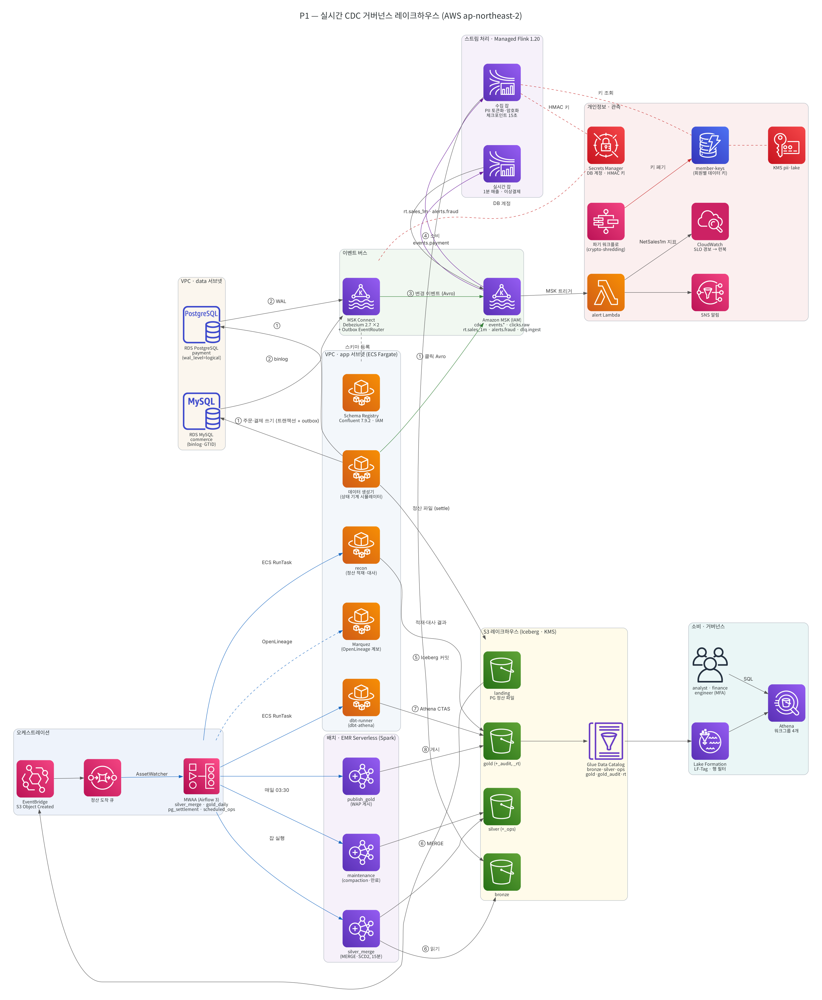
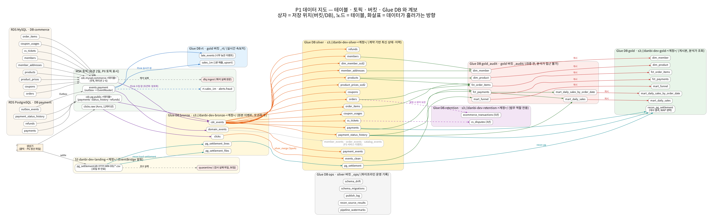



> 운영 DB(MySQL·PostgreSQL)의 모든 변경을 CDC 로 받아, 개인정보는 들어오는 순간 가리고, 중복·순서 역전·늦은 데이터를 정리해 정본을 만든 뒤, **검사를 통과한 숫자만** 분석가에게 공개합니다.
{: .prompt-info }

| 항목 | 내용 |
| --- | --- |
| 역할 | 1인 — 요구사항 정의, 아키텍처, 구현, Terraform, 실제 AWS 배포·장애 대응 |
| 기간 | 2026.10 – 2026.11 |
| 규모 | Terraform 스택 10개(공통 3 + P1 7) · Silver 데이터 계약 16개 · Kafka 토픽 23개 · Airflow DAG 7개 · dbt 마트 7개 · 런북 17개 · 장애 훈련 10종 |
| 리전 | AWS 서울(ap-northeast-2) |
| 저장소 | [github.com/hufs0529/danbi-data-platform](https://github.com/hufs0529/danbi-data-platform) |



## 1. 풀려는 문제

가상의 커머스·간편결제 회사 **단비마켓(단비페이)** 에서 *"어제 매출이 얼마인가"* 에 믿을 수 있는 답을 내는 것이 목표입니다. 어려운 이유는 데이터가 흘러오는 과정에 있습니다.

- **운영 DB 를 직접 조회할 수 없다** — 분석 쿼리가 주문 서비스를 느리게 만든다.
- **하루 한 번 덤프는 중간 상태를 잃는다** — 결제 후 취소된 주문은 마지막 상태만 남는다.
- **흘러오는 데이터는 지저분하다** — 중복, 순서 역전, 몇 분~몇 시간 늦은 도착, 예고 없는 컬럼 추가.
- **숫자가 한 번 틀리면 아무도 안 쓴다** — 재무팀 숫자와 대시보드가 다르면 대시보드는 끝이다.
- **개인정보는 법 문제다** — 분석 환경에 원문이 들어가면 안 되고, 탈퇴하면 레이크의 사본까지 지워야 한다.

테스트할 실제 쇼핑몰이 없어서, 시드로 재현 가능한 **데이터 생성기**를 만들고 늦은 도착·중복·순서 역전·하드 삭제·스키마 변경·금액 누락·부정 결제를 일부러 섞었습니다.

## 2. 아키텍처

{: w="1482" h="1802" }
_AWS 서비스 배치 — 번호 ①~⑧ 이 데이터가 흐르는 순서_

{: w="2790" h="875" }
_테이블·토픽·버킷·Glue DB 와 계보 — 상자 = 저장 위치, 화살표 = 데이터 흐름_

## 3. 어떤 코드가 어떤 AWS 서비스에서 도는가

| 단계 | 코드 | AWS 서비스 | 결과물 |
| --- | --- | --- | --- |
| 원천 | `p1/sources/sql`, `migrate.py` | RDS MySQL 8 · PostgreSQL (데이터 서브넷) | 주문 9개·결제 4개 테이블 + Outbox |
| 생성기 | `p1/generator` | ECS Fargate (Spot) | 주문·결제 트랜잭션, 클릭(Avro → Kafka), PG 정산 파일(S3) |
| CDC | `p1/cdc/connectors/*.tftpl` | MSK Connect (Debezium 2.7) | `cdc.*` 테이블 토픽, `events.payment` |
| 이벤트 버스 | `p1/streaming/topics.yaml` | Amazon MSK (Kafka 3.9, IAM 인증) | 토픽 23개 |
| 스키마 | `p1/streaming/schema_registry` | ECS (Confluent Schema Registry 7.9) | Avro 스키마 버전·호환성 |
| 수집 | `p1/streaming/ingest` | Managed Service for Apache Flink 1.20 (PyFlink) | Bronze Iceberg 3개 + DLQ |
| 실시간 | `p1/streaming/realtime` | Managed Flink + Lambda + SNS | 1분 매출, 이상결제 알림 |
| 저장·카탈로그 | `p1/lakehouse/ddl`, `contracts/` | S3 + Iceberg + Glue Data Catalog | bronze·silver·ops·gold·gold_audit·rt |
| 정제 | `p1/batch/jobs/silver_merge.py` | EMR Serverless (Spark, ARM64) | Silver 16개(MERGE·SCD2·append) |
| 변환 | `p1/dbt` | ECS RunTask (dbt-athena) → Athena | `gold_audit` 마트 7개 + 테스트 |
| 게시 | `p1/batch/jobs/publish_gold.py` | EMR Serverless | `gold` (원자적 교체) + `ops.publish_log` |
| 대사 | `p1/recon` | ECS RunTask + S3 → EventBridge → SQS | 정산 적재, `gold.recon_pg_settlement` |
| 오케스트레이션 | `p1/orchestration/dags` | MWAA (Airflow 3) | DAG 7개 |
| 거버넌스 | `p1/governance`, `p1/privacy` | Lake Formation · Step Functions · Lambda | LF-Tag 권한, 행 필터, 파기 워크플로 |
| 관측 | `p1/observability` | Lambda + CloudWatch | SLO 5개, 증상 알림 6개 |
| 인프라 | `infra/` | Terraform · GitHub Actions(OIDC) | 스택 10개 |

## 4. 핵심 설계 결정

### ① CDC + Outbox — 변경은 빠짐없이, 이벤트는 DB 와 같은 트랜잭션으로
결제 상태가 바뀔 때 `payments`, `payment_status_history`, `outbox_events` 를 **한 트랜잭션**으로 씁니다. Debezium 의 Outbox EventRouter 가 이를 `events.payment` 로 내보내고 키를 결제 ID 로 두어, 같은 결제의 이벤트는 같은 파티션에서 순서대로 흐릅니다. *DB 에는 반영됐는데 이벤트는 유실* 되는 경우가 구조적으로 생기지 않습니다. → [CDC 편]()

### ② 개인정보는 들어오는 순간 가린다
Silver 에서 가리면 Bronze·로그에 원문이 남습니다. 그래서 Flink 수집 단계에서 데이터 계약에 적힌 대로 토큰화(HMAC)·회원별 키 암호화(AES-GCM)·일반화·마스킹을 적용합니다. 탈퇴 시에는 사본을 찾아 지우는 대신 **회원 키를 폐기(crypto-shredding)** 합니다. → [Flink 수집 편]()

### ③ 도착 순서가 아니라 원천 순서로 MERGE
binlog 위치·LSN 을 정렬 가능한 문자열(`change_seq`)로 만들어 `WHEN MATCHED AND s._src_seq > t._src_seq` 로 비교합니다. 늦게 온 옛 변경은 최신 값을 덮지 못하고, 같은 메시지가 두 번 와도 두 번째는 무시됩니다. 그래서 대부분의 복구가 *같은 구간을 다시 돌리기* 로 끝납니다. → [Silver MERGE 편]()

### ④ 검사하고 나서 공개 — Write-Audit-Publish
dbt 는 공개 영역이 아닌 `gold_audit` 에 쓰고, 테스트를 모두 통과하면 Spark `publish_gold` 가 **한 번의 Iceberg 커밋**으로 `gold` 를 교체합니다. dbt 역할은 `gold` 에 쓸 수 없고 분석가는 `gold_audit` 를 볼 수 없어, 검사 안 된 숫자가 새어 나갈 길이 권한 수준에서 막혀 있습니다. → [Gold 편]()

### ⑤ 바깥 장부와 맞춰 본다 — 3단계 대사
원천 DB ↔ Silver(매시), Silver ↔ Gold(게시 전 테스트), 내부 결제 ↔ PG 정산 파일(매일). 어긋난 건은 `TIMING_NEXT_DAY`, `PG_MISSING`, `UNKNOWN_TXN` 같은 원인 코드로 분류하고 *설명되지 않는 차이 0건* 을 SLO 로 둡니다. → [대사·오케스트레이션 편]()

### ⑥ 데이터 계약이 단일 원본
`contracts/p1/silver/*.yaml` 하나가 Silver DDL, Flink 개인정보 정책, Silver 컬럼 매핑, Lake Formation 컬럼 태그를 모두 만듭니다. 운영 DB 에 새 컬럼이 생기면 CI 가 *"계약에도, 일부러 뺀 목록에도 없다"* 로 실패합니다.

## 5. 주요 기능

| 기능 | 설명 | 상세 |
| --- | --- | --- |
| 업무 흐름 생성기 | 가입 → 주문 → 승인 → 매입 → 부분취소 상태 기계, 결함 주입, CP949 정산 파일 | [2편]() |
| 로그 기반 CDC | binlog(ROW·GTID)·WAL(pgoutput), 락 없는 스냅샷, 오프셋 고정 | [3편]() |
| 토픽·스키마 as code | 토픽 plan/apply, 호환성 검사 통과 시에만 스키마 등록 | [4편]() |
| 수집 시점 개인정보 처리 | 토큰화·암호화·일반화·마스킹, 해석 실패는 DLQ | [5편]() |
| Iceberg Bronze | 불변 변경 로그, 수집일 파티션, 테이블 연산으로만 보존 관리 | [6편]() |
| Silver 증분 MERGE·SCD2 | 워터마크 + 10분 겹침, 원천 순서 가드, 스키마 드리프트 자동 반영 | [7편]() |
| Gold WAP | dbt-athena → gold_audit → 테스트 → publish_gold, 롤백 | [8편]() |
| 대사·오케스트레이션 | 정산 파일 판정·원인 코드, MWAA DAG 7개, SQS 이벤트 트리거 | [9편]() |
| 실시간·관측 | 1분 매출 속보치, 도용 카드 탐지, SLO·런북 | [10편]() |
| 거버넌스·파기 | LF-Tag 컬럼 권한, 동의 행 필터, 72시간 파기 워크플로, 접속기록 해시 체인 | [11편]() |
| 실제 배포 트러블슈팅 | 관리형 서비스의 숨은 제약 16가지와 해결 | [12편]() |

## 6. 저장소 구조

```text
infra/
  bootstrap/        # tfstate 버킷, GitHub OIDC 배포 역할, 예산 알림
  modules/          # network, secure_bucket, ecs_service, ssm_outputs ...
  stacks/           # 10-network → 20-security → 30-platform → p1-10 … p1-70 (이름 순서 = 적용 순서)
libs/danbi_common/  # PII 토큰화·암호화·일반화, Kafka(MSK IAM), Athena, DB 연결
p1/                 # sources · generator · cdc · streaming · lakehouse · batch · dbt · recon
                    # orchestration · governance · privacy · observability · drills
contracts/          # 데이터 계약(YAML)과 검사기
docs/               # 태스크 문서, 런북 17개, 포스트모템, 다이어그램
```

## 7. 배운 점

- **문서가 맞는지는 실제로 띄워 봐야 안다.** 관리형 서비스마다 숨은 제약(인스턴스 종류, 문자 집합, 클래스로더, Python 버전, 권한 모델)이 있고, 대부분 첫 배포에서만 드러났습니다.
- **원인을 확정하기 전에 고치면 시간이 더 든다.** Flink 클래스로딩 문제에서 relocation 을 한 번 잘못 넣었다가 오류 메시지만 바뀌었습니다. 이후에는 로그의 진짜 원인 줄을 먼저 뽑고, 로컬에서 재현한 뒤 고쳤습니다.
- **멱등성은 운영을 단순하게 만든다.** 원천 순서 비교 MERGE 와 덮어쓰기 적재 덕분에 대부분의 복구가 *다시 돌리기* 로 끝납니다.
- **권한은 경계를 만든다.** WAP 를 "절차"가 아니라 "dbt 는 gold 에 쓸 수 없다"는 권한으로 강제하니 실수로 우회할 방법이 없어졌습니다.
