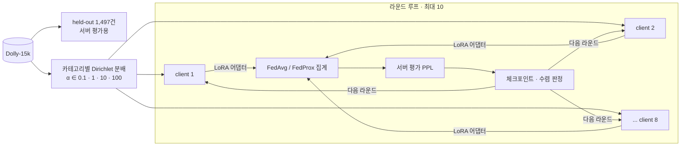
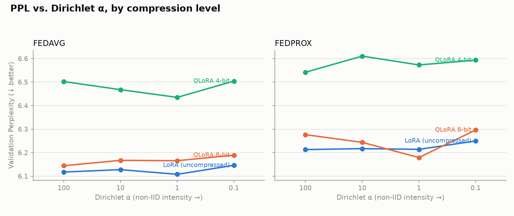



> 클라이언트 메모리가 부족해 모델을 **양자화**해야 하고, 동시에 기기마다 **데이터 분포가 다른** 상황. 이 두 악조건이 **곱해지는지(상호작용)**, 아니면 **더해지기만 하는지**를 24개 실험으로 측정했습니다.
> **결론: 더해지기만 합니다.** 다만 이 null 결과가 왜 *설계의 귀결* 에 가까웠는지까지 진단한 것이 이 연구의 핵심입니다.
{: .prompt-info }

| 항목 | 내용 |
| --- | --- |
| 과정 | FOSE7901 STEM Research Placement, Macquarie University |
| 기간 | 2026.08 – 2026.09 (6주) |
| 역할 | 1인 연구 — 연구 질문, 실험 설계, 구현, GPU 실험, 분석, 보고서 (지도교수 피드백 반영) |
| 규모 | 24개 학습 실행 · 33.7 GPU-시간 (NVIDIA A10G) · 테스트 66개 |
| 모델 / 데이터 | Qwen2.5-0.5B-Instruct · databricks-dolly-15k (15,011건) |
| 스택 | PyTorch · Flower · PEFT(LoRA · QLoRA) · bitsandbytes · Transformers |
| 저장소 | [github.com/hufs0529/peft_fl_STEM_placement](https://github.com/hufs0529/peft_fl_STEM_placement) (코드 Apache-2.0 · 로그 CC BY 4.0) |



## 1. 문제

데이터를 한곳에 모을 수 없는 상황(병원 기록, 휴대폰 입력 데이터)에서는 **연합학습(FL)** 으로 모델을 각 기기에 보내 학습시키고 결과만 합칩니다. 실제 클라이언트에는 두 제약이 동시에 걸립니다.

| 제약 | 대응 | 부작용 |
| --- | --- | --- |
| 메모리 부족 | base 모델 양자화 (QLoRA) | 수치 정밀도 손실 |
| 기기마다 데이터가 다름 (non-IID) | — | 클라이언트 업데이트가 서로 어긋남 (client drift) |

각각은 잘 알려져 있지만 **둘이 겹칠 때** 는 잘 모릅니다. 정밀도를 깎은 모델은 충돌하는 업데이트를 더 못 버틸 수 있습니다. 만약 그렇다면 압축 수준을 정할 때 *사용자 데이터 분포* 를 알아야 하고, 아니라면 **하드웨어만 보고** 정하면 됩니다.

> **RQ.** 동결된 base 모델을 양자화할 때 생기는 성능 손실이, 클라이언트 데이터가 비균등해질수록 커지는가?
>
> **H1.** 양자화 오차와 클라이언트 드리프트는 상호작용한다. Dirichlet α 가 작아질수록 양자화 페널티가 커진다.

## 2. 실험 설계

| 요인 | 수준 | 이유 |
| --- | --- | --- |
| **압축** | bf16 LoRA / INT8 QLoRA / NF4 4bit QLoRA | 양자화 강도 3단계 |
| **FL 알고리즘** | FedAvg / FedProx (μ=0.01) | 드리프트 교정 유무 |
| **데이터 이질성** | Dirichlet α = 0.1 / 1 / 10 / 100 | 1000배 범위, α=100 은 near-IID 끝점 |

일부만 돌리지 않고 **3 × 2 × 4 = 24조합 전수 설계**를 택했습니다. 상호작용을 보려면 격자 전체가 필요하기 때문입니다. 예산 안에 넣기 위해 모델을 3B → 1.5B → 0.5B 로 두 번 줄였습니다. 성능 · 속도 · 메모리 · 통신 **네 축**을 모두 기록했고, 이 선택이 가장 유용한 발견(INT8 속도 역전)을 만들었습니다. → [2편]()

## 3. 결과 요약

{: w="1500" h="630" }
_α 별 최종 perplexity — 압축 수준별 선이 평행하게 움직인다 (상호작용 없음)_

| 발견 | 수치 |
| --- | --- |
| **압축의 주효과는 명확** | NF4 PPL **+5.74%** (8칸 전부 악화), INT8 +0.55% (셀마다 부호가 바뀌는 노이즈 수준) |
| **상호작용은 없음 (핵심)** | NF4 페널티가 α 1000배 범위에서 **변동폭 0.37%p**. 분산분해에서 압축 89.6%, 압축 × α **0.2% (F=0.15, 잔차보다 작음)**. 가장 큰 페널티는 오히려 α=100(가장 균등)에서 |
| **INT8 은 품질 손실 없이 2.19배 느림** | VRAM −15%, 라운드당 11.7분 → 25.5분. `LLM.int8()` 이 매 행렬곱을 outlier · int8 경로로 쪼개는 고정 비용 |
| **양자화는 통신량을 줄이지 않음** | 24런 전부 라운드당 17,301,504 바이트. 양자화되는 건 *전송하지 않는* base 모델이고 어댑터는 fp32 |
| **FedProx 는 12셀 전부에서 FedAvg 보다 나쁨** | PPL 평균 +1.51%. 단 μ 하나만 시험해 알고리즘 열세로 단정 불가 |

→ [4편]()

## 4. 구현에서 내린 판단

- **Flower `start_simulation()` 대신 라운드 루프 직접 구현** — 고정 라운드만 돌 수 있어 수렴 기준 조기 종료와 체크포인트 재개가 어려웠습니다. 스팟 인스턴스가 회수돼도 이어서 돌아야 했습니다.
- **프롬프트를 앞에서 자르는 토크나이즈** — 뒤에서 자르면 긴 context 예제의 응답이 통째로 사라져 라벨이 전부 −100 이 되고, 실제로 **NaN 손실**이 났습니다.
- **서버 평가** — 지도교수 피드백으로 클라이언트 경유 평가를 서버 직접 평가로 바꿔, *서버가 평가한다* 는 구조를 코드에 드러냈습니다.
- **주차별 브랜치(`week1`~`week6`)** 로 어느 결과가 어느 코드에서 나왔는지 추적 가능하게 했습니다.

→ [3편]()

## 5. 발견하고 고친 문제

| 문제 | 증상 | 해결 |
| --- | --- | --- |
| 라벨 전부 마스킹 | 긴 context 예제가 한 배치에 몰리면 NaN → FedAvg 로 전역 모델 오염 | 프롬프트 앞부분을 자르도록 변경 |
| 조용한 결과 누락 | α 를 정수(`_a10`)와 float(`_a10.0`)로 다르게 이름 지어 완료된 6런이 *없음* 으로 보고 | 양쪽 `build_run_name()` 을 `float(alpha)` 로 정규화 |
| 아카이브 불일치 | 체크섬 목록은 로그 48개, 실제 12개 · 제외한다던 체크포인트 138MB 포함 | 누락분 보충, 체크포인트 제거 (141.6MB → 9.6MB) |
| 환경 혼입 | α=100 6런만 다른 소프트웨어 스택에서 실행됨 | INT8 라운드 시간 변화(25.5 → 21.6분)로 역추적, 시간 비교는 같은 환경 18런으로 제한 |

## 6. 회고 — null 결과를 설계로 진단하기

결과를 변호하기보다 **설계를 진단**했습니다.

1. **드리프트를 최소화한 설정에서 드리프트 상호작용을 찾았다** — local epoch 1 + 전원 참여는 FedAvg 를 큰 배치 SGD 에 가깝게 만듭니다. 실제로 non-IID 의 주효과도 라운드 1 +0.147 PPL 에서 최종 +0.024 로 거의 사라졌습니다.
2. **드리프트를 측정하지 않았다** — 클라이언트 업데이트 간 코사인 유사도나 노름 분산을 기록하지 않아 해석을 검증할 수단이 없었습니다.
3. **연구 질문과 조작 변수가 어긋났다** — 문헌의 *compression × non-IID* 는 **통신 압축**인데, 이 실험은 **메모리 압축**(base 양자화)을 조작했습니다.
4. **통계적 근거가 약하다** — 조합당 1회 실행, 파티션 시드 고정.

다시 한다면 드리프트를 키우고(local epoch 5~10, 부분 참여), 드리프트를 측정하고, 전송되는 어댑터를 양자화하고, 시드를 3회 반복하겠습니다. → [5편]()

## 7. 배운 점

- **null 결과도 결과다. 단, 왜 null 인지 설명할 수 있어야 한다.** 가설 기각과 *설계상 검출 불가* 는 다른 이야기입니다.
- **지표를 넓게 남기면 예상 밖의 발견이 생긴다.** 정확도만 봤다면 INT8 이 최선이었겠지만, 시간 축을 넣으니 결론이 뒤집혔습니다.
- **조용한 버그가 가장 위험하다.** 에러 없이 결과 6개를 빠뜨린 파일 이름 불일치처럼, 파이프라인 신뢰성은 데이터 엔지니어링과 연구 모두에서 같은 문제였습니다.
- **재현 가능성은 설계 단계부터.** 주차별 브랜치, JSONL 로그, 체크섬 매니페스트로 GPU 없이도 모든 표와 그림을 다시 만들 수 있게 했습니다.
