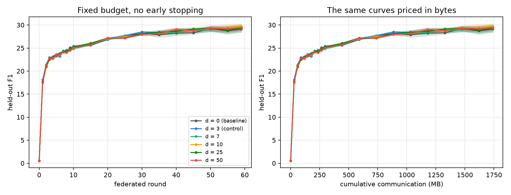



> 연합학습의 주된 비용은 통신입니다. 기존 방법(PEFT · 양자화 · 희소화)은 **라운드당 바이트**를 줄입니다. 이 연구는 다른 인수인 **필요 라운드 수**를, 각 클라이언트가 학습에 쓰는 **검색 품질**로 줄일 수 있는지 물었습니다. 로컬 연산(리랭킹)을 쓰고 통신을 되사는 *거래* 가 성립하는지, 성립한다면 **교환비** 가 얼마인지 측정했습니다.
{: .prompt-info }

| 항목 | 내용 |
| --- | --- |
| 과정 | FOSE7901 STEM Research Placement, Macquarie University |
| 기간 | 2026.09 – 2026.10 (6주) |
| 역할 | 1인 연구 — 연구 질문, 실험 설계, 파이프라인 구현, GPU 실험, 통계 분석, 보고서 (멘토 피드백 반영) |
| 규모 | 24개 연합 학습 실행 (깊이 6 × 시드 4) · 실행당 통신 1.74 GB · 테스트 333개 |
| 모델 / 데이터 | SmolLM2-135M-Instruct + LoRA · Natural Questions (open) · DPR Wikipedia 20만 문단 |
| 스택 | Flower · PyTorch · PEFT · Qdrant · bge-small-en-v1.5 · ms-marco-MiniLM 크로스 인코더 |
| 저장소 | [github.com/hufs0529/rag_fl_STEM_placement](https://github.com/hufs0529/rag_fl_STEM_placement) · Zenodo DOI [10.5281/zenodo.23718102](https://doi.org/10.5281/zenodo.23718102) |



## 1. 질문

```text
total bytes  =  R  ×  N  ×  |AB|  ×  2
               라운드  클라이언트  LoRA 어댑터  업로드 + 다운로드
```

데이터를 모을 수 없는 기관은 파인튜닝한 모델을 그냥 쓰지 않고 **RAG** 로 배포합니다. 그래서 학습도 배포와 맞추려면 각 클라이언트가 **자기 코퍼스에서 검색한 문서로 프롬프트를 만들어** 학습해야 합니다(RAFT). 여기서 아무도 측정하지 않은 연결이 생깁니다.

- 검색이 **성공** 하면 모든 클라이언트가 같은 과제(근거 문서로 답하기)를 배운다.
- 검색이 **실패** 하면 각 클라이언트는 자기만의 엉뚱한 문맥에 적응한다 → 업데이트가 어긋나고 수렴이 느려진다.

> **RQ.** 연합 LLM 파인튜닝에서 클라이언트 측 검색 연산을 써서 통신을 얼마나 되살 수 있으며, 그 교환비는 얼마인가?

가설은 네 고리로 된 인과 사슬입니다.


## 2. 실험 설계

| 설계 결정 | 내용 | 이유 |
| --- | --- | --- |
| **처리 축 하나** | 리랭킹 깊이 d ∈ {0, 3, 7, 10, 25, 50}: 상위 d 후보를 크로스 인코더로 다시 매겨 상위 3개 선택 | 깊이는 질의마다 반복되는 비용이라 라운드당 통신과 같은 단위로 비교 가능 |
| **문서는 언제나 3개** | 모든 조건이 같은 top-50 후보 풀에서 3개를 고름 | 조건 간 차이를 *선택에 쓴 연산* 하나로 제한 |
| **d = 3 통제군** | 3개 중 3개를 고르므로 문서는 못 바꾸고 순서만 바뀜 | 순수 순서 효과와 진짜 검색 품질 효과를 분리 |
| **통신 예산 고정** | 모든 실행 1.74 GB(59 라운드), 조기 종료 없음 | LoRA 는 몇 라운드면 수렴해서 *수렴 시 정지* 로는 차이를 못 잼. 학습 곡선을 보간해 목표 도달 라운드를 계산 |
| **평가는 모두 d = 0 문서로** | 어떤 깊이로 학습했든 같은 문서로 채점 | *더 잘 배운 효과* 만 측정하고, 추론 시 더 좋은 문맥이 주는 점수는 섞지 않음 |
| **고정 파티션** | 같은 크기 · 주제 분리 파티션 2개를 시드에 번갈아 배정 (Dirichlet 아님) | Dirichlet 은 주제 편중과 데이터 크기 불균형을 함께 바꾸고 시드마다 다시 뽑혀 분산을 더함 |
| **고정 아티팩트** | 코퍼스, 파티션, 밀집 검색 결과, 크로스 인코더 점수를 한 번 계산해 동결 | 실행 간 차이를 깊이 하나로 한정 |

### 파일럿 게이트 3개 — null 결과를 해석 가능하게

| 게이트 | 통과 조건 | 결과 |
| --- | --- | --- |
| ① 성능 여유 | 정답 문맥 F1 − 무작위 문맥 F1 ≥ 5 | 19.57 − 1.17 = **18.40** → 통과 |
| ② 처리 단조성 | 깊이에 따라 gold recall@3 이 단조 증가 | 0.467 → 0.5095, 처리 가능한 질문 비율 0.20–0.31 → 통과 |
| ③ 로컬 스텝 보정 | 드리프트가 측정되는 가장 작은 K | 전체 규모에서 재도출해 **K = 32, R = 59** → 통과 |

게이트 ③ 이 있는 이유는 *드리프트를 줄여서 작동하는 처리는 드리프트가 없는 곳에서는 관찰할 수 없기* 때문입니다. 첫 연구([FL × QLoRA]({{ '/portfolio/fl-peft-quantization/' | relative_url }}))의 회고에서 얻은 교훈을 설계에 반영한 것입니다. → [2편]()

## 3. 결과

{: w="1760" h="672" }
_라운드별(왼쪽) · 누적 통신량별(오른쪽) held-out F1 — 여섯 깊이의 곡선이 구별되지 않는다_

| 고리 | 측정 | 결과 |
| --- | --- | --- |
| ① 더 나은 문서 | 새 문서 비율(promotion rate) | **0% → 52.5%** 로 단조 증가. 처리는 의도대로 작동 ✓ |
| ② 일관된 학습 | 클라이언트 업데이트 발산 | 처리 강도 0 → 0.72 동안 **0.77%** 만 변화 ✗ |
| ③ 더 적은 라운드 | 63개 목표 정확도에서 라운드 절감 | 어느 깊이도 5/63 넘게 유의한 절감 없음. 가장 큰 중앙값 절감은 **문서를 못 바꾸는 d = 3 통제군** |
| ④ 더 적은 바이트 | 교환비 (절감 바이트 / 리랭킹 FLOPs) | **10개 중 8개 음수**, 양수 2개는 모두 통제군 |

**사슬은 ② 에서 끊어졌습니다.** 더 좋은 문서는 클라이언트에 도착했지만, 클라이언트는 그것을 학습에 쓰지 못했습니다. 가장 그럴듯한 원인은 135M 모델과 92만 LoRA 파라미터의 용량 한계입니다. → [4편]()

## 4. 설계 약속을 코드로 강제하기

틀리기 쉬운 설계 약속은 문서로만 남기지 않고 **코드와 테스트로 강제**했습니다.

| 설계 약속 | 강제 방법 |
| --- | --- |
| 문서는 정확히 3개, 깊이만 다르다 | `selection.py` + 테스트 |
| d = 3 은 순서만 바꾸고 새 문서를 올리지 않는다 | `promotion_rate == 0` 단언 |
| recall 곡선이 평평하면 실험하지 않는다 | `monotonicity_decision()` |
| 정답이 든 문단을 hard negative 로 쓰지 않는다 | 위반 시 0 이 아닌 종료 코드 |
| 라운드는 관례가 아니라 파일럿에서 | 게이트 ③ 결과 없으면 `resolve_schedule()` 예외 |
| 조기 종료 없음 | 러너에 정지 분기 자체가 없음 |
| 24개 실행이 같은 예산을 썼다 | `check_runs.py` 가 사후에 모든 예산 필드 비교 |
| 보고서 숫자 = 분석 결과 | 보고서를 분석 JSON 에서 **생성**, 손으로 옮겨 적지 않음 |

→ [3편]()

## 5. 통계 — 이 설계가 검출할 수 있는 한계까지 보고

- 시드별로 짝지어 비교(paired)해 표준오차를 0.88 → 0.16–0.47 라운드로 줄였습니다.
- 시드 4개면 자유도 3, 판정 기준은 **t = 3.182** 입니다. 초기 분석이 *2 × 표준오차* 를 쓰고 있던 것을 스스로 찾아 고쳤고, 그 결과 유의해 보이던 대비 하나(d=10 vs d=0, p=0.127)가 사라졌습니다.
- 시드 4개의 paired permutation 검정은 가장 작은 p 가 **0.125** 라서 *어떤 크기의 효과도 유의하다고 선언할 수 없는 설계* 였습니다. 이 해상도 한계를 결과와 함께 보고했습니다.

→ [5편]()

## 6. 배운 점

- **처리가 작동했는지와 효과가 있는지는 따로 확인해야 한다.** 처리 확인(promotion rate)을 따로 측정했기 때문에 *아무 일도 안 일어났다* 가 아니라 *어느 고리에서 끊어졌다* 고 말할 수 있었습니다.
- **분석자의 선택을 줄인다.** 목표 정확도 하나를 고르는 대신 63개를 훑고, 판정 규칙을 미리 정해 결과가 선택에 끌려가지 않게 했습니다.
- **이전 연구의 실패가 다음 설계가 된다.** 첫 연구에서 *드리프트가 없는 설정에서 드리프트 효과를 찾았던* 실수를, 이번에는 게이트 ③ 과 발산 측정으로 막았습니다.
- **기록에는 실패도 남긴다.** 고친 결함 9개와 계획 대비 변경을 연구 기록에 모두 남겼습니다.
