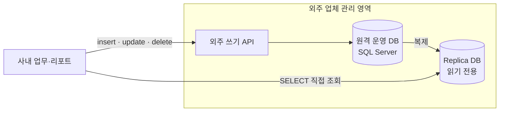
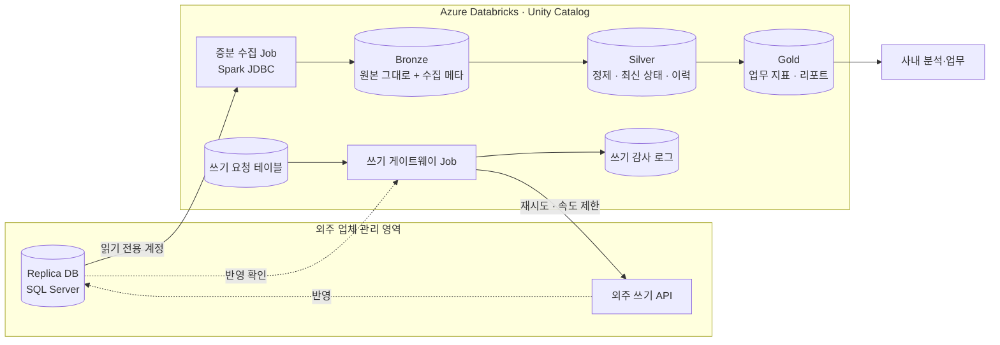



> 사내 데이터가 전부 **외주 업체가 관리하는 원격 DB** 에 있었고, 읽을 때는 replica 를 직접 조회하고 쓸 때는 **외주 API 를 거쳐야만** 하는 구조였습니다. 이 데이터를 회사가 직접 소유하고 다룰 수 있도록 **Azure Databricks 레이크하우스**로 옮기는 프로젝트에 참여했습니다.
{: .prompt-info }

| 항목 | 내용 |
| --- | --- |
| 회사 | 1001 Optometry (호주 안경·검안 체인) |
| 역할 | Data Engineering Intern — **replica 증분 수집 파이프라인**, **외주 API 쓰기 경로(쓰기 게이트웨이)** 담당 |
| 기간 | 2026.05 – 2026.07 (2개월) |
| 환경 | Azure Databricks · Apache Spark · Delta Lake · Unity Catalog · SQL Server(replica) · 외주 REST API |
| 공개 범위 | 회사 내부 테이블 이름, 데이터 규모, 외주 업체 이름은 적지 않았습니다. 코드는 공개하지 않고 설계만 정리합니다. |



## 1. 기존 구조와 문제

| 구조 | 생기는 문제 |
| --- | --- |
| 데이터가 외주 업체의 원격 DB 에만 있음 | 회사가 자기 데이터를 **소유하지 못함**. 스키마 변경, 보존, 접근 권한을 모두 외주에 요청해야 함 |
| 읽기는 replica 직접 조회 | 리포트마다 운영 스키마에 직접 쿼리. 복제 지연이 그대로 숫자에 반영되고, replica 에 무거운 쿼리가 몰림 |
| replica 는 **현재 상태**만 보관 | 상태가 언제 어떻게 바뀌었는지 이력이 없어 시점 분석·정정 추적이 어려움 |
| 쓰기는 외주 API 로만 | 대량 정정이나 일괄 반영이 API 호출 단위로 쪼개지고, **누가·언제·무엇을 바꿨는지** 사내에 남지 않음 |
| 변경 감지 기능을 켤 권한 없음 | DB 설정(CDC 등)은 외주 소유라 로그 기반 변경 수집을 바로 쓸 수 없음 |

## 2. 왜 Databricks 인가

1. **데이터 소유권을 사내로** — 원격 DB 를 대신하는 *사내 정본* 이 필요했습니다. ADLS 에 저장되는 Delta Lake 테이블은 회사 Azure 구독 안에 있어서 보존과 권한을 직접 정할 수 있습니다.
2. **현재 상태만이 아니라 이력도** — Delta 의 `MERGE`, 트랜잭션 로그, time travel 로 replica 에 없던 *변경 이력과 특정 시점 조회* 를 확보합니다.
3. **수집, 정제, 분석을 한 곳에서** — Spark 배치 수집, SQL 분석, Jobs 오케스트레이션이 한 플랫폼에 있어서 소규모 데이터팀이 따로 운영할 시스템이 적습니다.
4. **거버넌스** — 고객과 검안 관련 정보는 민감 데이터입니다. Unity Catalog 로 카탈로그, 스키마, 컬럼 단위 권한과 계보를 한곳에서 관리합니다.
5. **Azure 와의 결합** — Entra ID 계정, Key Vault 기반 시크릿, ADLS 스토리지와 바로 붙습니다.

## 3. 목표 아키텍처

| 계층 | 역할 |
| --- | --- |
| **Bronze** | replica 에서 읽은 행을 손대지 않고 저장합니다. 수집 시각, 배치 ID, 원천 테이블 같은 메타 컬럼을 붙여 *언제 무엇을 가져왔는지* 남깁니다. |
| **Silver** | 기본 키 기준으로 `MERGE` 해 최신 상태를 유지하고, 필요한 테이블은 이력(SCD2)으로 보관합니다. 타입 정규화, 시간대(AEST/AEDT) 처리, 중복 제거도 여기서 합니다. |
| **Gold** | 매장별 매출, 예약, 재고처럼 업무 질문에 바로 답하는 테이블입니다. |
| **쓰기 경로** | 쓰기는 여전히 외주 API 로만 가능하므로 **요청 → 호출 → 감사 → 반영 확인** 을 하나의 흐름으로 묶었습니다. |

## 4. 내가 맡은 부분

### ① replica → Bronze 증분 수집 → [3편]()
- 외주 DB 에 CDC 를 켤 수 없어서 **쿼리 기반 증분 추출**로 설계했습니다. 변경 시각 컬럼이 있는 테이블은 워터마크로, 작은 기준 테이블은 전체 스냅샷으로 가져옵니다.
- **replica 지연**을 고려해 워터마크를 *마지막으로 본 값 − 겹침 구간* 부터 다시 읽고, Silver 는 기본 키 기준 `MERGE` 로 받습니다. 같은 구간을 두 번 읽어도 결과가 같은 **멱등 수집**입니다.
- 증분 쿼리로는 보이지 않는 **하드 삭제**는 주기적인 기본 키 비교로 찾아냅니다.
- replica 부하를 줄이려고 파티션 단위 병렬 읽기와 가져올 컬럼, 실행 시간대를 조절했습니다.

### ② 외주 API 쓰기 게이트웨이 → [4편]()
- 직접 API 를 부르는 대신 쓰기 요청을 Delta **요청 테이블**에 먼저 기록하고, 게이트웨이 Job 이 호출합니다.
- 요청마다 사내 요청 ID 를 붙이고 재시도 전에 상태를 확인해 **중복 반영**을 막습니다. 속도 제한과 지수 백오프를 적용했습니다.
- 호출 결과와 그 뒤 replica 에서 확인한 실제 반영 결과를 **감사 로그**에 남깁니다. 그동안 사내에 없던 *누가·언제·무엇을 바꿨는지* 기록이 생겼습니다.
- 나중에 쓰기를 외주 API 에서 떼어 낼 때 **어댑터만 바꾸면 되도록** 경계를 나눴습니다.

## 5. 마이그레이션 전략 — 읽기 먼저, 쓰기는 감싸서

| 단계 | 내용 | 인턴 기간 기여 |
| --- | --- | --- |
| 1. 읽기 이전 | replica → Bronze/Silver 수집. 리포트를 replica 직접 조회에서 레이크 조회로 옮김 | ✅ 수집 파이프라인 |
| 2. 쓰기 감싸기 | 외주 API 호출을 게이트웨이로 모아 감사·검증 | ✅ 쓰기 게이트웨이 |
| 3. 정합성 확인 | replica 와 레이크의 행 수, 키, 합계를 정기적으로 비교 | ✅ 수집 쪽 검증 |
| 4. 의존 축소 | 쓰기 정본을 사내로 옮기고 외주 의존을 줄임 | 인턴 이후 과제로 남김 |

한 번에 바꾸지 않고 **기존 시스템을 감싼 채 조금씩 옮기는(strangler)** 방식을 택했습니다. 외주 시스템은 계속 돌아가야 했고, 2개월이라는 짧은 기간 안에 되돌릴 수 있는 단계로 나눠야 했기 때문입니다. → [5편]()

## 6. 기여도 — 무엇을 가지고 들어갔고 무엇을 남겼나

| 가져간 것 | 프로젝트에서 쓴 곳 |
| --- | --- |
| **한국에서 7개월간 Spark 기반 데이터 엔지니어링 실무** | JDBC 파티션 읽기, 증분 적재, `MERGE` 기반 멱등 처리처럼 실무에서 겪은 패턴을 수집 파이프라인 설계에 바로 적용 |
| **Databricks Certified Data Engineer Professional** | Delta Lake 의 `MERGE`, 스키마 변경 처리, Jobs 구성, Unity Catalog 권한 모델을 기준으로 Bronze/Silver 구조와 수집 Job 을 설계 |
| 외주 시스템 제약 분석 | *읽기는 replica, 쓰기는 API* 라는 제약을 정리하고, 그 안에서 가능한 수집 방식과 쓰기 경로를 제안 |

- 맡은 두 영역(수집, 쓰기 경로)은 **설계부터 구현과 문서화까지** 직접 진행했습니다.
- 전체 레이크하우스 구조, 거버넌스, 리포트 이전은 팀과 함께 진행했고, 저는 그 안에서 *데이터가 들어오고 나가는 경계* 를 맡았습니다.
- 인턴 종료 후에도 운영할 수 있도록 테이블별 수집 방식, 재실행 방법, 장애 시 확인 순서를 문서로 남겼습니다.

## 7. 배운 점

- **내 것이 아닌 시스템에서는 제약이 곧 설계 조건이다.** CDC 를 켤 수 없고, replica 는 늦고, 쓰기는 API 로만 가능하다는 조건이 수집과 쓰기 경로 설계를 대부분 결정했습니다.
- **멱등성은 운영을 단순하게 만든다.** 겹쳐 읽고 `MERGE` 로 받는 구조라서 실패해도 *같은 구간을 다시 돌리기* 로 복구됩니다.
- **간접 쓰기에는 확인 단계가 필요하다.** API 의 성공 응답은 *요청을 받았다* 는 뜻일 뿐이고, replica 에서 실제 반영을 확인해야 끝난 것입니다.
- **영어로 일하는 데이터 팀** 에서 요구사항을 확인하고 설계를 문서로 설득하는 경험을 했습니다.
