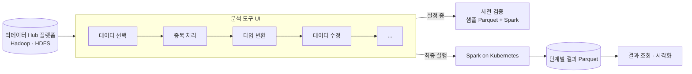
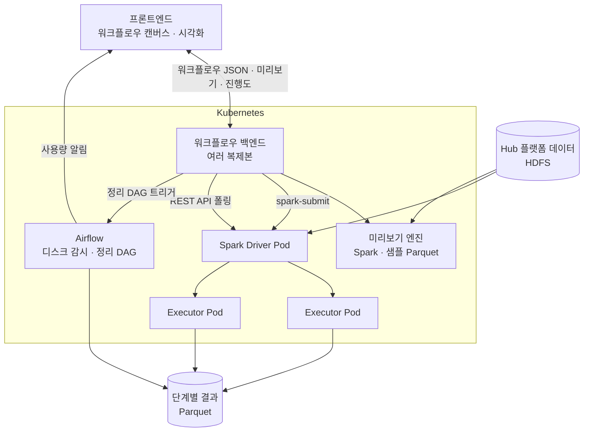



> 고객은 회사의 **Hadoop 기반 빅데이터 Hub 플랫폼**에서 데이터를 관리하고, 분석할 때는 제가 개발한 도구를 썼습니다. 코드를 몰라도 **드래그 앤 드롭**으로 *데이터 선택 → 중복 처리 → 타입 변환 → 데이터 수정* 같은 흐름을 만들고, 대용량 데이터는 **Spark on Kubernetes** 로 실행합니다.
{: .prompt-info }

| 항목 | 내용 |
| --- | --- |
| 기간 | 2024.01 – 2024.07 (7개월, 국내 회사 재직) |
| 팀 | 3인 — 팀장(설계 · 코드 리뷰, 개발은 하지 않음), 개발자 2명(본인 · 동기) |
| 역할 | 데이터 엔지니어 — Spark 실행 엔진, 사전 검증, 단계별 저장, 실행 관리(진행도 · 동시 실행 제한 · 취소), Airflow 디스크 관리, 프론트엔드 팀과 데이터 계약 협의 |
| 기술 | Apache Spark · Kubernetes · Airflow · Parquet · Hadoop(HDFS) · Spark REST API |
| 공개 범위 | 회사 제품 코드는 공개하지 않고 설계와 문제 해결 과정만 정리합니다. |



## 1. 어떤 도구인가

- 사용자는 캔버스에 처리 단계(노드)를 놓고 연결해 **워크플로우**를 만듭니다.
- 단계를 하나 추가할 때마다 **샘플 데이터로 바로 결과와 오류를 확인**합니다.
- 완성된 워크플로우는 **전체 데이터로 Spark 에서 실행**하고, 결과는 며칠 뒤에도 다시 볼 수 있습니다.

## 2. 풀어야 했던 문제

| 문제 | 왜 어려운가 | 해결 | 상세 |
| --- | --- | --- | --- |
| 제출해 봐야 오류를 안다 | spark-submit 은 기동부터 오래 걸린다. 10분 뒤 *타입 변환 실패* 를 알면 그 시간이 버려진다 | **샘플 Parquet + Spark 로 설정 단계에서 사전 검증** | [3편]() |
| 수십 단계 · 대용량이면 OOM | 한 DataFrame 에 단계를 계속 이어 붙이면 실행 계획과 메모리가 커진다 | **단계마다 결과를 Parquet 로 디스크에 저장** (속도를 조금 내주고 안정성을 얻음) | [4편]() |
| 결과를 며칠 뒤에도 보고 싶다 | 메모리 캐시는 작업이 끝나면 사라진다 | 단계별 저장 결과를 그대로 조회용으로 사용 | [4편]() |
| 디스크가 찬다 | 단계별 저장은 용량을 쓴다 | **Airflow** 로 사용량 알림, UI 에서 정리 DAG 실행 | [5편]() |
| 실행이 끝날 때까지 UI 에서 대기 | 제출 요청이 완료까지 붙잡혀 있었다 | **비동기 제출 + Spark REST API 진행도** | [6편]() |
| 동시 실행이 몰리면 OOM | 여러 작업이 한 번에 자원을 잡는다 | **동시 실행 제한(block)** | [6편]() |
| 중간에 멈추고 싶다 | 강제 종료하면 반쯤 쓴 결과와 자원이 남는다 | **SIGTERM 으로 안전한 종료** | [6편]() |
| 화면에 어떻게 보여줄까 | 대용량 결과를 그대로 넘길 수 없다 | **프론트엔드 팀과 시각화 방식 · 데이터 포맷 계약** | [7편]() |

## 3. 아키텍처

| 구성 요소 | 역할 |
| --- | --- |
| **워크플로우 백엔드** | 워크플로우 JSON 을 받아 검증하고 Spark 작업으로 바꿉니다. 실행 상태, 진행도, 취소를 관리합니다. |
| **미리보기 엔진** | 샘플 Parquet 에 지금까지의 단계를 적용해 결과 일부와 오류를 바로 돌려줍니다. |
| **Spark on Kubernetes** | 최종 실행. 드라이버와 익스큐터가 Pod 로 뜨고 끝나면 자원을 반납합니다. |
| **단계별 결과 저장소** | 단계마다 Parquet 로 결과를 남깁니다. 다음 단계의 입력이자 나중에 조회할 결과입니다. |
| **Airflow** | 디스크 사용량을 감시해 알리고, 사용자가 UI 에서 실행하는 정리 작업을 처리합니다. |
| **Kubernetes** | 서비스 복제본과 자동 재시작으로 **고가용성**을 확보하고, Spark 작업마다 자원을 격리합니다. |

## 4. 핵심 설계 결정

### ① 실패는 제출 전에 — 샘플 기반 사전 검증
단계를 추가하면 **샘플 Parquet** 에 지금까지의 단계를 Spark 로 적용해 *결과 미리보기, 바뀐 스키마, 타입 변환 실패 건수, 오류 메시지* 를 바로 보여줍니다. 오래 걸리는 spark-submit 을 하기 전에 대부분의 설정 실수를 잡습니다. → [3편]()

### ② 메모리 대신 디스크 — 단계별 저장
수십 단계를 한 DataFrame 에 이어 붙이면 계보(lineage)와 실행 계획이 길어지고 메모리 압박이 커져 OOM 이 자주 났습니다. 단계마다 결과를 Parquet 로 쓰고 다음 단계는 그것을 다시 읽게 해서 **계보를 끊었습니다**. 디스크 I/O 만큼 느려지지만 큰 작업이 끝까지 돌고, 그 결과를 **며칠 뒤에도 다시 볼 수 있다** 는 요구까지 함께 해결했습니다. → [4편]()

### ③ 저장했으면 치운다 — Airflow 디스크 관리
단계별 저장은 디스크를 씁니다. Airflow DAG 이 사용량을 주기적으로 확인해 임계치를 넘으면 사용자에게 알리고, 사용자는 UI 에서 버튼을 눌러 **정리 DAG 를 트리거**해 직접 지울 수 있습니다. → [5편]()

### ④ 기다리게 하지 않는다 — 비동기 실행, 진행도, 제한, 취소
제출하면 바로 실행 ID 를 돌려주고, 백엔드가 **Spark REST API** 로 진행도를 읽어 UI 에 보여줍니다. 동시에 너무 많은 작업이 자원을 잡지 않도록 **제출을 막고(block)**, 사용자가 취소하면 **SIGTERM** 으로 드라이버가 정리할 시간을 주고 종료합니다. → [6편]()

### ⑤ 화면과 데이터의 약속 — 프론트엔드 협업
워크플로우 JSON, 미리보기 데이터 형식, 오류 표현, 진행도 형식, 시각화 방식을 프론트엔드 팀과 **계약**으로 정했습니다. → [7편]()

## 5. 팀과 내 역할

| 구성원 | 역할 |
| --- | --- |
| 팀장 | 전체 설계 방향, 코드 리뷰 (개발 미참여) |
| **본인** | Spark 실행 엔진, 사전 검증, 단계별 저장, 실행 관리(진행도 · 동시 실행 제한 · 취소), Airflow 디스크 관리, 프론트엔드 팀과 데이터 계약 협의 |
| 동기 | 함께 백엔드 개발 |

개발자가 2명뿐이라 한 사람이 *Spark 작업 코드* 부터 *Kubernetes 배포, Airflow DAG, 프론트엔드와의 API 협의* 까지 넓게 맡아야 했습니다. 모든 변경은 팀장의 코드 리뷰를 거쳤습니다.

## 6. 배운 점

- **빠른 피드백이 곧 사용성이다.** 대용량 엔진일수록 *실행 전에 틀린 것을 알려주는 것* 이 실행을 빠르게 만드는 것만큼 중요했습니다.
- **trade-off 는 요구사항과 함께 판단한다.** 디스크 저장은 속도만 보면 손해지만, *안정성* 과 *며칠 뒤 다시 보기* 라는 요구를 함께 놓고 보면 맞는 선택이었습니다.
- **만들면 치우는 것까지 설계한다.** 중간 결과를 남기기로 한 순간 디스크 관리가 기능이 되었습니다.
- **API 는 다른 팀과의 계약이다.** 데이터 포맷을 먼저 합의하면 프론트엔드와 백엔드가 동시에 개발할 수 있었습니다.
