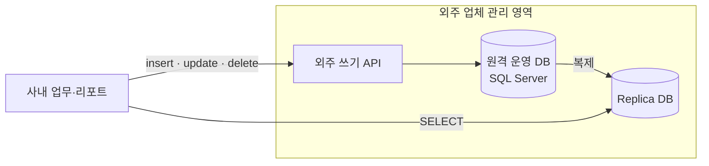
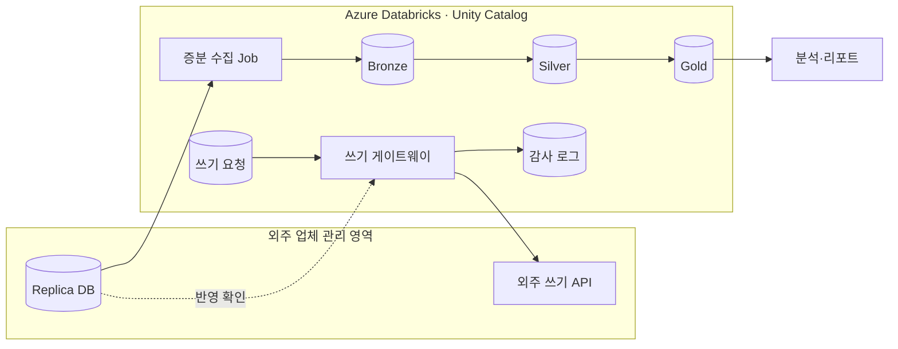

# 1001 Optometry — 외주 원격 DB 에서 Azure Databricks 레이크하우스로

> 호주 안경·검안 체인 **1001 Optometry** 에서 Data Engineering Intern 으로 일하며(2026.05 – 2026.07, 2개월) 참여한 데이터 플랫폼 마이그레이션 프로젝트 소개입니다.
> 회사 업무 결과물이므로 **코드는 공개하지 않고** 문제, 설계, 기여 범위만 정리합니다. 내부 테이블 이름, 데이터 규모, 외주 업체 이름은 적지 않았습니다.

📝 자세한 글: [hufs0529.github.io/portfolio/optometry-databricks](https://hufs0529.github.io/portfolio/optometry-databricks/)

## 한눈에 보기

| 항목 | 내용 |
| --- | --- |
| 역할 | Data Engineering Intern — **replica 증분 수집 파이프라인**, **외주 API 쓰기 게이트웨이** 담당 |
| 기간 | 2026.05 – 2026.07 (호주) |
| 환경 | Azure Databricks · Apache Spark · Delta Lake · Unity Catalog · SQL Server(replica) · REST API · Python |
| 배경 | 한국에서 Spark 기반 데이터 엔지니어링 실무 7개월 · Databricks Certified Data Engineer Professional |

## 문제 — 내 데이터인데 내 손에 없다

- 사내 데이터가 모두 **외주 업체가 관리하는 원격 DB** 에 있었습니다.
- 읽기는 항상 **replica DB** 로, 쓰기는 **외주 API** 를 거쳐 간접적으로만 할 수 있었습니다.
- 그래서 데이터 소유권, 변경 이력, 쓰기 감사 기록이 없었고, 무거운 분석 쿼리가 replica 에 직접 몰렸습니다.

## 왜 Azure Databricks 인가

1. 회사 Azure 구독 안에 **사내 정본** (Delta Lake on ADLS) 을 둘 수 있습니다.
2. `MERGE`, 트랜잭션 로그, time travel 로 replica 에 없던 **변경 이력과 특정 시점 조회** 를 만들 수 있습니다.
3. 수집, 분석, 스케줄링이 한 플랫폼에 있어 **작은 팀이 운영하기 쉽습니다**.
4. 고객·검안 관련 민감 정보를 **Unity Catalog** 로 관리할 수 있습니다.
5. Entra ID, Key Vault, ADLS 와 바로 연동됩니다.

## 목표 아키텍처

## 내가 맡은 설계

### 1. replica → Bronze 증분 수집 (CDC 없이)
- 외주 DB 에 CDC 를 켤 수 없어 **설정 기반 쿼리 증분 추출**로 설계했습니다 (`incremental` / `snapshot` / `incremental + pk_check`).
- 복제 지연에 대비해 **겹침 구간이 있는 워터마크**를 쓰고, 적재가 모두 성공한 뒤에만 워터마크를 갱신합니다.
- Silver 는 기본 키 기준 **멱등 `MERGE`** 로 받아, 실패하면 같은 구간을 다시 돌리는 것으로 복구됩니다.
- **하드 삭제**는 주기적인 기본 키 비교와 삭제 표시로 처리합니다.
- replica 부하를 줄이려고 필요한 컬럼만, 제한된 병렬로, 업무가 적은 시간대에 읽습니다.
- 행 수, 키, 합계를 비교해 조용한 데이터 오류를 막습니다.

### 2. 외주 API 쓰기 게이트웨이
- 모든 쓰기를 **요청 테이블**에 먼저 기록합니다 (누가, 무엇을, 왜, 기대 결과).
- `request_id` 와 재전송 전 반영 확인으로 **중복 반영**을 막고, 속도 제한과 지수 백오프로 재시도합니다.
- API 성공 응답 후 **replica 에서 실제 반영을 재확인**합니다 (`CONFIRMED` / `MISMATCH`).
- append 전용 **감사 로그**로 사내에 쓰기 기록을 남깁니다.
- 외주 API 어댑터를 분리해, 나중에 쓰기 정본을 옮길 때 **어댑터만 바꾸면 되게** 했습니다.

## 전환 전략 — 읽기 먼저, 쓰기는 감싸서

| 단계 | 내용 | 인턴 기간 기여 |
| --- | --- | --- |
| 1 | 읽기 이전 (replica → 레이크) | ✅ 수집 |
| 2 | 쓰기 감싸기 (게이트웨이·감사) | ✅ 게이트웨이 |
| 3 | 정합성 확인 (replica ↔ 레이크) | ✅ 수집 검증 |
| 4 | 쓰기 정본 사내화 | 이후 과제 |

## 기여도

- **7개월 Spark 실무 경험**을 바탕으로 JDBC 파티션 읽기, 증분 적재, 멱등 `MERGE`, 재처리 가능한 배치 같은 패턴을 수집 설계에 처음부터 적용했습니다.
- **Databricks Data Engineer Professional** 지식을 바탕으로 Delta Lake, medallion 계층, Jobs, Unity Catalog 기준의 설계 근거를 팀과 공유했습니다.
- 수집과 쓰기 경로는 설계, 구현, 문서화를 직접 맡았고, 레이크하우스 전체 구조와 거버넌스는 팀과 함께 진행했습니다.

## 블로그 시리즈

1. [왜 Databricks 로 옮겼나](https://hufs0529.github.io/posts/optometry-01-overview/)
2. [기존 구조와 제약](https://hufs0529.github.io/posts/optometry-02-legacy-constraints/)
3. [replica 증분 수집 설계](https://hufs0529.github.io/posts/optometry-03-replica-ingestion/)
4. [외주 API 쓰기 게이트웨이](https://hufs0529.github.io/posts/optometry-04-write-gateway/)
5. [전환 전략 · 기여도 · 회고](https://hufs0529.github.io/posts/optometry-05-migration-retrospective/)
