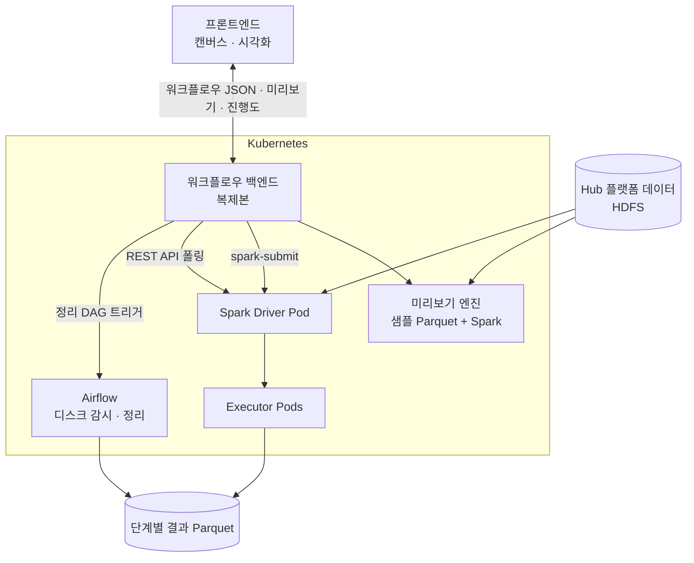

# Spark · Kubernetes 기반 드래그 앤 드롭 데이터 분석 워크플로우 도구

> 국내 회사에서 데이터 엔지니어로 일하며(2024.01 – 2024.07, 7개월) 개발한 분석 도구 소개입니다.
> 회사 제품이므로 **코드는 공개하지 않고** 문제, 설계, 역할만 정리합니다.

📝 자세한 글: [hufs0529.github.io/portfolio/spark-workflow-builder](https://hufs0529.github.io/portfolio/spark-workflow-builder/)

## 한눈에 보기

| 항목 | 내용 |
| --- | --- |
| 제품 맥락 | 회사의 **Hadoop 기반 빅데이터 Hub 플랫폼** 고객이 데이터를 분석할 때 쓰는 도구 |
| 기간 | 2024.01 – 2024.07 (7개월) |
| 팀 | 3인 — 팀장(설계 · 코드 리뷰, 개발 미참여), 개발자 2명(본인 · 동기) + 프론트엔드 팀 협업 |
| 역할 | Spark 실행 엔진, 샘플 기반 사전 검증, 단계별 디스크 저장, 실행 관리(진행도 · 동시 실행 제한 · 취소), Airflow 디스크 관리, 프론트엔드와 데이터 계약 협의 |
| 기술 | Apache Spark · Kubernetes · Airflow · Parquet · Hadoop(HDFS) · Spark REST API |

## 무엇을 만들었나

사용자는 코드 없이 **드래그 앤 드롭**으로 데이터 처리 흐름을 만들고, 대용량 데이터를 **Spark on Kubernetes** 로 실행합니다.

## 아키텍처

## 문제와 해결

### 1. 제출해 봐야 오류를 안다 → 샘플 Parquet 사전 검증
spark-submit 은 기동과 실행이 오래 걸려서, 설정 실수를 한참 뒤에야 알 수 있었습니다.
- 워크플로우를 **설정하는 순간** 샘플 Parquet 에 최종 실행과 같은 변환을 Spark 로 적용합니다.
- 결과 미리보기, 바뀐 스키마, **타입 변환 실패 건수와 예시 값**, 정합성 경고를 바로 보여줍니다.
- 오래 걸리는 제출 → 실패 → 재시도 반복을 줄였습니다.

### 2. 수십 단계 · 대용량에서 OOM → 단계별 디스크 저장
한 DataFrame 에 수십 단계를 이어 붙이면 계보와 실행 계획이 커지고 셔플이 겹쳐 OOM 이 자주 났습니다.
- 단계마다 결과를 **Parquet 로 디스크에 저장**하고 다음 단계는 다시 읽어서 **계보를 끊었습니다**.
- **trade-off**: 단계 사이 I/O 로 속도는 조금 느려지지만 → 큰 작업이 안정적으로 끝나고, **실패한 단계부터 재실행**할 수 있고, 사용자가 **며칠 뒤에도 결과를 다시 확인**할 수 있게 됐습니다.

### 3. 디스크가 찬다 → Airflow 감시 · 수동 정리
- 감시 DAG 가 사용량을 확인해 임계치를 넘으면 *무엇이 공간을 차지하는지* 와 함께 사용자에게 알립니다.
- 사용자는 UI 에서 정리할 결과를 고르고, 백엔드가 Airflow REST API 로 **정리 DAG 를 트리거**합니다.
- 정리 DAG 는 실행 중인 작업의 결과와 권한을 확인한 뒤 삭제하고 이력을 남깁니다.

### 4. 실행 완료까지 UI 에서 대기 → 비동기 실행 관리
- **비동기 제출**: run_id 를 바로 돌려주고 백그라운드에서 spark-submit.
- **진행도**: Spark REST API 의 jobs · stages 정보를 읽어 *"N단계 중 n번째 실행 중"* 과 진행률로 표시.
- **동시 실행 제한**: 실행 중인 작업과 요청 자원을 확인해 한도를 넘으면 제출을 막아(block) 함께 OOM 나는 것을 방지.
- **취소**: 드라이버에 **SIGTERM** 을 보내 job 취소, 자원 반납, 쓰다 만 결과 정리, `CANCELLED` 기록 후 종료.
- **고가용성**: Kubernetes 복제본과 자동 재시작, 실행마다 드라이버 · 익스큐터 Pod 를 따로 띄워 자원 격리.

### 5. 화면과 데이터의 약속 → 프론트엔드 팀과 데이터 계약
- **워크플로우 JSON**: 화면 상태(좌표 등)는 프론트엔드 소유, 실행 정보(노드 타입 · 옵션 · 연결)는 백엔드가 검증.
- **미리보기 데이터**: 스키마 + 행 배열, decimal · 큰 숫자는 문자열, null 과 빈 문자열 구분, 행 수 상한과 `truncated` 표시.
- **오류**: `node_id` · `field` · `code` 로 해당 노드와 옵션 칸에 바로 표시.
- **진행도**: 단계 단위로 보내 캔버스에서 실행 중인 노드를 강조.
- **시각화**: 원본 대신 Spark 로 집계한 결과(히스토그램 구간, 상위 N 범주, 시계열 집계, 컬럼 요약)만 전달.

## 배운 점

- 대용량 엔진일수록 **실행 전에 틀린 것을 알려주는 것** 이 실행을 빠르게 만드는 것만큼 중요합니다.
- trade-off 는 속도 하나가 아니라 **안정성 · 재조회 · 복구** 요구와 함께 판단해야 합니다.
- 중간 결과를 남기기로 했다면 **치우는 것까지** 설계해야 합니다.
- API 포맷을 먼저 합의하면 프론트엔드와 백엔드가 **동시에** 개발할 수 있습니다.

## 블로그 시리즈

1. [개요와 전체 구조](https://hufs0529.github.io/posts/spark-wf-01-overview/)
2. [워크플로우 모델과 실행 계획](https://hufs0529.github.io/posts/spark-wf-02-workflow-model/)
3. [샘플 Parquet 사전 검증](https://hufs0529.github.io/posts/spark-wf-03-preview-validation/)
4. [단계별 디스크 저장과 trade-off](https://hufs0529.github.io/posts/spark-wf-04-stage-checkpoint/)
5. [Airflow 디스크 관리](https://hufs0529.github.io/posts/spark-wf-05-airflow-disk/)
6. [실행 관리 (진행도 · 제한 · 취소)](https://hufs0529.github.io/posts/spark-wf-06-execution-control/)
7. [프론트엔드 협업과 회고](https://hufs0529.github.io/posts/spark-wf-07-frontend-collaboration/)
